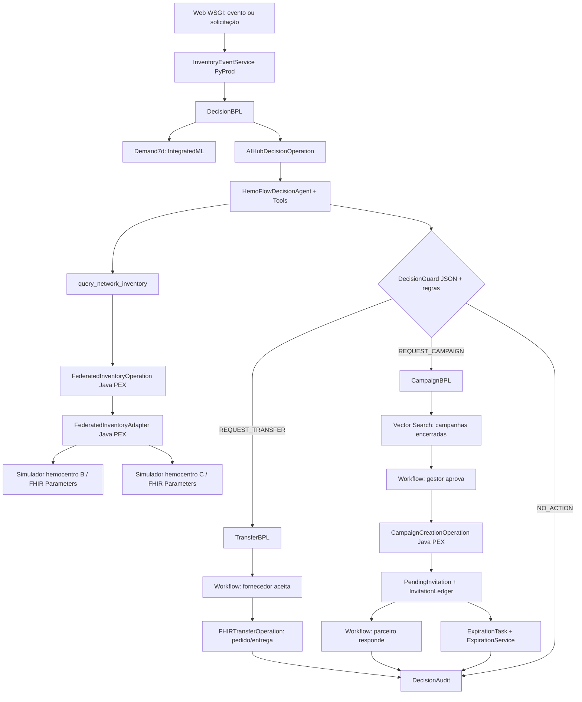

# HemoFlow — Guia de implementação do MVP v5.1

> **Atualização de 29/10/2026:** este documento conserva o planejamento original. Para a implementação atual, prevalecem [docs/UI.md](docs/UI.md) e [docs/DEMONSTRATION.md](docs/DEMONSTRATION.md): inglês, URLs em inglês, tema branco/vermelho, oito grupos ABO/Rh de hemácias, seed v2 aditivo e gráficos ECharts locais. Os invariantes de aprovação institucional, fonte federada e separação entre previsão/estoque permanecem. A edição da imagem efetivamente utilizada e suas limitações estão no README.

**Documento mestre:** [`SPEC.md`](./SPEC.md)  
**Mapa obrigatório:** [`SPEC/MAPA_TECNOLOGIAS.md`](./SPEC/MAPA_TECNOLOGIAS.md)  
**Interfaces e demonstração:** [`UI/TELAS_E_APRESENTACAO.md`](./UI/TELAS_E_APRESENTACAO.md) e [`UI/index.html`](./UI/index.html)  
**Natureza:** guia de desenvolvimento, **não** relato de software compilado.  
**Alvo previsto:** IRIS for Health AI Hub EAP `2026.3.0AI.154.0`; verificar edição, licença, class reference e versões *dentro da imagem entregue*.

## 1. Missão e limites não negociáveis

> Como garantir que a rede tenha o hemocomponente certo, no local certo e no momento certo, sem incentivar coletas desnecessárias nem comprometer a segurança transfusional?

Implementar **uma Production, dois workflows de negócio, um Agent AI Hub, um modelo AutoML, uma coleção Vector Search e cinco telas**. O caso demonstrado usa **concentrado de hemácias O negativo e dados 100% sintéticos**. Não calcular compatibilidade transfusional, não liberar bolsa clinicamente e não declarar resultados assistenciais reais.

1. **Fonte de verdade federada:** os simuladores B/C guardam seus estoques localmente. O HemoFlow não cria `BloodUnit` nem saldo central de B/C; consulta sob demanda pelo IRIS Interoperability.
2. **A consulta não reserva unidades:** reserva, aceite, transferência e recebimento são etapas diferentes. O centro de origem revalida na aprovação.
3. **AI Hub:** decide `REQUEST_TRANSFER`, `REQUEST_CAMPAIGN` ou `NO_ACTION`. Ausência de dados, IA inválida e inviabilidade temporal são **revisão operacional**, nunca uma quarta ação do LLM.
4. **Campanhas:** convite organizacional `PARTNER_HOSTED` e interesse de doadores sintéticos `CENTER_DIRECT`. Nenhum convite a doador sem `opt_in`.
5. **TTL:** padrão 24h, configuração 1–168h; convite pendente desaparece pela *consulta* após vencimento, mesmo antes da tarefa agendada. Ledger, decisão e campanha aprovada sobrevivem.
6. **Temporalidade:** campanha só é alternativa quando tem tempo para organização, coleta, processamento e liberação; transferência apenas quando há prazo de chegada e uso antes do vencimento.
7. **Minimizar componentes:** o Java PEX possui somente a consulta federada (BO + adapter) e a construção de convites (BO); o Python oferece serviços de domínio/WEB e hosts essenciais; BPL mantém os estados.
8. **Documentar apenas dependências executadas pelo produto.** Não inventar outras telas, outros modelos ou outras integrações.

## 2. Mapa de tecnologias e dono de implementação

> Matriz resumida da SPEC, preservada integralmente em `SPEC/MAPA_TECNOLOGIAS.md`.

| Tecnologia | Responsabilidade concreta | Parte que comprova |
|---|---|---|
| IRIS Interoperability | Service → BP/BPL → BO; mensagens, workflow, trace | WF-01 e WF-02; dois traces reproduzíveis |
| AI Hub ObjectScript SDK | `HemoFlowDecisionAgent`, Tools somente leitura, JSON de decisão | Uma sessão com chamadas efetivas, evidências e validação |
| IRIS SQL / `%Persistent` | Ledger, auditoria, configurações, consumo agregado, pedidos | Consultas e persistência pós-restart |
| IntegratedML + AutoML | `Demand7d`: previsão de consumo 7 dias | Treino/validação temporal, run, forecast e MAE |
| IRIS Vector Search | `CampaignExperience`: recuperar campanhas encerradas semelhantes | SQL `VECTOR_COSINE` + IDs e resultados históricos |
| FHIR R4 | `Parameters`/`OperationDefinition` customizados e `SupplyRequest`/`SupplyDelivery` | JSON validado em R4 e origem B/C independente |
| Java PEX | `FederatedInventoryOperation` e `CampaignCreationOperation` | Hosts PEX realmente registrados e invocados |
| Custom Outbound Adapter | `FederatedInventoryAdapter`: consulta HTTP FHIR federada | BO usando adapter, não chamada HTTP fora da Production |
| Workflow Engine | Aceite do fornecedor, aprovação do gestor, aceite do parceiro | Tasks com responsável e resultado |
| Embedded Python / PyProd | Regras de domínio, cálculo e web + hosts Python mínimos | Execução dentro da imagem IRIS; trace de host |
| `%Dictionary` e TTL | Metadados, `Expirable`, tarefa de expiração | `PendingInvitation` + `DecisionContext` com TTL; ledger intacto |
| Flask / WSGI | Cinco páginas SSR, rotas autenticadas e POSTs operacionais | Jornada completa na UI, sem SPA separada |
| Docker/Compose | IRIS + simuladores B/C com bancos independentes | Build EAP, health/readiness, restart preservando estado |
| IPM/ZPM | Instalação reprodutível | Pacote instalável no mesmo build; publicação se executada |

**Atenção:** bônus são apenas potenciais; a implementação precisa gerar evidência. O protótipo HTML entregue neste pacote **não** comprova nenhum deles.

## 3. Visão ponta a ponta e chamadas reais



**Ordenação concreta:** o contexto de campanhas semelhantes deve estar disponível ao AI Hub **antes da decisão definitiva** sobre parceiro/janela (por Tool ou pré-busca de contexto). O diagrama expressa responsabilidades, não execução sequencial literal. A Tool de inventário usa **gateway operacional dedicado com limites de concorrência/timeout**, sem chamar recursivamente o mesmo `DecisionBPL` que já aguarda o Agent. Se uma chamada síncrona causar deadlock no build, refatorar o gateway com request/response por correlação antes de prosseguir; não esconder o bloqueio.

**Pontos de corte das fronteiras:** web recebe pedidos mas **não** atualiza estado de `Transfer/Campaign` diretamente; a Production conduz a transição. Java PEX prepara e consulta, não aprova. AI Hub justifica a escolha, não altera saldo ou publica convites. Aprovação humana e guardas determinísticas autorizam as operações.

## 4. Estrutura de arquivos para implementação

**Não criar arquivos extras até que exista uma responsabilidade demonstrável.** As classes `.cls`, tipos de mensagem, assinaturas de métodos e settings listados são **interfaces propostas do produto**; herança exata e APIs de SDK devem ser ajustadas após introspecção do build 154.

```text
HemoFlow/
├── SPEC.md                                     # Requisitos e decisões normativas v5
├── GUIA_IMPLEMENTACAO.md                       # Este roteiro, limites e contratos de implementação
├── README.md                                   # Execução, evidências e guia de demo (atualizar ao implementar)
├── Dockerfile                                  # Criar: build a partir da imagem IRIS EAP autorizada
├── compose.yaml                                # Criar: IRIS + simuladores B/C isolados + volumes
├── .env.example                                # Criar: configuração não secreta e nomes de secrets
├── module.xml                                  # Criar: manifesto IPM validado no build
├── iris/
│   ├── bootstrap.script                        # Criar: namespace, roles e carregamento idempotentes
│   └── HemoFlow/
│       ├── Production.cls                      # Criar: host settings, configuração e nome da Production
│       ├── DecisionBPL.cls                     # Criar: orquestra previsão, decisão e roteamento
│       ├── TransferBPL.cls                     # Criar: aprovação, pedido, expedição e recebimento
│       ├── CampaignBPL.cls                     # Criar: contexto de campanha, aprovação e respostas
│       ├── DecisionAgent.cls                   # Criar: `%AI.Agent` com Provider, instruções e limites
│       ├── DecisionTools.cls                   # Criar: `%AI.ToolSet` com cinco consultas tipadas
│       ├── AIHubDecisionOperation.cls          # Criar: ponte pequena do host à API AI Hub do build
│       ├── Expirable.cls                       # Criar: classe-base TTLSECONDS, CreatedAt, ExpiresAt
│       ├── PendingInvitation.cls               # Criar: payload transitório, herda Expirable
│       ├── DecisionContext.cls                 # Criar: contexto efêmero, herda Expirable
│       └── ExpirationTask.cls                  # Criar: task periódica de varredura TTL
├── python/hemoflow/
│   ├── hosts.py                                # Criar: Service de evento e Operations PyProd necessárias
│   ├── service.py                              # Criar: cálculo de déficit/validade/janela temporal
│   ├── repository.py                           # Criar: acesso SQL parametrizado, transações e ledger
│   ├── intelligence.py                         # Criar: forecast e busca vetorial, dados de evidência
│   ├── fhir.py                                 # Criar: parse/geração e validação FHIR R4
│   ├── ttl.py                                  # Criar: comparação UTC, transição atômica e expurgo
│   └── web.py                                  # Criar: app Flask WSGI, auth, cinco páginas e POSTs
├── java/pex/
│   ├── pom.xml                                 # Criar: dependências PEX do build e empacotamento jar
│   └── src/main/java/com/hemoflow/pex/
│       ├── FederatedInventoryOperation.java    # Criar: BO PEX orquestra consultas autorizadas
│       ├── FederatedInventoryAdapter.java      # Criar: Custom Outbound Adapter FHIR/HTTP
│       └── CampaignCreationOperation.java      # Criar: BO PEX produz convites de plano autorizado
├── simulators/
│   ├── center_b.py                             # Criar: endpoint FHIR customizado e estoque isolado B
│   ├── center_c.py                             # Criar: endpoint FHIR customizado e estoque isolado C
│   └── data/                                   # Criar: dados sintéticos distintos e persistentes B/C
├── web/templates/                             # Criar: cinco templates SSR correspondentes à UI
├── UI/
│   ├── index.html                              # Entregue: protótipo visual navegável, sem backend
│   └── TELAS_E_APRESENTACAO.md                # Entregue: UX, wireframes lógicos e roteiro da demo
├── schemas/decision.schema.json               # Existente: JSON Schema v5 de saída do Agent
├── fixtures/                                  # Existente: JSONs de decisões de teste v5
├── agents/                                    # Existente: sete especialistas técnicos anexados
└── tests/
    ├── test_decision_guard.py                 # Criar: schema, enums, centro e quantidade permitidos
    ├── test_federation.py                     # Criar: alterações B/C refletidas sem replicação
    ├── test_temporal_safety.py                # Criar: prazo de transferência e campanha bloqueados
    ├── test_campaigns_ttl.py                  # Criar: 24h, aceite tardio 409, ledger e concorrência
    ├── test_ai_ml_vector.py                   # Criar: ferramentas, forecast, SQL Vector, versionamento
    ├── test_fhir_r4.py                        # Criar: exemplos e operação customizada validáveis
    └── test_e2e_production.py                 # Criar: mensagens, rastreio e aceites WF-01/WF-02
```

### 4.1 Contratos de objetos persistentes

Todas as entidades da **seção 11 da SPEC** são persistidas no IRIS quando pertencem à aplicação: `NetworkCenter`, `Partner`, `DonorContact`, `ConsumptionDaily`, `CampaignExperience`, `Transfer`, `Campaign`, `InvitationLedger`, `PendingInvitation`, `DecisionContext`, `DecisionAudit/EventAudit`, `SystemConfig`. Não inventar `NetworkInventory` ou `BloodUnit` central.

Campos transversais mínimos: `id` estável, `created_at_utc`, `updated_at_utc` se alterável, `correlation_id` para eventos operacionais; chaves de idempotência únicas para criação de proposta/convite; `center_id`/`partner_id` e checagem de escopo no servidor. Guardar `secret_ref`, jamais credencial na tabela do centro. A tabela de experiências vetoriais armazena versão e dimensão do modelo de embeddings.

### 4.2 Matriz de interfaces da aplicação (contratos propostos)

| Interface lógica | Entrada | Saída | Dono | Falhas obrigatórias |
|---|---|---|---|---|
| `receive_inventory_event` | `{event_id, center_id, component, blood_type, observed_at}` | `202 + correlation_id` | PyProd Service | evento inválido/duplicado/sem permissão |
| `forecast_demand` | `{center_id, component, blood_type, horizon_days:7}` | `{expected_units, model_version, quality_flags, forecast_as_of}` | Embedded Python → IntegratedML | modelo indisponível → revisão |
| `query_network_inventory` | `{requesting_center_id, component, blood_type, center_ids:[...]}` | consultas agregadas `{center_id,status,transferable_units,expiry_buckets,observed_at}` | AI Hub Tool → PEX BO/Adapter | timeout = `UNAVAILABLE`, não zero |
| `search_campaign_experience` | `{context, region, partner_type, top_k:5}` | `[ {campaign_id, score, metrics, source} ]` | AI Hub Tool → SQL Vector | sem resultados: `[]`, não sucesso inventado |
| `list_campaign_partners` | `{center_id, region, partner_type}` | IDs permitidos/capacidade | AI Hub Tool → IRIS SQL | centro não autorizado = negação |
| `get_active_campaigns` | `{center_id, component, blood_type}` | campanhas confirmadas e previsões condicionais | AI Hub Tool → IRIS SQL | atraso/inconsistência → revisão |
| `validate_decision` | JSON AI Hub + evidências + snapshot temporal | `{accepted,reason,validated_action}` | `DecisionGuard` determinístico Python | contrato/ID inválido → bloquear |
| `create_transfer_request` | decisão validada, aprovação origem, reserva revalidada | `transfer_id`/FHIR `SupplyRequest` | TransferBPL + BO | saldo mudou → rejeitar/replanejar |
| `create_campaign_invitations` | plano aprovado e destinatários autorizados | IDs de convites, idempotência | CampaignBPL → Java PEX → Python | opt-in falso / duplicado → bloquear |
| `respond_to_invitation` | `{invite_id, actor_id, response, at}` | novo status/`409` se expirou | Web → Production/Workflow | sem escopo; corrida com expiry |
| `expire_pending` | `{now_utc, batch_size}` | IDs expirados / eventos únicos | Task → Python TTL | não apagar ledger/campanha |

**Proposta de API pública do MVP** (autorização e rota confirmadas pelo Flask, não métodos nativos do IRIS):

```text
GET  /                         # SSR do painel
GET  /rede                     # SSR dos centros e parceiros
GET  /transferencias           # SSR e filtros
GET  /campanhas                # SSR convites, campanhas e prazos
GET  /auditoria                # SSR logs, KPIs e configuração
POST /api/inventory-events     # Receber evento com chave idempotente
POST /api/decisions            # Reanálise pelo centro autenticado
POST /api/transfers/{id}/reply # Aceitar/recusar pela origem
POST /api/transfers/{id}/delivery # Confirmar entrega autorizada no destino
POST /api/campaigns/{id}/approve # Aprovar/recusar pelo gestor do centro
POST /api/invitations/{id}/reply # Aceite/recusa com checagem atômica de prazo
PUT  /api/settings/invite-ttl  # TTL para novos convites (admin)
```

Retornar `403` para outro escopo, `409` para prazo/estado inválido, `422` para payload semanticamente inválido, `503` para indisponibilidade técnica. Todas as mutações trazem correlation ID e chave idempotente. URLs são desenho do HemoFlow, não endpoints oficiais do IRIS.

## 5. Fatiamento incremental para implementação

| Gate | Construir somente | Prova objetiva para avançar |
|---|---|---|
| **G0 — Ambiente** | IRIS EAP, runtime Python, PEX Java, namespace, suporte Workflow, AI SDK | log da versão exata e classes descobertas; Production mínima iniciada |
| **G1 — Federação** | B/C com bases separadas, `Parameters` FHIR, BO PEX + custom adapter | alterar B localmente muda resposta do HemoFlow sem sincronização |
| **G2 — Decisor** | `Demand7d`, Tools, Agent, DecisionGuard e DecisionBPL | três decisões validáveis; trace e sessão correlacionados |
| **G3 — WF-01 completo** | TransferBPL, aprovação/revalidação, pedido e entrega FHIR | cenário de transferência válida e bloqueio por validade/saldo |
| **G4 — WF-02 completo** | Vector Search, CampaignBPL, Java PEX convites, Workflow, TTL | campanha aprovada; convite aceito; expiração 24h e 409; histórico íntegro |
| **G5 — UI e entrega** | cinco páginas WSGI, KPIs, instalador, testes, demo | duas jornadas demonstradas, restart persistente, README e traces |

**Ordem de trabalho por fatia:** escrever um contrato → fixture → teste → host real → trace → ligar a tela pertinente. Não construir todas as telas com dados reais antes de fechar G2/G3; o `UI/index.html` deste pacote é exclusivamente apresentação e referência visual.

### 5.1 G0 — inventário técnico, sem adivinhar APIs

1. Confirmar build/edição, namespace, produto e licença FHIR, Python efetivo e pacotes instalados. Consultar documentação/class reference **do build** antes das classes.
2. Verificar `%AI.Agent`, `%AI.ToolSet`, `%AI.Provider`, sessões, método de invocação e mecanismo de Tool do build. Não assumir que `master` no GitHub equivale ao EAP 154.
3. Verificar PEX Java, bibliotecas jar e Java ELS/gateway, registro das classes proxy, host/job pools e adapter. A documentação geral mostra `BusinessOperation`, `OutboundAdapter` e `getAdapterType()`, mas os exemplos concretos devem ser compilados contra o jar da imagem.
4. Confirmar `intersystems_pyprod`, Python runtime do IRIS, API de WSGI e como carregar componentes; PyProd é experimental e o suporte varia por build.
5. Confirmar Workflow Engine/Tasks e comportamento de expiração/cancelamento na instância. Não confundir timers da UI com tarefas IRIS.
6. Só então fixar `requirements`/`pom.xml`, scripts idempotentes e configurações autenticadas. `module.xml` deve apontar apenas para arquivos reais do projeto.

### 5.2 G1 — consulta federada (WF-01, primeiro valor comprovável)

- Cada simulador B/C expõe a **operação HemoFlow**, `POST /fhir/$inventory-availability`, `resourceType: Parameters`. B e C usam dados próprios, fornecem `availableUnits`, `transferableUnits`, buckets de validade, `observedAt` e `dataVersion`.
- `FederatedInventoryAdapter` Java recebe endpoint já autorizado/configurado — nunca uma URL escolhida pelo LLM — e usa timeout, autenticação e validação do contrato.
- `FederatedInventoryOperation` Java PEX chama o Adapter; retorna uma resposta por centro, preservando `AVAILABLE`, `UNAVAILABLE`, `TIMEOUT`. Nenhum fallback para disponibilidade fictícia.
- Criar `OperationDefinition` com parâmetros tipados e exemplos `Parameters`; rodar um validador FHIR R4 em fixture real.
- **Teste essencial:** alterar B diretamente e refazer a Tool; HemoFlow reflete o novo saldo, sem gravar `BloodUnit` ou `NetworkInventory`.

### 5.3 G2 — AI Hub e predição

- Produzir dados sintéticos de consumo diário de A com indicadores de dia de ruptura; separar cronologicamente treinamento/teste, impedir leakage do target.
- Treinar `Demand7d` por IntegratedML/AutoML; registrar modelo, origem, baseline, MAE de validação. Se a versão não suportar o provider, registrar bloqueio técnico, sem declarar que utilizou AutoML.
- Implementar as cinco Tools mínimas e um `DecisionGuard` independente do LLM; JSON Schema da SPEC é a fonte.
- A avaliação só encerra como `NO_ACTION` se a cobertura e os dados críticos estiverem confirmados. Timeout AI e dados desatualizados levam à revisão operacional.
- Confirmar *chamada real* de Tool no trace próprio da IA; adicionar registro explícito para correlacionar com Visual Trace da Production.

### 5.4 G3 — transferência segura

- Criar proposta sem mexer no saldo remoto. Gerar tarefa humana para origem, verificar permissão no aceite.
- No aceite, pedir revalidação de versão/quantidade/validade na origem. Se mudou, bloquear ou reduzir apenas mediante nova autorização; sem reserva presumida.
- Após confirmação, trocar FHIR `SupplyRequest`; `SupplyDelivery` só após entrega realmente confirmada na simulação. `DELIVERED` não vira `USED`.
- Introduzir testes de transporte inadequado, data `need_by` insuficiente, vencimento antes de uso, baixa da origem além do limite e duplicação de pedido.

### 5.5 G4 — campanha, Vector e expiração

- Criar `CampaignExperience` com campanhas **encerradas**; usar vetor de dimensão única e filtros SQL, sem confundir score de cosseno com probabilidade de êxito.
- Verificar campanhas já confirmadas e prazo de organização/coleta/liberação; se tardia, bloquear a campanha e registrar revisão, não sugerir uma solução impossível.
- Gestor aprova o plano; `CampaignCreationOperation` Java PEX recebe **somente plano validado**, cria envelopes de convites por idempotency key; o Python persiste ledger e payload transitório.
- Padrão TTL 24h, configurável `1..168h`. A visibilidade e o endpoint bloqueiam convite no mesmo instante do vencimento; a task expurga o payload posteriormente.
- `PendingInvitation` e `DecisionContext` herdam de `Expirable` demonstrando reuso; `InvitationLedger`, `DecisionAudit` e campanhas aprovadas persistem. Convites institucionais expirados emitem no máximo **um** evento de reavaliação. Convite individual expirado **não** chama LLM.

### 5.6 G5 — cinco páginas e evidências

- Implementar os cinco templates com dados lidos do IRIS e ações via Production, conforme `UI/TELAS_E_APRESENTACAO.md`.
- Capturar traces reais de 3 decisões, aprovação/recusa, PEX/Adapter e TTL; no painel, links identificam `correlation_id`, `workflow_id` e estado real.
- Docker deve manter armazenamento persistente para IRIS e simuladores; testar reinício, segurança e erros de endpoints.
- Manter uma demonstração orientada por cenários com dados sintéticos e legendas diferenciando `PREVISTO`, `SOLICITADO`, `ACEITO`, `ENTREGUE` e `UTILIZADO`.

## 6. Contrato de validação e segurança operacional

### 6.1 DecisionGuard — ordem de checagem

1. Confirmar JSON válido e schema por decisão (campos obrigatórios, enums e tipos).
2. Confirmar `request_id`, `center_id`, `partner_id`, `source_center_id` na allowlist e no escopo autenticado.
3. Confirmar timestamp, idade máxima da consulta, versão do dado, qualidade do forecast, objetivo do centro e evidência `evidence_ids` realmente existente.
4. Para `REQUEST_TRANSFER`: mesmo grupo/componente, `requested_units <= transferable_units` revalidável, margem mínima da origem, lead time compatível com `need_by`, vencimento/uso plausíveis.
5. Para `REQUEST_CAMPAIGN`: necessidade residual, ausência de campanha suficiente, janela pós-coleta/processamento e anterior a `need_by`, parceiro capaz e autorizado, convites idempotentes.
6. Para `NO_ACTION`: cobertura efetiva comprovada e sem dados críticos faltantes; nenhuma operação de transferência ou convite.
7. Se alguma checagem falhar: auditar `ESCALATED`, abrir revisão operacional, não disparar side effects.

### 6.2 Tabelas e imutabilidade

- `PendingInvitation`: pode expirar/sumir; índice por `ExpiresAt`, filtragem `ExpiresAt > now`, status pendente. Limpeza física posterior por batch.
- `InvitationLedger`: registra `published_at`, `expires_at`, `accepted_at/rejected_at`, `actor_id`, `status`; **nunca apagado pelo TTL de pendentes**.
- `DecisionAudit`: referencia snapshots/resumos e versões com retenção adequada; não guardar bolsa individual de B/C em uma tabela operacional.
- `Transfer`: separa unidades `requested`, `approved`, `received`, `used`; valores não implicam status posteriores automaticamente.
- `Campaign`: separa `invited`, `interested`, `collected`, `released_usable`, `used_before_expiry`.
- `ConsumptionDaily`: contém `demand_unmet_flag`; dado faltante não vira consumo zero por suposição.

### 6.3 Matriz de falhas

| Caso | Comportamento esperado |
|---|---|
| Centro B/C offline | `UNAVAILABLE` + timestamp de consulta, sem saldo zero assumido |
| Centro B mudou estoque após consulta | nova validação antes da aprovação, sem transferência obsoleta |
| Modelo sem treino confiável | `method=BASELINE` identificado, não atribuir previsão ao AutoML; revisão se inadequado |
| AI Hub indisponível/JSON inválido | bloquear ação e abrir revisão operacional |
| Convite vence durante aceite | transição atômica, responder 409, ledger `EXPIRED` |
| Mesmo evento enviado duas vezes | uma decisão/convite por chave de idempotência aplicável |
| Doador sem consentimento | nenhum convite emitido ou dados expostos |
| Campanha já confirmada cobre a necessidade | bloquear campanha duplicada, registrar motivo |
| Campanha terminaria após necessidade | revisão operacional; não prometer unidades |
| PEX Gateway indisponível | operação falha visivelmente, retry seguro, não mascarar envio |
| Workflow sem aprovador | permanecer pendente/escalado, nunca autoaprovar |

## 7. Testes e evidências de conclusão

**O executor deve comprovar os testes T01–T28 da seção 16 da SPEC**, sem trocar IDs ou reduzir aceites. Evidências mínimas: versão EAP; print de Production; Visual Trace dos dois workflows; query live B/C; PEX e Adapter chamados; sessão AI Hub com ToolSet; SQL IntegratedML treino/forecast; SQL Vector top-K; aprovação humana; aceite/expiração em 24h e 409; FHIR R4 válido; UI autenticada com cinco telas; restart persistente.

**Os KPIs da UI usam exclusivamente dados sintéticos**, claramente sinalizados. Um valor de `unidades transferidas` não é chamado de `unidades utilizadas`; uma campanha aceita não é contabilizada como sangue liberado; uma previsão não é chamada de dado real.

### 7.1 Checklist de entrega

- [ ] G0: ambiente e APIs reais confirmados; nenhuma assinatura inventada.
- [ ] G1: B/C consultados sob demanda via PEX Custom Adapter.
- [ ] G2: AI Hub chama Tools e produz as três ações válidas; AutoML executado.
- [ ] G3: WF-01 completo e bloqueios de validade/estoque.
- [ ] G4: WF-02 completo com Vector, Java PEX, Workflow e TTL 24h.
- [ ] G5: cinco telas conectadas aos dados do IRIS, autenticação, trace e apresentação.
- [ ] Docker/Compose sobe ambiente reproduzível; IPM instalável conforme a versão.
- [ ] Evidências de testes, falhas, audit trail e decisões anexadas ao README.

## 8. Distribuição dos sete especialistas

| Referência | Revisão exigida |
|---|---|
| `agents/IA_HUB.agent.md` | SDK Agent/ToolSet/Provider, contratos e segurança de Tools |
| `agents/iInteroperability.agent.md` | BPL/BO/BS, mensagens, reentrância, trace e Workflow |
| `agents/iEmbeddedPython.agent.md` | PyProd, WSGI, Embedded Python, TTL e SQL seguro |
| `agents/iris.IntegratedML-AutoML.agent.md` | Dados temporais, backtest e inferência |
| `agents/iris.VectorSearch.agent.md` | Embeddings, coluna VECTOR, similaridade e filtros |
| `agents/iris.Dictionary.agent.md` | Classe-base, índices, parâmetros, herança e Class Reference |
| `agents/docker.iris.agent.md` | Docker, PEX Java/ELS, bootstrap, IPM e perfis de execução |

**Esses sete arquivos são guias de engenharia; o produto contém somente um Agent AI Hub em execução.**

## 9. Documentação consultada e pontos dependentes do build

- PEX Operations: https://irisdocs.intersystems.com/irislatest/csp/docbook/DocBook.UI.Page.cls?KEY=EPEX_operation
- PEX Custom Outbound Adapter: https://irisdocs.intersystems.com/irislatest/csp/docbook/DocBook.UI.Page.cls?KEY=EPEX_outbound
- PyProd (experimental): https://docs.intersystems.com/irislatest/csp/docbook/DocBook.UI.Page.cls?KEY=APYPROD
- AI Hub EAP (API sujeita a mudanças): https://github.com/intersystems-community/ai-hub-eap
- FHIR R4: https://hl7.org/fhir/R4/operationdefinition.html ; https://hl7.org/fhir/R4/parameters.html ; https://hl7.org/fhir/R4/supplyrequest.html ; https://hl7.org/fhir/R4/supplydelivery.html

**Compatibilidade:** confirmar assinatura de `%AI.*`, subclasses PEX, Workflow Tasks, classe-base persistente e WSGI na imagem concreta. Chamar métodos desenhados neste guia de **contratos do HemoFlow**, não de API oficial já validada. Nenhum código de backend foi compilado ou testado neste pacote.
