# HemoFlow

**English** · [Português (Brasil)](README_PT_BR.md)

**HemoFlow connects blood centers and communities to turn available donations into timely, coordinated supply.** An AI Hub agent running inside InterSystems IRIS Interoperability investigates institutional stock, forecasts demand and retrieves past campaign experience, then proposes one of two actions: redistribute suitable red blood cells or organize a donation campaign before a future shortage. Every proposal follows an auditable workflow with institutional approval, helping teams pursue supply continuity and better use of donated units while keeping responsibility with the people who manage them.

**One IRIS Production · One AI Hub agent · Five tools · Two workflows · Eight ABO/Rh groups**

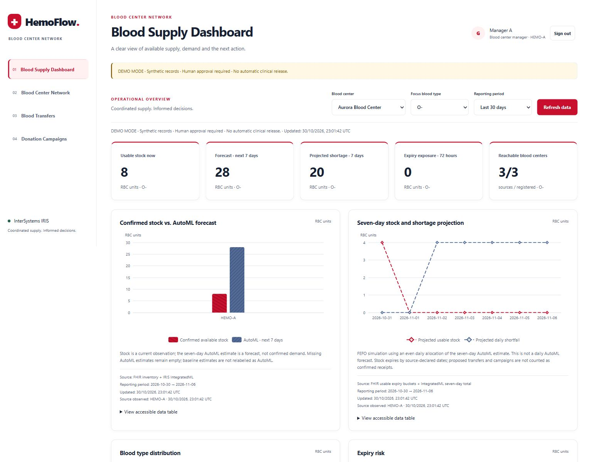

HemoFlow is a working demonstration with **synthetic data**, three independent blood-center simulators and a real LLM connection. It coordinates red blood cell supply for the exact requested blood group; it does not perform transfusion compatibility decisions, substitute groups or release blood for clinical use. Social impact is the application's objective, not a claimed clinical outcome.

[Start locally](#run-locally) · [Explore the screens](#screen-by-screen-guide) · [Inside the agent](#the-ai-agent-inside-iris-interoperability) · [Two workflows](#two-workflows-from-evidence-to-action) · [Technology map](#technology-map) · [Verify](#verification-and-observability) · [Full documentation index](#documentation-navigation)

## Why this matters

A donation is valuable only if a usable component reaches the right institution within its valid window. A network can have surplus in one location and a projected shortage in another; organizing a collection also takes time before units become available. HemoFlow brings those constraints into the same operational conversation.

| Operational challenge | HemoFlow's response | What can actually be measured |
| --- | --- | --- |
| A center expects a shortage while another has transferable stock | Query institutions, assess timing and propose a same-group transfer | Requested, dispatched and confirmed received units |
| Future demand cannot be covered by a viable transfer | Propose a campaign using demand, partner capacity and similar past campaigns | Invitations, attendance, collection and released units, recorded separately |
| Stock may expire before it can be used | Check expiry, transport and destination consumption windows | Current expiry exposure; this is not proof of avoided waste |
| Several institutions must agree on the next step | Assign approvals and retain evidence, deadlines and decisions | Responsible actor, state transitions, correlation and outcome |

Inventory remains under each institution's control. HemoFlow queries availability rather than maintaining a central synchronized stock balance. IRIS retains workflow records and message evidence for accountability.

### Who uses HemoFlow?

| Participant | What they do | Practical value |
| --- | --- | --- |
| Blood-center manager | Investigate needs, review proposals, approve supply and confirm outcomes | A shared view of evidence and the next accountable action |
| Partner organization | Accept or decline an authorized collection invitation | Community participation linked to a specific need and feasible window |
| Opted-in donor | Register interest in an invitation | Participation without confusing interest with eligibility or available blood |
| Network administrator | Maintain institutions, partners and invitation deadlines | Consistent coordination across independent organizations |
| Auditor | Review decisions, tools, model evaluation and recorded outcomes | Trace why a proposal was made and what actually followed |

**The social objective is concrete:** help institutions act before a shortage, use viable surplus within its expiry window, and mobilize donations with enough time for processing. The demo measures operational steps toward that objective; it does not estimate lives saved or claim a proven reduction in clinical harm.

## Start here: from installation to an explained decision

1. **Install the runtime.** Follow [Run locally](#run-locally) to load the AI Hub build 154 image, configure your provider key, start Compose and seed the synthetic network.
2. **See the need.** Sign in as `gestor-a`, open the dashboard and compare confirmed stock with the seven-day forecast for one blood group.
3. **Ask the agent to investigate.** Enter the required-by date and request AI Hub analysis. For a controlled walkthrough, use an admin scenario from the [demonstration runbook](#complete-demonstration-runbook).
4. **Follow the selected workflow.** Review a transfer with the source manager or authorize a campaign and its partner invitation. Approval is an explicit step, not a model-generated permission.
5. **Explain the result.** Inspect the decision evidence and the [two Visual Traces](#two-workflows-from-evidence-to-action), then compare the proposal with recorded receipt or release.

| Screen | Main task | What the user gets |
| --- | --- | --- |
| Sign in | Choose an authorized role | An institution-scoped session |
| Blood Supply Dashboard | Compare stock, forecast and risk; request analysis | An evidence-backed decision and next actions |
| Blood Center Network | Inspect live availability across institutions | Source timestamps, exact groups and transfer limits |
| Blood Transfers | Review, approve, dispatch and receive a proposal | Traceable movement from source commitment to receipt |
| Donation Campaigns | Authorize a plan, answer invitations and record outcomes | A collection workflow with consent, deadlines and measured release |
| Audit & Analytics | Inspect decisions, predictions and operational events | Model/tool evidence and business correlations |

Each view has an embedded screenshot, an example and operating instructions in the [screen-by-screen guide](#screen-by-screen-guide). Installation, technical implementation, validation and complete trace records are all documented in this file.

## The AI agent inside IRIS Interoperability

The agent participates directly in **`HemoFlow.Production`**. An inventory event or an authenticated dashboard request enters `InventoryEventService`; `DecisionBPL` prepares the authorized context, invokes the AI Hub operation, validates its response and routes the accepted decision to `TransferBPL` or `CampaignBPL`.

**AI Hub (AI_HUB)** uses the native **`%AI.*` SDK**: the implementation extends `%AI.Agent` and `%AI.ToolSet` and creates a `%AI.Provider`. The agent executes within the interoperability workflow, with its own persisted conversation and explicitly correlated tool messages.

**IRIS coordinates the workflow; AI Hub executes the agent; institutions authorize the commitment.** The language model is accessed through the configured remote OpenAI endpoint, while the agent instance, tool integration, persisted session, business validation and BPL routing are managed inside IRIS.

| Native capability | Concrete HemoFlow implementation |
| --- | --- |
| `%AI.Provider.Create("openai", config)` | Resolve the API key, endpoint and model from server-side configuration |
| `HemoFlow.DecisionAgent Extends %AI.Agent` | Apply domain instructions and coordinate evidence gathering and candidate selection |
| `HemoFlow.DecisionTools Extends %AI.ToolSet` | Expose five named tools with typed `requestId` arguments |
| `agent.CreateSession()` / `agent.Chat(...)` | Execute investigation and selection in the same conversation |
| `session.%Save()` / `%Id()` / `GetStats()` | Persist the conversation and return its identity and usage statistics |
| `HemoFlow.AIHubDecisionOperation` | Invoke the agent as a queued Business Operation and return the result to `DecisionBPL` |

HemoFlow's agent instructions and tool definitions are implemented in code. Managers request analyses and approve business actions in the UI. Provider settings come from `.env`, as described in installation.

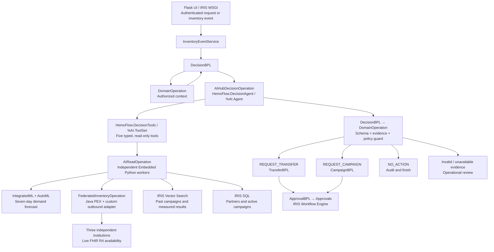

This diagram shows responsibilities. The Visual Traces below show actual messages, their returns and the selected branch.

### From agent instructions to an executable decision

1. **Prepare a bounded request.** `DomainOperation` resolves the actor, institution, exact blood group and deadline. A `DecisionContext` identifies the request and evidence. The domain lock is released before waiting for the LLM.
2. **Investigate through tools.** The agent calls all five tools with its authorized `requestId`, choosing their order and refreshing evidence when needed. Each read records an evidence ID, version, observation time and result hash. It first returns `EVIDENCE_READY`.
3. **Build admissible options in code.** The application derives a candidate catalog from those observations. Quantities and dates come from deterministic policy. Partial transfers and campaigns can be alternatives; an unexecuted offer is not subtracted as confirmed supply.
4. **Let the agent choose and explain.** In the same AI Hub session, a second `Chat` asks it to copy one current candidate and add an English reason. The configured default provider/model is OpenAI / `gpt-4.1-mini`.
5. **Validate independently.** The JSON Schema and `policy.guard` reject changed quantities, identities or dates, missing/stale evidence and unsafe choices. The operation allows at most one corrective response. `DecisionBPL` then invokes the domain guard before dispatching the branch.
6. **Execute through the Production.** A validated proposal starts the appropriate BPL and human tasks. `NO_ACTION` creates no proposal. Invalid output, insufficient evidence or provider failure leads to operational review, not a fabricated no-action result.

### 1. Define the native agent and provider

The native declaration in [DecisionAgent.cls](iris/HemoFlow/DecisionAgent.cls) binds the ToolSet:

```objectscript
Class HemoFlow.DecisionAgent Extends %AI.Agent
{
Parameter TOOLSETS = "HemoFlow.DecisionTools";
// INSTRUCTIONS require evidence gathering and exact candidate copying,
// and prohibit approval, reservation or invitation publication by the model.
}
```

The SDK invocation in [AIHubDecisionOperation.cls](iris/HemoFlow/AIHubDecisionOperation.cls) creates a real provider and persistent conversation:

```objectscript
set provider=##class(%AI.Provider).Create("openai",config)
set agent=##class(HemoFlow.DecisionAgent).%New(provider)
set agent.Model=config.%Get("model"),agent.MaxIterations=8
$$$ThrowOnError(agent.%Init())
set session=agent.CreateSession({"timeout_ms":60000,"max_tokens":900,"temperature":0})
set result=agent.Chat(session,..Prompt(request.JSON))
set selection=..Catalog(input.%Get("request_id"))
set result=agent.Chat(session,"Choose exactly one candidate from this current catalog. Copy every candidate field and add reason only. Return decision JSON only. "_selection)
```

These excerpts omit surrounding instructions, validation and error handling; the linked files contain the full implementation.

### 2. Expose authorized tools through the Production

The actual `XData Definition` in `HemoFlow.DecisionTools` registers the five methods with AI Hub:

```xml
<ToolSet Name="HemoFlow">
  <Tool Name="forecast_demand" Method="ForecastDemand"/>
  <Tool Name="query_network_inventory" Method="QueryNetworkInventory"/>
  <Tool Name="search_campaign_experience" Method="SearchCampaignExperience"/>
  <Tool Name="list_campaign_partners" Method="ListCampaignPartners"/>
  <Tool Name="get_active_campaigns" Method="GetActiveCampaigns"/>
</ToolSet>
```

Each method accepts `requestId As %String` and delegates to the following native dispatcher. This is the boundary that connects an agent tool invocation to a real interoperability message:

```objectscript
ClassMethod Dispatch(name As %String, requestId As %String) As %String
{
    if requestId'=$get(^HemoFlow.ActiveAgent($job)) throw ##class(%Exception.General).%New("Tool request not authorized")
    set input={}
    do input.%Set("request_id",requestId),input.%Set("correlation_id",requestId)
    set input.tool=name
    quit ##class(HemoFlow.Runtime).Submit(input.%ToJSON(),"AIReadOperation")
}
```

The active request is established by the Operation for the current job and cleared after execution. `AIReadOperation` runs the authorized read in an independent worker; inventory reads continue through the Java PEX Operation and custom adapter. This preserves the evidence path visible in the screenshots rather than making tool work invisible behind a direct HTTP model call.

### 3. Validate the response and persist its AI Hub session

`AIHubDecisionOperation.Validate`, implemented with Embedded Python, checks that all five tool families were actually observed in `EventAudit`, then invokes `policy.guard` with the current context and candidate catalog. Merely mentioning a tool or evidence ID in the generated answer is insufficient. Invalid JSON or a rejected candidate allows one repair attempt; continued failure enters operational review.

After validation, the Operation records the native session and usage using these source lines:

```objectscript
$$$ThrowOnError(session.%Save())
set output={}
set output.decision=##class(%DynamicObject).%FromJSON(result.Content)
do output.%Set("session_id",session.%Id())
set output.stats=session.GetStats(),output.usage=result.Usage
do output.%Set("model",agent.Model)
do output.%Set("repair_attempts",repairs)
set response.JSON=..Finalize(output.%ToJSON(),input.%Get("request_id"))
```

The failure path also saves an available session and its statistics, with the configured API key removed from error detail. The AI Hub conversation ID and native message-session ID are different; business correlation connects both to the decision.

### 4. Return the decision to BPL and select the workflow

| Message boundary | Actual contract |
| --- | --- |
| Request | `HemoFlow.Message Extends Ens.Request` |
| Payload and correlation | `JSON`, `CorrelationId`, `Phase`, `EntityId` properties |
| Response | `HemoFlow.Response Extends Ens.Response`, carrying `JSON` |
| Agent invocation | BPL Call named `Agent`, target `AIHubDecisionOperation`, `async="1"` |
| Synchronization | `<sync calls="Agent" type="all" timeout="110"/>` |
| Independent validation | Call `DomainOperation` with `Phase="guard"`; read its validated `route` |
| Transfer branch | `REQUEST_TRANSFER` sets `Phase="start_transfer"` and calls `TransferBPL` |
| Campaign branch | `REQUEST_CAMPAIGN` sets `Phase="start_campaign"` and calls `CampaignBPL` |
| No admissible action | No workflow branch is created for `NO_ACTION` or operational review |

The route is read from the domain guard's response, not directly trusted from model text. `DecisionBPL` therefore makes the accepted agent choice an explicit native Call to the selected workflow. The concrete message IDs for those Calls are **4451** (`TransferBPL`) and **4514** (`CampaignBPL`) in the captured sessions.

The implementation uses Provider, Agent, Session and ToolSet. Campaign retrieval is implemented with IRIS vector SQL and embeddings; an MCP server or a separate AI Hub RAG knowledge-base service is not required by this flow.

### Five tools, five evidence sources

| Tool in `HemoFlow.DecisionTools` | Implementation path | Evidence used by the decision |
| --- | --- | --- |
| `forecast_demand` | `AIReadOperation` → Embedded Python → IntegratedML `PREDICT` | Seven-day estimate, model version and quality flags for the requested center/group |
| `query_network_inventory` | `AIReadOperation` → Java PEX `FederatedInventoryOperation` → `FederatedInventoryAdapter` | Live availability, transfer limits, timestamps and expiry/transport constraints |
| `search_campaign_experience` | `AIReadOperation` → `VECTOR_COSINE` over `CampaignExperience` | Top-five similar campaigns, IDs, scores and recorded outcomes |
| `list_campaign_partners` | `AIReadOperation` → authorized IRIS records | Partner identity, scope and declared capacity |
| `get_active_campaigns` | `AIReadOperation` → scoped campaign records | Existing commitments to prevent overlapping or unnecessary proposals |

The [ToolSet](iris/HemoFlow/DecisionTools.cls) uses native ObjectScript trampolines to send messages to `AIReadOperation`. Embedded Python runs in independent workers, with tool execution visible in Interoperability. [Runtime.Submit](iris/HemoFlow/Runtime.cls) reuses the active Business Host, preserving the native message session. A tool cannot substitute another request ID.

**Three complementary forms of intelligence:** AutoML forecasts demand; Vector Search retrieves experience; AI Hub investigates and selects an admissible strategy. Neither similarity nor a forecast is an institutional authorization.

### Forecasting, retrieval and safeguards

The pooled `Demand7dMulti` model uses features computed separately for each center/group: seven- and 28-day consumption averages, weekday and month. [intelligence.py](python/hemoflow/intelligence.py) implements `CREATE MODEL`, `TRAIN MODEL`, `VALIDATE MODEL` and SQL `PREDICT`. Evaluation uses a chronological holdout, a seven-day embargo and a baseline MAE; censored labels are excluded. The daily FEFO trajectory evenly allocates the seven-day total—it is a derived simulation, not a separately trained daily forecast.

Campaign retrieval uses `BAAI/bge-small-en-v1.5`, `VECTOR(DOUBLE,384)` and exact cosine ranking in IRIS. The query filters region and embedding model, optionally partner type, and orders by score and campaign ID. Completed campaigns contribute recorded outcomes and an embedding. Similarity does not imply a probability of attendance or a forecast of released blood.

The [decision schema](schemas/decision.schema.json) permits `REQUEST_TRANSFER`, `REQUEST_CAMPAIGN` and `NO_ACTION`. [policy.py](python/hemoflow/policy.py) validates the catalog choice against current evidence, exact blood group, availability and timing. `Command` deduplicates evaluations; `Outbox` supports dispatch recovery without asking the LLM to choose again. Human approvals remain necessary before reservations or invitations.

## Two workflows: from evidence to action

Both workflows run in the same [HemoFlow.Production](iris/HemoFlow/Production.cls). Their initial decision sessions contain the agent, tools, Java PEX consultation, guard and selected BPL. Later human commands have their own sessions linked by the business correlation ID.

### WF-01 — Redistribute available units

**Example:** Aurora needs red blood cells; Bandeirantes has same-group units it can transfer within the receiving and expiry windows. The agent proposes a bounded quantity, and the source institution decides whether to commit it.

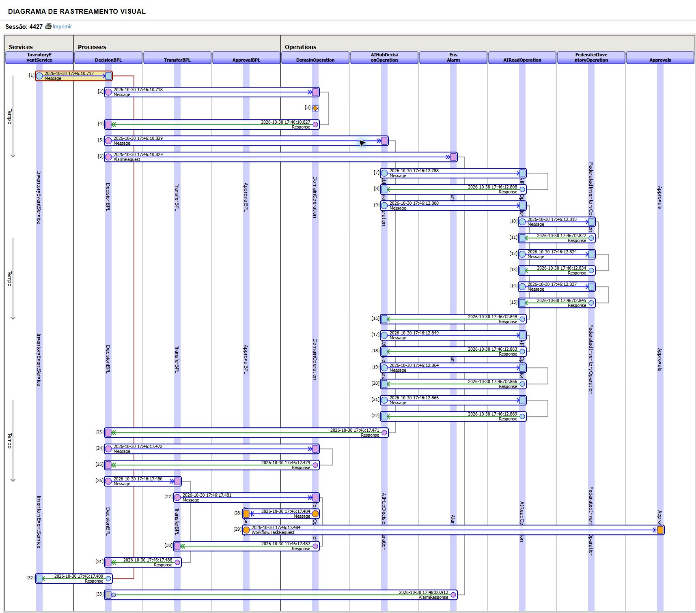

*Actual IRIS Visual Trace, captured on 30 October 2026, namespace `USER`, **session 4427**. It shows agent investigation → domain guard → `TransferBPL` → approval task. Correlation: `67b6a658-02d5-4591-923d-2eb806e9265d`. [Complete message evidence](#complete-native-message-traces) · [Capture provenance](#screenshot-provenance).*

**Read the trace:** message `4430` calls the agent; `4432` begins tool-worker exchanges; `4435` reaches the federated Java PEX Operation. After the agent response, `4449` calls the domain guard and `4451` enters `TransferBPL`. Message `4454` creates the approval task. The evidence shows the agent participating before the workflow branch is selected.

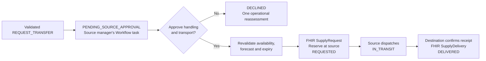

`TransferBPL` coordinates domain commands; `ApprovalBPL` and `Approvals` provide real Workflow Engine tasks. `FHIRTransferOperation` exchanges custom FHIR R4 contracts with institutions. Approval triggers revalidation before reservation; destination confirmation records receipt. **Delivered is not the same as used.** A decline produces one operational reassessment instead of an automatic proposal loop.

### WF-02 — Plan a donation campaign

**Example:** a future shortage remains and the collection plus processing window is feasible. The agent uses past campaign outcomes and partner capacity to propose a plan. The center authorizes it, and the invited institution accepts its role.

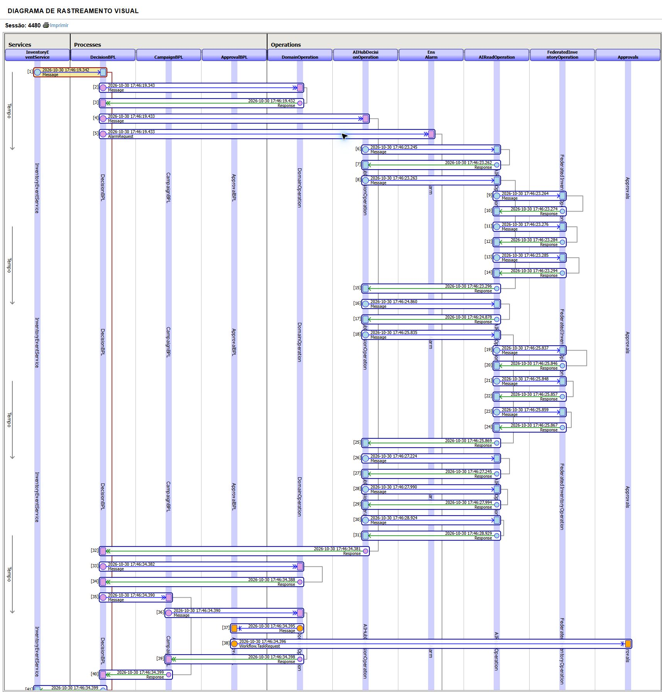

*Actual IRIS Visual Trace, captured on 30 October 2026, namespace `USER`, **session 4480**. It shows agent investigation → domain guard → `CampaignBPL` → approval task. Correlation: `386df328-e3f8-47e0-aff9-d75eaead0304`. All 42 message headers are documented in the [complete message evidence](#complete-native-message-traces). [Capture provenance](#screenshot-provenance).*

**Read the trace:** `4483` calls the same agent Operation; `4485` starts tool-worker exchanges and `4488` reaches the federation Operation. This run includes refreshed reads. The agent returns at `4511`; `4512` invokes the guard, `4514` selects `CampaignBPL`, and `4517` creates the center's approval task. Invitation publication happens later, after authorization, and is not claimed to appear in this initial decision session.

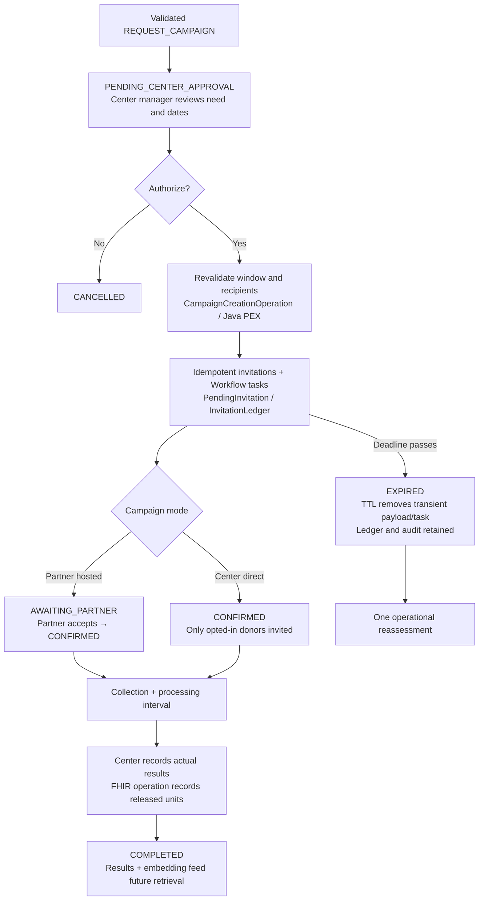

`CampaignCreationOperation` is a Java PEX Business Operation that materializes approved invitations idempotently. Pending invitations have a configurable TTL; reads immediately hide expired invitations and a 15-second timer completes cleanup. The durable ledger remains. Direct donor invitations require opt-in; registering interest is not eligibility, collection or stock.

## Run locally

### 1. Load the AI Hub image

Prerequisites: Docker with Compose and Linux containers, Python 3 for local configuration, and access to the AI Hub Early Access image and dependency/model downloads. The validated runtime is **InterSystems IRIS Community AI Hub `2026.3.0AI.154.0`, Linux amd64**, namespace `USER`. Allow memory and startup time for IRIS, AutoML and embeddings.

Obtain the image from the [InterSystems AI Hub Early Access portal](https://evaluation.intersystems.com/Eval/early-access/AIHub), then load and tag it locally:

```powershell
docker image load -i iris-community-2026.3.0AI.154.0-docker.tar.gz
docker image ls
# Replace LOADED_IMAGE_NAME with the image name reported by Docker.
docker tag LOADED_IMAGE_NAME iris-community:2026.3.0AI.154.0
```

The [Dockerfile](Dockerfile) and [Compose configuration](compose.yaml) use this tag by default. Other editions/architectures require the corresponding image and fresh validation. Follow the EAP distribution terms; do not publish the base image or derived images to a public registry.

### 2. Configure and start

```powershell
python tools/configure.py
# Edit .env locally and fill OPENAI_API_KEY.
docker compose up -d --build
docker compose ps
```

`configure.py` creates missing secrets and preserves existing configuration. The [configuration template](.env.sample) documents:

| Variable | Purpose |
| --- | --- |
| `OPENAI_API_KEY` | Required for live agent decisions; use your own OpenAI key |
| `OPENAI_MODEL` | Defaults to `gpt-4.1-mini` |
| `OPENAI_BASE_URL` | Defaults to `https://api.openai.com/v1` |
| `IRIS_IMAGE` | Defaults to `iris-community:2026.3.0AI.154.0` |
| `HEMOFLOW_ADMIN_PASSWORD` | Generated application admin password |
| `HEMOFLOW_CENTER_TOKEN`, `HEMOFLOW_SESSION_SECRET` | Generated institutional and web-session secrets |
| `HEMOFLOW_DEMO` | `1` in the template enables synthetic scenarios and accounts |
| `HEMOFLOW_EMBEDDING_MODEL` | Defaults to `BAAI/bge-small-en-v1.5` |
| `HEMOFLOW_INPUT_USD_PER_MILLION`, `HEMOFLOW_OUTPUT_USD_PER_MILLION` | Optional pricing inputs; unset means cost unknown |

Do not commit `.env`. Bootstrap compiles classes, configures IRIS WSGI, starts the Production and enables TTL processing. Each simulator has an independent SQLite volume; IRIS and embeddings have separate persistent volumes.

### 3. Load the synthetic demonstration

Wait until containers are healthy, then run:

```powershell
Get-Content tools/seed.script | docker compose exec -T iris iris session IRIS -U USER
Invoke-RestMethod http://localhost:52774/csp/hemoflow/health
```

Linux/macOS equivalent:

```bash
docker compose exec -T iris iris session IRIS -U USER < tools/seed.script
curl http://localhost:52774/csp/hemoflow/health
```

The first seed downloads embeddings and trains the model. Open **[HemoFlow](http://localhost:52774/csp/hemoflow/)** after completion. Health reports `status: ok` and `Embedded Python / IRIS WSGI`; it confirms the web runtime, not a successful provider call. Workflow acceptance verifies the agent separately.

Seed v2 includes three centers, six partners, three fictitious donor contacts, 13 accounts, **4,320 consumption observations** (3 centers × 8 groups × 180 days) and 72 initial embedded campaign experiences. A completed seed returns `ALREADY_LOADED` on repetition, preserving later activity. Existing v1 datasets migrate additively with backups; see [migration notes](#seed-migration-backup-and-recovery).

### 4. Choose a role

Synthetic accounts share the demo-only password **`DemoHemoFlow2026!`**. `admin` uses the generated `HEMOFLOW_ADMIN_PASSWORD`. IRIS Management Portal credentials are separate from application accounts.

| Login | Role and practical use |
| --- | --- |
| `admin` | Configure registry and invitation TTL; load/restore demo data; run controlled scenarios |
| `gestor-a`, `gestor-b`, `gestor-c` | Manage the corresponding center, analyze supply and act on its approvals |
| `parceiro-1` … `parceiro-6` | View and answer invitations for that partner only |
| `doador-1`, `doador-2` | Record interest in authorized donor invitations |
| `doador-3` | Demonstrate the no-opt-in case; no invitation should be issued |
| `auditor` | Review audit and analytics without approving operations |

## Screen-by-screen guide

The application uses English server-rendered pages, Flask/Jinja and IRIS WSGI. Six primary views—including sign-in—are documented below, plus campaign planning and mobile layouts. All routes are under `/csp/hemoflow`; actions depend on the authenticated role/institution. Screenshot figures are synthetic observations, not fixed expected outputs.

### Sign in — `/login`

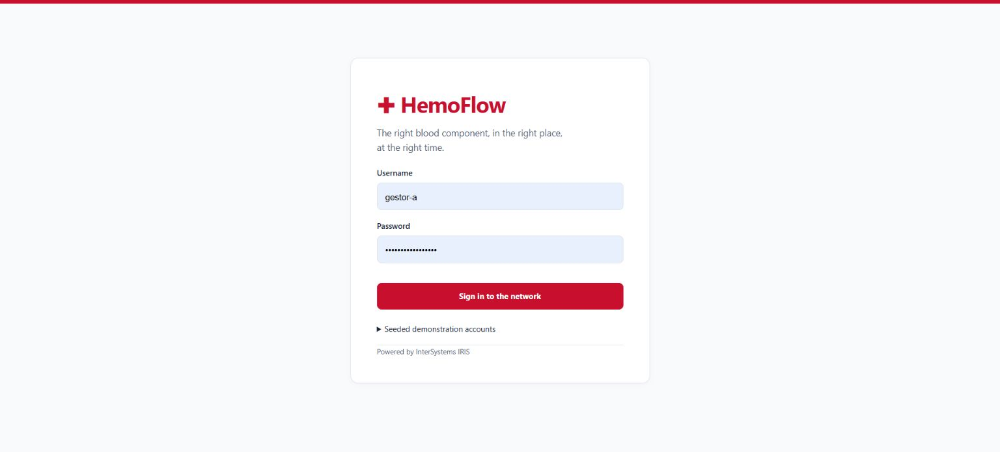

Enter a seeded account or `admin` and the matching password, then select **Sign in to the network**. Expand **Seeded demonstration accounts** for examples. Start as `gestor-a` to explore center operations, and use **Sign out** before changing roles. Authentication, CSRF checks and institution scope are enforced on the server.

### Blood Supply Dashboard — `/dashboard`


**Purpose:** understand current supply and request an investigation. Select **Blood center**, **Focus blood type** and **Reporting period**, then **Refresh data**. Compare usable stock, the seven-day AutoML estimate, FEFO trajectory, blood-group distribution, expiry exposure and network heatmap. Expand chart data tables and check source timestamps.

**Example:** as `gestor-a`, select Aurora and O−. A read observed 8 usable units and a seven-day forecast of 28 in this synthetic environment; values evolve with activity. Under **Assess supply needs**, choose the center/group, enter a future **Required by (UTC)** value and select **Request AI Hub analysis**. Review the resulting decision and evidence. The period filter changes historical charts, not the time of the current stock observation.

Admin controls also support seeding, restore, clock advancement and controlled scenarios. These scenarios restore owned demo inventory and close open synthetic plans; use them in an isolated demo session.

### Blood Center Network — `/blood-center-network`

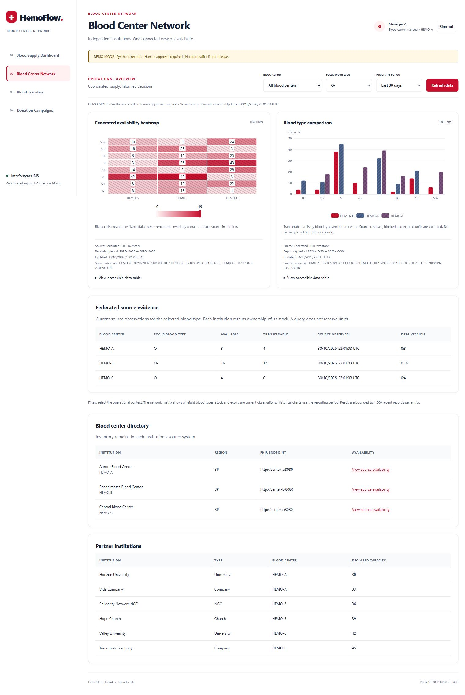

**Purpose:** compare live availability without taking ownership of stock. Select a center or compare the network, inspect available/transferable heatmaps and group comparisons, and use **View live availability** from the registry.

**Example:** compare Aurora, Bandeirantes and Central for A+. Transferable units exclude source reserves, blocked and expired stock. An unreachable center is missing evidence, never zero. Viewing the network does not reserve units. Admins register centers and partners in the lower registry form: centers include endpoints; partners include scope, type and declared capacity.

### Blood Transfers — `/blood-transfers`

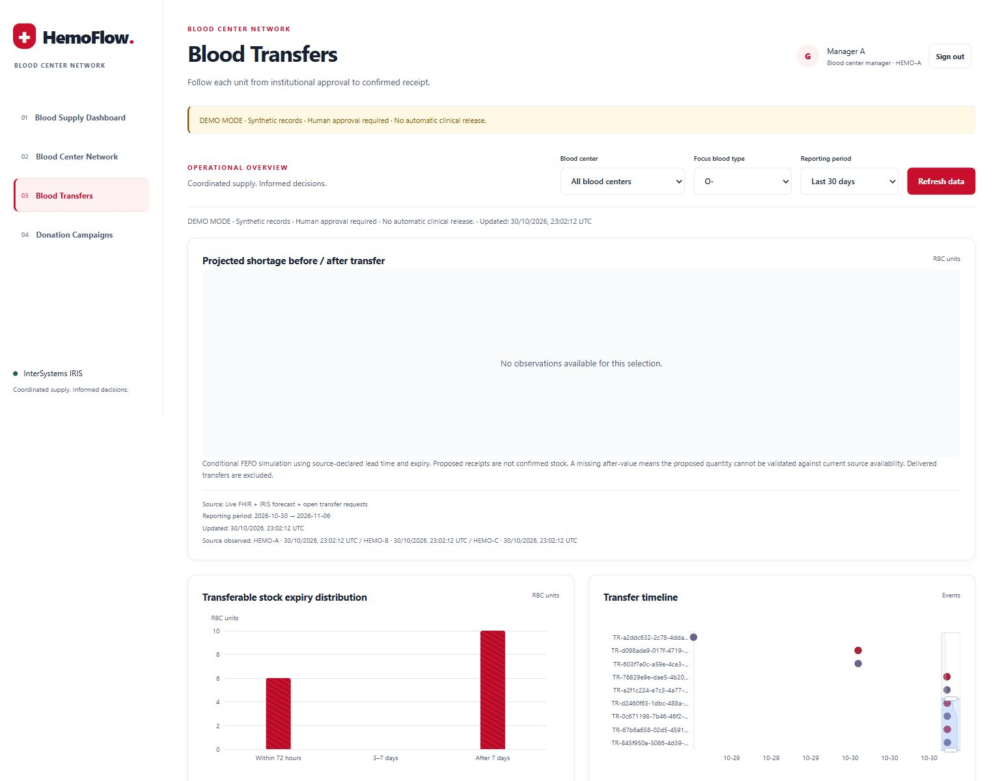

**Purpose:** follow a proposal through approval, dispatch and receipt. Filter by group/center and inspect source, destination, quantity, deadline, status and recorded events. The after-transfer chart is hypothetical until receipt and can be unavailable when current evidence cannot support the proposal.

**Example:** generate **Redistribute surplus** as admin. As `gestor-b`, review the pending request, confirm handling/transport conditions, approve and dispatch. As `gestor-a`, confirm receipt. The state becomes `DELIVERED`; received units are not automatically reported as used. A source decline leads to a correlated reassessment rather than an automatic replacement request.

### Donation Campaigns — `/donation-campaigns`

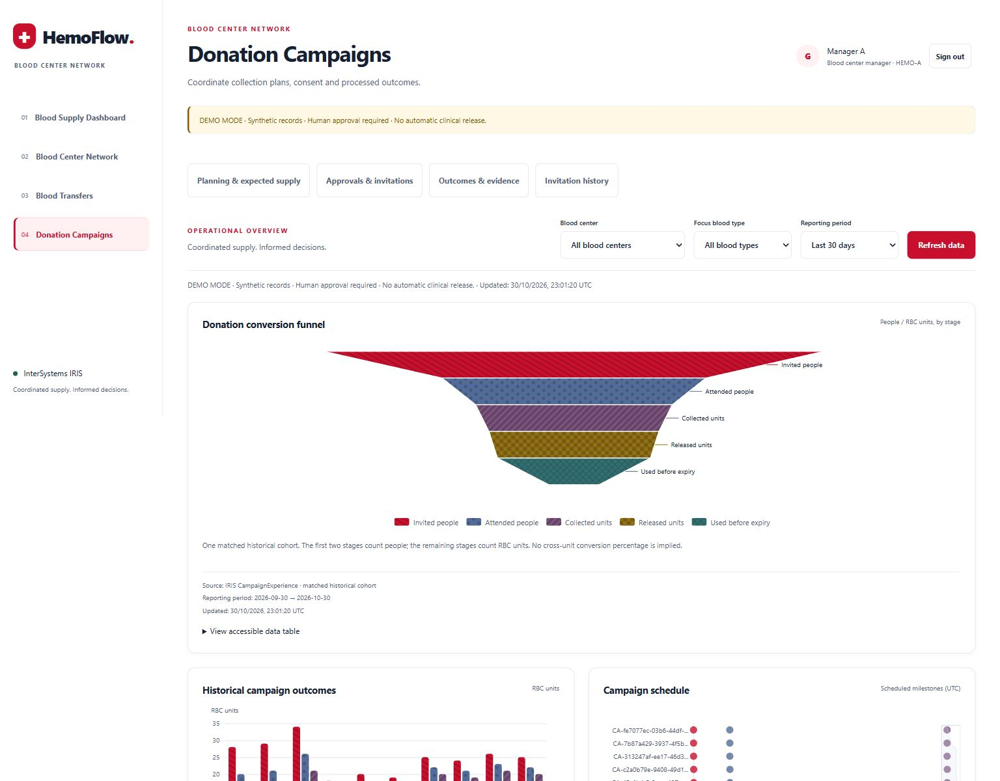

**Purpose:** connect a future need to a feasible collection plan, responsible participants and measured outcomes. Filters support all groups for comparison. The page separates **Planning & expected supply**, invitations, outcomes and invitation history.

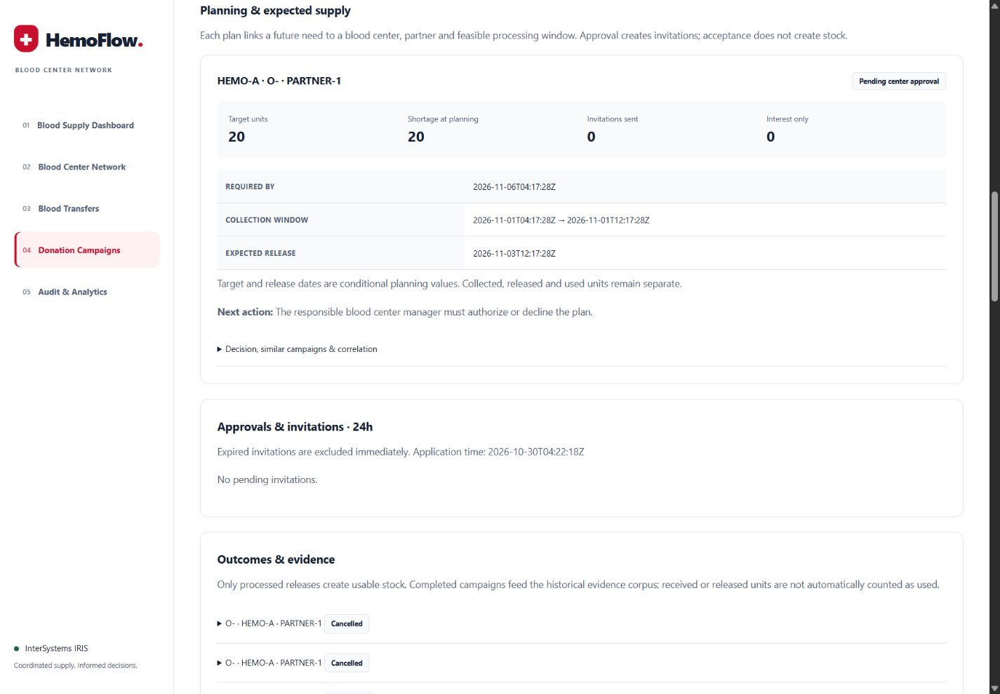

**Example:** generate **Future donation campaign** as admin. As `gestor-a`, inspect need-by time, collection window, expected release and next actor, then authorize the plan. Choose partner-hosted or center-direct mode. In partner-hosted mode, sign in as the named partner and accept the invitation. In direct mode, opted-in donors register interest; this does not add stock.

Open the plan's evidence details for persisted similar-campaign results and its correlation ID. After confirmation and processing, the manager records attendance, collected, released and used units with declared expiry. In demo mode, **Simulate collection and processing · advance demo clock** exercises the release path. Completed results feed future retrieval. The historical funnel distinguishes people from RBC units.

Admins configure invitation TTL on this page. Expired invitations cannot be accepted even before timer cleanup; the history retains their durable status.

### Audit & Analytics — `/audit-analytics`

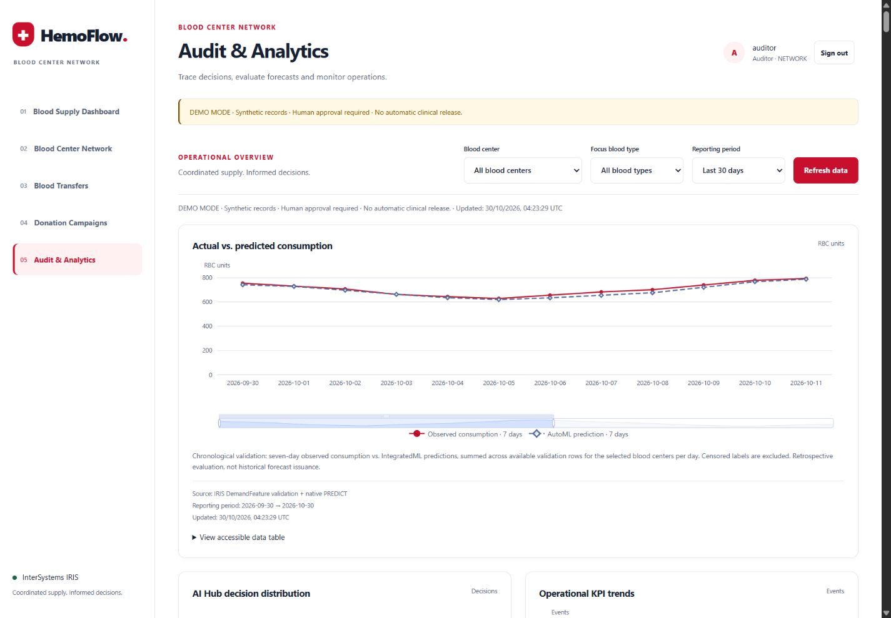

**Purpose:** explain what the system recommended and what actually happened. As `auditor` or `admin`, select reporting filters, compare actual versus predicted consumption, review decision distribution and inspect operational trends and evidence.

**Example:** locate a transfer or campaign decision and follow its correlation, tool observations and session references into IRIS Visual Trace. Check model version, evidence IDs, tokens, latency and reason. The actual/predicted chart is a retrospective chronological holdout evaluation, not a history of forecasts issued in production. Synthetic-data MAE is not clinical validation.

### Mobile use and shared chart behavior

| Dashboard on mobile | Campaigns on mobile |
| --- | --- |
| 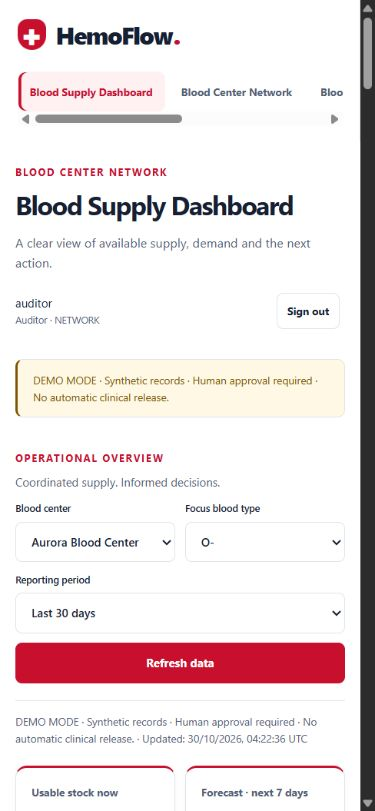 | 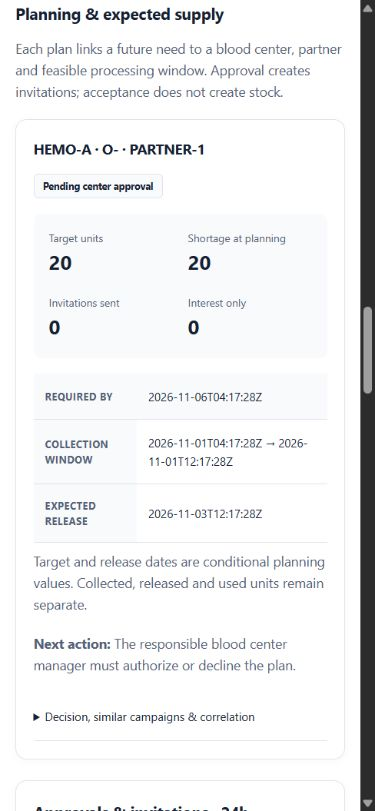 |

The same routes adapt to mobile with identical server-side permissions. Sixteen local Apache ECharts visualizations include units, provenance, timestamps, interpretation notes and accessible tables. Empty/error states remain explicit; the UI never invents replacement data. Chart reads do not invoke the LLM or mutate workflows. See [UI architecture and interpretation](#ui-architecture-and-data-interpretation) and the [guided demonstration](#complete-demonstration-runbook).

## Technology map

| Technology | Role in HemoFlow | Concrete implementation |
| --- | --- | --- |
| **IRIS Interoperability** | Persistent messages, orchestration and tracing of both workflows | [Production](iris/HemoFlow/Production.cls), [DecisionBPL](iris/HemoFlow/DecisionBPL.cls), [TransferBPL](iris/HemoFlow/TransferBPL.cls), [CampaignBPL](iris/HemoFlow/CampaignBPL.cls) |
| **AI Hub (`%AI.*`)** | Native agent, provider, sessions and typed tools | [DecisionAgent](iris/HemoFlow/DecisionAgent.cls), [DecisionTools](iris/HemoFlow/DecisionTools.cls), [AIHubDecisionOperation](iris/HemoFlow/AIHubDecisionOperation.cls) |
| **IntegratedML + AutoML** | SQL-driven training, validation and seven-day prediction | [intelligence.py](python/hemoflow/intelligence.py), [DemandFeature](iris/HemoFlow/DemandFeature.cls), [ConsumptionDaily](iris/HemoFlow/ConsumptionDaily.cls) |
| **IRIS Vector Search** | Exact cosine retrieval using 384-dimensional campaign embeddings | [CampaignExperience](iris/HemoFlow/CampaignExperience.cls), [retrieval and embeddings](python/hemoflow/intelligence.py) |
| **Embedded Python** | Domain rules, SQL access, ML preparation, analytics and TTL inside IRIS | [Python package](python/hemoflow/), [AIReadOperation](iris/HemoFlow/AIReadOperation.cls), [DomainOperation](iris/HemoFlow/DomainOperation.cls) |
| **ObjectScript / BPL** | SDK bindings, workflow coordination and runtime bridges | [IRIS classes](iris/HemoFlow/), [Runtime](iris/HemoFlow/Runtime.cls) |
| **Java PEX** | Federated inventory queries and approved invitation creation | [Java operations](java/pex/src/main/java/com/hemoflow/pex/) |
| **Custom Outbound Adapter** | Institutional availability protocol and remote failure handling | [FederatedInventoryAdapter.java](java/pex/src/main/java/com/hemoflow/pex/FederatedInventoryAdapter.java) |
| **FHIR R4 contracts** | Availability requests, reservations and confirmed deliveries | [FHIRTransferOperation](iris/HemoFlow/FHIRTransferOperation.cls), [fhir.py](python/hemoflow/fhir.py), [simulator](simulators/center.py) |
| **IRIS Workflow Engine** | Human approval, refusal and expiry tasks | [ApprovalBPL](iris/HemoFlow/ApprovalBPL.cls), `EnsLib.Workflow.Operation`, [WorkflowLink](iris/HemoFlow/WorkflowLink.cls) |
| **IRIS SQL / `%Persistent`** | Decisions, histories, workflow state and durable audit | [DecisionAudit](iris/HemoFlow/DecisionAudit.cls), [EventAudit](iris/HemoFlow/EventAudit.cls), [InvitationLedger](iris/HemoFlow/InvitationLedger.cls) |
| **`%Dictionary` + TTL** | Discover expirable subclasses and clear transient state, retaining audit | [Expirable](iris/HemoFlow/Expirable.cls), [ExpirationService](iris/HemoFlow/ExpirationService.cls), [ttl.py](python/hemoflow/ttl.py) |
| **Flask / Jinja / WSGI** | Authenticated server-rendered UI hosted by IRIS | [web.py](python/hemoflow/web.py), [templates](web/templates/); WSGI is the web gateway interface |
| **Apache ECharts 5.6.0** | Sixteen local, accessible operational charts | [app.js](web/static/app.js), [analytics.py](python/hemoflow/analytics.py), [projections.py](python/hemoflow/projections.py) |
| **Docker Compose / SQLite** | Repeatable runtime and three independent institutional databases | [compose.yaml](compose.yaml), [Dockerfile](Dockerfile), [simulators](simulators/) |
| **IPM / ZPM** | Install IRIS classes in the prepared runtime | [module.xml](module.xml), [clean installation evidence](#ipm-installation) |

## Verification and observability

The [validation history](#acceptance-matrix-and-recorded-results) distinguishes isolated contracts from real IRIS execution. The 30 October 2026 orchestration validation records **56 passing native tests and 12 passing live demo scenarios**. The [workflow acceptance](#recorded-workflow-acceptance) records 12 units received in the transfer case and 20 units released in the campaign case: synthetic operational results, not utilization or clinical outcomes.

Reproduce checks in an isolated demo environment:

```powershell
Get-Content tools/run.script | docker compose exec -T iris iris session IRIS -U USER
Get-Content tools/test.script | docker compose exec -T iris iris session IRIS -U USER
docker compose exec -T iris python3 /opt/hemoflow/tools/test_ui_http.py
Get-Content tools/demo_e2e.script | docker compose exec -T iris iris session IRIS -U USER
```

`demo_e2e.script` calls the real OpenAI model, creates backups, exercises scenarios and restores owned synthetic inventory. It incurs provider usage and closes open synthetic plans; do not run it during another person's walkthrough. `e2e_fixture.script` is a separate pre-seed fixture requiring an empty network.

After acceptance, enter a `USER` session and run the causal trace check:

```powershell
docker compose exec iris iris session IRIS -U USER
```

```objectscript
do ##class(HemoFlow.Probe).File("/opt/hemoflow/tools/test_orchestration.py")
halt
```

This reads existing evidence and checks that all five tool observations, Java PEX consultation and the correct BPL branch belong to the decision. It also rejects proposals associated with `NO_ACTION` or escalation. Reports are written to `/durable/hemoflow-evidence/`; the checked-in [trace export](#complete-native-message-traces) and [acceptance export](#recorded-workflow-acceptance) provide inspectable examples.

Open the [local IRIS Management Portal](http://localhost:52774/csp/sys/UtilHome.csp), select namespace **USER** and `HemoFlow.Production`, then open Message Viewer / Visual Trace for the decision's session. Examples are **4427** and **4480**; new runs receive different IDs. An **Interoperability session** identifies the message exchange; an **AI Hub session** identifies the agent conversation. Business correlation links these records and later human commands.

Evidence includes model, tool calls, evidence versions, latency, token/cache usage and corrective attempts. Monetary estimates require configured prices; unknown cost is not displayed as zero. Missing institutional observations remain unavailable, never inferred as zero inventory.

## Runtime notes and data lifecycle

### Installation checks and troubleshooting

| Symptom | What to inspect | Next step |
| --- | --- | --- |
| Base image cannot be found | `docker image ls` and the `IRIS_IMAGE` value | Load the EAP archive and tag the exact loaded image as shown in installation |
| Containers are not healthy | `docker compose ps` and `docker compose logs --tail 100 iris` | Check dependency downloads, bootstrap output and simulator readiness before seeding |
| UI is reachable but agent analysis fails | Provider key/model settings and the correlated decision error | Set `OPENAI_API_KEY` in the local `.env`; verify provider access. Web health alone does not verify the LLM |
| Login is rejected | Account type and seed completion | Use the generated admin password for `admin`, the documented demo password for seeded accounts, and separate credentials for the IRIS Portal |
| Charts are loading or empty | Source timestamps, role, selected group and reporting interval | Wait for the read to complete, use Refresh data, and inspect empty/error notes; do not infer zero inventory |
| Analysis yields operational review | Evidence freshness, remote availability, forecast quality, need-by time and guard outcome | Resolve the reported constraint before requesting another analysis; review is not a completed supply action |
| A proposal or invitation is no longer actionable | Current status, actor scope and expiry | Use the correct responsible account; expired/cancelled records remain historical evidence |

Use these read-only checks from the project root:

```powershell
docker compose ps
docker compose logs --tail 100 iris
Invoke-RestMethod http://localhost:52774/csp/hemoflow/health
```

A meaningful installation check progresses from healthy containers to a working web session, then to a real agent decision and its correlated workflow evidence. The [verification commands](#verification-and-observability) exercise those layers separately.

### Persistent data and operation

- **Safe demo restore:** requires demo mode, admin access, seed ownership markers and absence of foreign data. It backs up, closes open synthetic plans and restores owned inventory, preserving audit and `InvitationLedger`. Do not use `docker compose down -v` as restoration.
- **Demo clock:** shared with simulators, bounded and disabled outside demo mode. It does not change the host clock. Advancing 25 hours demonstrates invitation expiry; restoration resets the offset.
- **IPM scope:** `module.xml` was tested with IPM 0.10.9 and `zpm "load /opt/hemoflow -v"` in a clean build 154 instance. It expects Python, JARs and assets prepared in `/opt/hemoflow`; Compose is the complete distribution. No public IPM registry publication is claimed. The installation procedure appears below.

### Transient data: implementation inspired by DPI-I-393

[DPI-I-393 — Transient data](https://ideas.intersystems.com/ideas/DPI-I-393), proposed by Yuri Marx, inspires assigning a lifetime to persisted data. HemoFlow implements this concept through a reusable base class and a periodic service inside the IRIS Production.

**Automatic cleanup applies to temporary campaign data:** it physically deletes expired invitations from `PendingInvitation` and expired contexts from `DecisionContext`. `Campaign` records, outcomes, `InvitationLedger` and audit remain available for traceability and agent experience retrieval. Expired work leaves the operational queue while the institutional history is preserved.

#### Persistent model and expiration deadline

[HemoFlow.Expirable](iris/HemoFlow/Expirable.cls) inherits from `HemoFlow.Record`, which extends `%Persistent`, and defines the shared contract:

```objectscript
Class HemoFlow.Expirable Extends HemoFlow.Record [ Abstract, NoExtent ]
{
Parameter TTLSECONDS = 86400;
Property ExpiresAt As %String(MAXLEN = 32) [ Required ];
Index ExpiryIndex On ExpiresAt;
}
```

[PendingInvitation](iris/HemoFlow/PendingInvitation.cls) and [DecisionContext](iris/HemoFlow/DecisionContext.cls) extend this class. `TTLSECONDS` declares the 24-hour reference; deletion uses the actual value stored in `ExpiresAt`. Business code calculates the deadline for each record type: invitations use `invite_ttl_hours`, configurable by an admin from 1 to 168 hours, defaulting to 24; analysis contexts receive five minutes and shipment contexts receive two days. [repository.py](python/hemoflow/repository.py) projects the payload's `expires_at` into the persistent `ExpiresAt` property.

#### Dictionary discovery and periodic execution

[ttl.py](python/hemoflow/ttl.py) discovers direct subclasses through the class dictionary, restricting discovery to the application package:

```sql
SELECT Name FROM %Dictionary.ClassDefinition
WHERE Super='HemoFlow.Expirable' AND Name %STARTSWITH 'HemoFlow.'
```

[ExpirationService](iris/HemoFlow/ExpirationService.cls) is an `Ens.BusinessService` with `Ens.InboundAdapter`. The [Production](iris/HemoFlow/Production.cls) sets `CallInterval=15`. Each cycle invokes `ExpirationTask.OnTask()`: this class extends `%SYS.Task.Definition` and executes Embedded Python to call `expire()`, followed by `dispatch_outbox()`. Periodic execution is integrated into the Production.

Processing acquires the `mutations` lock, opens a transaction and selects records with `ExpiresAt <= current time`, ordered by expiry. Each cycle processes a default batch of 100 records per class, capped at 500. Deletion uses the persistent `_DeleteId` API, the Python equivalent of `%DeleteId`; success commits the transaction, an exception rolls it back, and the lock is released at the end.

#### Expiration connected to the Workflow Engine

For each expired invitation still marked `PENDING`, the same routine:

1. Updates `InvitationLedger` to `EXPIRED`.
2. Records `INVITATION_EXPIRED` in `EventAudit` with the business correlation.
3. Writes an Outbox event with the stable ID `expired:<invitation_id>`.
4. Calls [workflow.timeout](python/hemoflow/workflow.py), which completes the native task with `CompleteTask('EXPIRED')` and updates `WorkflowLink`.
5. Deletes the transient `PendingInvitation` record.

After commit, [dispatch_outbox](python/hemoflow/service.py) routes a reassessment to `DecisionBPL` with `review_only=True` and the event ID as its idempotency key. This path records an operational review without automatically republishing invitations.

Pending reads filter on `expires_at > current time`, and invitation replies check the deadline before mutation, returning HTTP 409 for an expired invitation. Validity is enforced immediately, including between timer cycles. Recorded acceptance covers `AUTOMATIC_TTL_24H_TWO_CLASSES_AND_LATE_409` and `SINGLE_EXPIRATION_REASSESSMENT`: cleanup of both classes, blocked late replies and a single reassessment, with history preserved.

## Complete demonstration runbook

Use the seeded environment with `HEMOFLOW_DEMO=1`. The application password and roles are listed under [Choose a role](#4-choose-a-role). The controlled scenarios use O−; all eight groups remain available for independent analysis and exact-group workflows.

| Step | Actor and action | Expected result |
| --- | --- | --- |
| 1. Inspect the need | `gestor-a`: select Aurora, compare O− and A+, inspect forecast, expiry and source evidence | Observed stock, forecast and simulated shortage remain distinct |
| 2. Inspect the network | Open Blood Center Network and compare the three institutions | Live source observations; querying does not reserve units |
| 3. Start a transfer | `admin`: choose **Redistribute surplus** | AI Hub investigates and a valid proposal enters `PENDING_SOURCE_APPROVAL` |
| 4. Commit and deliver | `gestor-b`: confirm conditions, approve and dispatch; `gestor-a`: confirm receipt | Revalidation and reservation precede dispatch; final state `DELIVERED`, without assumed use |
| 5. Start a campaign | `admin`: choose **Future donation campaign**; `gestor-a`: inspect dates/evidence and authorize | Proposed release must fit the need; partner invitations are created after approval |
| 6. Confirm participation | Sign in as the partner named in the plan and accept; direct campaigns instead invite opted-in donors | Partner acceptance confirms the plan; donor acceptance records interest only |
| 7. Record processing | Responsible manager: use the labelled demo processing action, or record actual outcomes after the release interval | Released units are recorded separately from collection and utilization; experience is indexed |
| 8. Explain the result | `auditor`: inspect decisions, observations, metrics and correlations | Business evidence connects to the native Visual Trace sessions |

### Additional scenarios and expected behavior

| Scenario | How to demonstrate it | Expected behavior |
| --- | --- | --- |
| Sufficient coverage | Admin selects **Sufficient coverage** | `NO_ACTION`, supporting evidence and no transfer/campaign proposal |
| Expiry constraints | Run the controlled expiry scenario | Infeasible transfer is blocked; expiry is not ignored to fill a shortage |
| Remote unavailability | Run the controlled offline scenario | Source is `UNAVAILABLE`, never an invented zero; insufficient evidence triggers review |
| Urgent shortage | Run the controlled shortage scenario | A campaign releasing too late cannot solve the urgent need; operational review |
| Source refusal | Decline as the source manager | Durable refusal plus one operational reassessment |
| Invitation expiry | Leave an invitation pending and advance the demo clock by 25 hours | It disappears from pending reads immediately; timer cleanup expires transient state and completes the task |
| Late acceptance | Attempt to answer an expired invitation | Rejected with HTTP 409; the durable ledger is retained |
| No donor consent | Inspect the `doador-3` case | No invitation is issued without opt-in |

Controlled scenarios restore owned inventory snapshots and close open synthetic plans. Run them before a demonstration, not while another participant is approving a plan. They preserve audit and invitation history. The demo clock changes application/simulator time, not the host clock.

To prepare the existing presentation fixtures after acceptance:

```powershell
Get-Content tools/prepare_demo_presentation.script | docker compose exec -T iris iris session IRIS -U USER
```

This invokes the real AI Hub, verifies an A+ transfer without changing O− inventory, then prepares a pending campaign and pending A+ transfer. It restores owned demo stock and closes previous open synthetic plans, retaining audit. Results go to `/durable/hemoflow-evidence/presentation-acceptance.json`. Use it only in an isolated demo environment.

During a walkthrough, show the demo notice, source time, measurement unit and period; distinguish observations, forecasts and hypothetical receipts; identify the responsible approver; and inspect the correlation for each workflow. Cancelled or expired records must not be presented as active commitments.

## UI architecture and data interpretation

### Rendering, language and accessibility

Flask/Jinja renders the pages through IRIS WSGI. English copy is centralized in `web/static/locales/en.json`, loaded by `python/hemoflow/ui.py` and `web/static/app.js`. Templates use `t()`, `label` and `display_name`. Login IDs, domain identifiers, FHIR values and historical source evidence are preserved; new agent reasons are requested in English. Old Portuguese routes permanently redirect to their English counterparts while retaining query parameters.

`web/static/app.css` defines the theme: primary `#C8102E`, background `#FFFFFF`, surface `#F8FAFC` and text `#172033`. White text on primary red has approximately 5.9:1 contrast. Critical notices combine text, an alert role and a visible border; demo notices are amber. Layouts adapt at 1200, 950 and 650 pixels. Navigation includes a skip link, visible keyboard focus and current-page semantics.

Apache ECharts 5.6.0 renders SVG charts with ARIA descriptions, patterned forecasts and keyboard-accessible data tables. Reduced-motion preferences disable animations. Assets, LICENSE and NOTICE are served locally; no CDN is required. To regenerate the vendored assets from the locked dependencies:

```powershell
npm ci --ignore-scripts
npm run vendor
```

Node/npm are asset-maintenance tools, not application runtime requirements. The self-only Content Security Policy remains in effect.

### Analytics endpoint and authorization

The authenticated endpoint below returns projections; the application base path is `/csp/hemoflow`:

```http
GET /csp/hemoflow/api/analytics/panel?center=ALL&days=30&blood_type=O%2B
```

| Parameter | Allowed values and meaning |
| --- | --- |
| Page segment | `panel`, `network`, `transfers`, `campaigns`, `audit` |
| `center` | Authorized center ID or `ALL`, subject to role/scope |
| `days` | `7`, `30`, `90`, `180`; historical reporting period |
| `blood_type` | `O-`, `O+`, `A-`, `A+`, `B-`, `B+`, `AB-`, `AB+`; campaigns/audit also allow `ALL` |

Encode a plus sign as `%2B`. The HTTP layer authenticates the session; `AnalyticsOperation` independently resolves the actor and enforces scope before reading IRIS. The web role receives no additional SQL grants. Charts do not invoke the LLM or alter stock/workflows.

Admin/auditor analytics have network scope. Managers can inspect network stock for redistribution, while workflow/history records remain institution scoped. Partners see their campaign cohort; donors see linked schedules only. Inventory and audit charts are denied to partner/donor roles. Demo-marked records and demo-trained predictions based on seeded history are suppressed outside demo mode.

### Chart inventory and sources

| Screen | Charts | Source |
| --- | --- | --- |
| Dashboard | Stock versus forecast; seven-day FEFO trajectory; eight-group distribution; expiry exposure; network heatmap | Live federated FHIR inventory, consumption history and IntegratedML |
| Network | Availability heatmap; blood-group comparison | Live federated FHIR inventory |
| Transfers | Shortage before/after hypothetical receipt; expiry distribution; recorded transfer timeline | FHIR, IntegratedML, `Transfer`, `EventAudit` |
| Campaigns | Matched-cohort funnel; historical outcomes; planned schedule | `CampaignExperience` and scoped campaign records |
| Audit | Actual/predicted validation consumption; decision distribution; operational trends | `DemandFeature`/`PREDICT`, `DecisionAudit`, recorded delivery events |

Together these are 16 charts. The dashboard also has five summary indicators and source/pending-action tables. Each visualization exposes units, source, period, update time and interpretation notes, with explicit loading, empty, error and retry behavior.

### Rules for interpreting the numbers

- **Exact product identity:** all queries, reservations, shipments, receipts, campaigns and historical features retain the requested RBC blood group. Legacy records without a group default to O−. No substitution or compatibility inference is performed.
- **Unavailable is not zero:** unreachable institutions are excluded and identified. Network totals cover reachable sources; numeric zero means an observed zero.
- **Observed versus predicted:** stock is a current observation; the forecast spans seven future days. Baselines are never relabelled as AutoML; unavailable model predictions stay empty.
- **FEFO projection:** the seven-day forecast is spread evenly across daily first-expiring-first-out steps. Arrival time and source-declared expiry constrain hypothetical transfer effects. Same-day receipts enter the first applicable interval. Delivered transfers are excluded to prevent double counting.
- **Missing after-transfer values:** a proposal must still be supportable by current source availability. A missing projection can reflect already reserved/shipped units; it does not itself mean an approved shipment was cancelled.
- **Expiry exposure:** charts describe current transferable expiry buckets. These observations support the operational assessment of expiry risk.
- **Campaign funnel:** only a historical cohort with all five stages reported is used. Invited/attended count people; collected/released/used count RBC units. Missing attendance is not invented and cross-unit conversion percentages are not calculated.
- **Planned versus released:** schedule windows extend the selected number of days before and after application time. Expected release dates and targets are conditional, not stock.
- **Model validation:** actual/predicted consumption is a retrospective chronological holdout evaluation, excluding censored labels. It is not a history of operationally issued forecasts.
- **Recorded outcomes:** timelines use recorded events only; missing dates/days are not fabricated or interpolated. Completed-campaign indexing failures are audited separately from operational completion.

### UI implementation map

| Responsibility | Source |
| --- | --- |
| Routes, authentication, forms and SSR | `python/hemoflow/web.py`, `web/templates/` |
| English copy and design | `python/hemoflow/ui.py`, `web/static/locales/en.json`, `web/static/app.css` |
| Chart rendering | `web/templates/charts.html`, `web/static/app.js`, `web/static/vendor/echarts/` |
| Analytics and projection | `python/hemoflow/analytics.py`, `python/hemoflow/projections.py`, `iris/HemoFlow/AnalyticsOperation.cls` |
| Product identity and institutional exchange | `python/hemoflow/products.py`, `fhir.py`, `federation.py`, `service.py`, `simulators/center.py` |
| Historical features and migration | `python/hemoflow/intelligence.py`, `demo.py`, `ConsumptionDaily.cls`, `DemandFeature.cls`, `tools/migrate_multitype.script` |

## Seed migration, backup and recovery

Seed v2 extends the original dataset additively to 4,320 observations and 72 initial campaign experiences. IDs/content are deterministic for seed version/epoch; runtime timestamps and IDs of new executions remain runtime-specific. Migration takes snapshots first and does not reset later workflows. The active pooled model derives features independently for each center/group; the legacy model remains available.

`ConsumptionDaily` and `DemandFeature` have explicit storage maps. Migration recognizes the original v1 layout by its owned identifier/date, backs it up, remaps stored values and retrains derived features. Unexpected layouts are rejected. After rebuilding an older installation, run:

```powershell
Get-Content tools/migrate_multitype.script | docker compose exec -T iris iris session IRIS -U USER
Get-Content tools/verify_products.script | docker compose exec -T iris iris session IRIS -U USER
```

Normal seeding also applies the migration. Verification checks actual AutoML inference for all 24 center/group pairs and seed idempotency. A successful seed is distinct from a restore: restore explicitly closes owned open plans and resets owned synthetic inventory while retaining audit and invitation ledger.

Institutional snapshots are stored under `/data/snapshots` in each simulator; application backups are under `/durable/hemoflow-demo-backups`. Restore requires `HEMOFLOW_DEMO=1`, admin access, an owned seed marker and absence of foreign data. It resets demo clock offset to zero. Persistent Docker volumes survive ordinary container restarts; deleting volumes is not the restore mechanism.

## Runtime configuration

The application runs on InterSystems IRIS Community AI Hub build 2026.3.0AI.154.0. Build and bootstrap prepare the application namespace, AutoML integration, Embedded Python dependencies, Java PEX classes and WSGI assets. Native ObjectScript tool dispatchers connect the agent to independent Python workers through Production messages.

FHIR R4 resources and custom operations connect the institutional simulators. Analytical inference uses parameterized feature queries shared by the dashboard and audit views.

## IPM installation

Compose prepares Python dependencies, Java JARs and web assets in `/opt/hemoflow`; `module.xml` installs the IRIS classes into `USER`. In an appropriately prepared build 154 instance with IPM available:

```powershell
docker compose exec iris iris session IRIS -U USER
```

```objectscript
zpm "load /opt/hemoflow -v"
write ##class(Ens.Director).StartProduction("HemoFlow.Production")
halt
```

Recorded validation used IPM 0.10.9 in a clean instance: `CLEAN_APPLICATION_CLASSES 0`, successful Initialize/Validate/Compile/Activate stages, then `IPM_APPLICATION_CLASSES 1`. Production and PEX were checked after loading. Distribution is through the supplied Compose/Dockerfile.

## Acceptance matrix and recorded results

**Evidence scope:** the results below summarize recorded runs, not tests rerun whenever this README is edited. Contract tests use isolated fixtures/test doubles; runtime tests execute inside IRIS with the Production or institutional simulators. Neither constitutes clinical validation.

| Validation stage | Recorded result |
| --- | --- |
| Initial MVP, 29 October 2026 | 35 native tests; 12 demo cases; 12 transfer units received and 15 campaign units released in that earlier run |
| Initial persistence/model evidence | Restart preserved seed, decisions, ledger and audit; earlier seed had 540 observations and 40 experiences. Earlier AutoML MAE 1.85 versus baseline 4.93 over 84 validation rows |
| Multigroup UI validation, 30 October 2026 | 44 native tests; 12 end-to-end cases; all 16 chart specifications, local assets, routes, forms and permissions checked; all 24 center/group forecasts and seed idempotency passed |
| Presentation validation | An A+ transfer delivered seven units without changing O− inventory; a completed campaign was indexed |
| Current orchestration validation, 30 October 2026 | 56 native tests, `PYTEST_EXIT 0`; 12 live scenarios; agent/tool/PEX/guard/correct-branch correlation verified |
| README trace review, 30 October 2026 | Read-only causal check passed again for sessions 4427 and 4480; captures refreshed without rerunning the LLM workflows |

Older counts and metrics describe earlier datasets/runs; they are not the current seed size or a claim of unchanged model accuracy. The current seed has 4,320 consumption rows and 72 initial experiences. The model quality panel in the captured multigroup demo reports MAE 0.57 versus baseline 4.43; these remain synthetic-data measurements.

| ID | Behavior and executed evidence |
| --- | --- |
| T01 | Contract changes institutional SQLite then rereads; runtime seed scenarios query updated sources via PEX without central stock synchronization |
| T02 | Real delayed custom-adapter response and offline scenario yield `UNAVAILABLE`, with no invented quantity |
| T03 | Runtime `CREATE`/`TRAIN`/`VALIDATE`/`PREDICT`, model version, MAE and baseline |
| T04 | Censored-history runtime fixture yields `stockout_affected`; guard rejects insufficient quality |
| T05 | Runtime `VECTOR_COSINE`; repeated top-five retrieval returns the same IDs |
| T06 | Runtime service → BPL → AI Hub with native conversation and message evidence; current check includes tools and selected branch |
| T07 | Contract rejects changed quantity, unknown evidence and missing required fields |
| T08 | Full runtime transfer: approval, revalidated reservation, `SupplyRequest` and delivery |
| T09 | Contract removes/blocks source stock before reservation; insufficient reservation is rejected |
| T10 | FEFO contract and runtime expiry-blocked transfer |
| T11 | Runtime `DELIVERED` with `received_units=12`, `used_units=0` |
| T12 | Short campaign window rejected; urgent shortage escalates for review |
| T13 | Confirmed campaign blocks overlapping candidates/invitations |
| T14 | Runtime Java PEX creates approved invitations with stable campaign/recipient IDs |
| T15 | Runtime federation uses the custom Java adapter, including actual timeout handling |
| T16 | Real Workflow tasks for manager/partner with approval/refusal/ledger; contracts reject wrong role/scope |
| T17 | Valid invitation acceptance → `CONFIRMED` → simulated processing → `COMPLETED` |
| T18 | Automatic timer, 24-hour expiry, pending-read exclusion and late reply HTTP 409 |
| T19 | Timer purges `DecisionContext`/`PendingInvitation`, retaining `DecisionAudit` and ledger |
| T20 | Expiry outbox is completed once; no automatic invitation loop |
| T21 | No-opt-in donor rejected before Java invitation creation |
| T22 | FHIR R4 `OperationDefinition`, `Parameters`, `SupplyRequest`, `SupplyDelivery` validated and exchanged |
| T23 | Runtime `NO_ACTION` produces no external proposal |
| T24 | Unavailable-provider contract yields HTTP 503 and `ESCALATED`; invalid real outputs were also blocked |
| T25 | Restart/image-update persistence retains identified decisions and volumes |
| T26 | Clean IPM installation, activation, Production start and PEX query on the same build |
| T27 | Another institution's invitation returns HTTP 403 before mutation |
| T28 | Dashboard distinguishes before/current observations with the same forecast, simulation, receipts and usage |

Additional current policy checks cover partial supply, FEFO reconciliation across offers, unnecessary campaigns and current evidence. Command checks cover stale revisions and deduplication of completed/in-progress evaluations. Before/after risk comparisons are not causal experiments, and expiry exposure is not measured avoided waste.

### Recorded workflow acceptance

All twelve cases in the current orchestration acceptance passed:

| Case | Result |
| --- | --- |
| `SEED_COUNTS_AND_IDEMPOTENCY` | PASSED |
| `REQUEST_TRANSFER_FULL_WORKFLOW` | PASSED; 12 units received; correlation `67b6a658-02d5-4591-923d-2eb806e9265d` |
| `REQUEST_CAMPAIGN_FULL_WORKFLOW` | PASSED; 20 units released; correlation `386df328-e3f8-47e0-aff9-d75eaead0304` |
| `NO_ACTION` | PASSED |
| `OFFLINE` | PASSED |
| `STOCKOUT` | PASSED |
| `EXPIRY_BLOCKS_TRANSFER` | PASSED |
| `DECLINED` | PASSED |
| `EXPIRED_INVITE` | PASSED |
| `AUTOMATIC_TTL_24H_TWO_CLASSES_AND_LATE_409` | PASSED |
| `SINGLE_EXPIRATION_REASSESSMENT` | PASSED |
| `SAFE_RESTORE_PRESERVES_AUDIT_AND_LEDGER` | PASSED |

UI checks exercise authentication, the five operational SSR pages, all 16 chart specifications, local assets, unchanged form enums, invalid filters and role boundaries. Analytics/projection/simulator contracts cover missing observations, baseline exclusion, demo isolation, same-day receipts and blood-group isolation through reservation, dispatch and receipt. Workflow mutations were run before the final UI rebuild; subsequent checks verified native tests, HTTP, forecasts and seed without repeating all mutations.

## Screenshot provenance

All embedded screenshots are from the real local IRIS application on **30 October 2026**, using synthetic demo data. The JPEG files are image assets displayed in this README; no separate document is needed to interpret them. Values, application-clock times and workflow states evolve between runs.

| Capture | Provenance and interpretation |
| --- | --- |
| Sign-in | Captured during the README review; seeded account example |
| Dashboard, network, transfers, campaigns | Refreshed after chart data loaded, at the default 1536-pixel desktop width; dashboard/transfers/campaigns show the first 1200 pixels, network shows the full page |
| Campaign planning and audit | Earlier same-day desktop captures at a 1440 × 1000 test viewport; planning shows a then-pending example, not a claim that it remains pending |
| Mobile dashboard/campaigns | Earlier same-day 390 × 844 responsive captures |
| Transfer Visual Trace | Namespace `USER`, native session 4427, 32 message headers; portal shows 33 items because it includes an event marker |
| Campaign Visual Trace | Namespace `USER`, native session 4480, 42 message headers; repeated tool reads are visible |

The two updated traces replace isolated command captures from sessions 2568/2284. They show service → preparation → AI Hub → tool workers → Java PEX → domain guard → selected BPL → initial approval task. They are **decision/proposal sessions**, not the later human commands through delivery or collection. Business correlation connects those later sessions.

The campaign screenshot shows investigation, routing and approval. The complete header sequence, including the final response and alarm exchange, is included in the next section. The read-only trace check passed during capture; no workflow was rerun for these screenshots.

## Documentation navigation

All project explanations, operating instructions and documented evidence are consolidated in this README. Source-code links identify implementations; image files supply the screenshots embedded above. Neither requires a separate explanatory document.

| Topic | Section in this README |
| --- | --- |
| Product purpose and social impact | [Why this matters](#why-this-matters) |
| Agent engineering and architecture | [AI agent inside IRIS](#the-ai-agent-inside-iris-interoperability) |
| Role-based walkthrough and scenarios | [Complete demonstration runbook](#complete-demonstration-runbook) |
| UI, accessibility and analytics | [UI architecture and data interpretation](#ui-architecture-and-data-interpretation) |
| Technology implementation map | [Technology map](#technology-map) |
| Installation and operation | [Run locally](#run-locally), [IPM](#ipm-installation), [backup and recovery](#seed-migration-backup-and-recovery) |
| Runtime preparation | [Runtime configuration](#runtime-configuration) |
| Tests and evidence | [Acceptance matrix](#acceptance-matrix-and-recorded-results), [workflow results](#recorded-workflow-acceptance) |
| Capture details and complete traces | [Screenshot provenance](#screenshot-provenance), [native message traces](#complete-native-message-traces) |

## Complete native message traces

These tables reproduce every exported message header for the two captured decision sessions. IDs identify native IRIS messages; source and target identify Production hosts. Later approval/dispatch/outcome commands belong to separate correlated sessions. Alarm replies can arrive after the main decision response.

### REQUEST_TRANSFER — session 4427

Business correlation: `67b6a658-02d5-4591-923d-2eb806e9265d`. Exported headers: **32**.

| Message ID | Session | Source | Target |
| --- | --- | --- | --- |
| 4427 | 4427 | InventoryEventService | DecisionBPL |
| 4428 | 4427 | DecisionBPL | DomainOperation |
| 4429 | 4427 | DomainOperation | DecisionBPL |
| 4430 | 4427 | DecisionBPL | AIHubDecisionOperation |
| 4431 | 4427 | DecisionBPL | Ens.Alarm |
| 4432 | 4427 | AIHubDecisionOperation | AIReadOperation |
| 4433 | 4427 | AIReadOperation | AIHubDecisionOperation |
| 4434 | 4427 | AIHubDecisionOperation | AIReadOperation |
| 4435 | 4427 | AIReadOperation | FederatedInventoryOperation |
| 4436 | 4427 | FederatedInventoryOperation | AIReadOperation |
| 4437 | 4427 | AIReadOperation | FederatedInventoryOperation |
| 4438 | 4427 | FederatedInventoryOperation | AIReadOperation |
| 4439 | 4427 | AIReadOperation | FederatedInventoryOperation |
| 4440 | 4427 | FederatedInventoryOperation | AIReadOperation |
| 4441 | 4427 | AIReadOperation | AIHubDecisionOperation |
| 4442 | 4427 | AIHubDecisionOperation | AIReadOperation |
| 4443 | 4427 | AIReadOperation | AIHubDecisionOperation |
| 4444 | 4427 | AIHubDecisionOperation | AIReadOperation |
| 4445 | 4427 | AIReadOperation | AIHubDecisionOperation |
| 4446 | 4427 | AIHubDecisionOperation | AIReadOperation |
| 4447 | 4427 | AIReadOperation | AIHubDecisionOperation |
| 4448 | 4427 | AIHubDecisionOperation | DecisionBPL |
| 4449 | 4427 | DecisionBPL | DomainOperation |
| 4450 | 4427 | DomainOperation | DecisionBPL |
| 4451 | 4427 | DecisionBPL | TransferBPL |
| 4452 | 4427 | TransferBPL | DomainOperation |
| 4453 | 4427 | DomainOperation | ApprovalBPL |
| 4454 | 4427 | ApprovalBPL | Approvals |
| 4455 | 4427 | DomainOperation | TransferBPL |
| 4456 | 4427 | TransferBPL | DecisionBPL |
| 4457 | 4427 | DecisionBPL | InventoryEventService |
| 4949 | 4427 | Ens.Alarm | DecisionBPL |

### REQUEST_CAMPAIGN — session 4480

Business correlation: `386df328-e3f8-47e0-aff9-d75eaead0304`. Exported headers: **42**.

| Message ID | Session | Source | Target |
| --- | --- | --- | --- |
| 4480 | 4480 | InventoryEventService | DecisionBPL |
| 4481 | 4480 | DecisionBPL | DomainOperation |
| 4482 | 4480 | DomainOperation | DecisionBPL |
| 4483 | 4480 | DecisionBPL | AIHubDecisionOperation |
| 4484 | 4480 | DecisionBPL | Ens.Alarm |
| 4485 | 4480 | AIHubDecisionOperation | AIReadOperation |
| 4486 | 4480 | AIReadOperation | AIHubDecisionOperation |
| 4487 | 4480 | AIHubDecisionOperation | AIReadOperation |
| 4488 | 4480 | AIReadOperation | FederatedInventoryOperation |
| 4489 | 4480 | FederatedInventoryOperation | AIReadOperation |
| 4490 | 4480 | AIReadOperation | FederatedInventoryOperation |
| 4491 | 4480 | FederatedInventoryOperation | AIReadOperation |
| 4492 | 4480 | AIReadOperation | FederatedInventoryOperation |
| 4493 | 4480 | FederatedInventoryOperation | AIReadOperation |
| 4494 | 4480 | AIReadOperation | AIHubDecisionOperation |
| 4495 | 4480 | AIHubDecisionOperation | AIReadOperation |
| 4496 | 4480 | AIReadOperation | AIHubDecisionOperation |
| 4497 | 4480 | AIHubDecisionOperation | AIReadOperation |
| 4498 | 4480 | AIReadOperation | FederatedInventoryOperation |
| 4499 | 4480 | FederatedInventoryOperation | AIReadOperation |
| 4500 | 4480 | AIReadOperation | FederatedInventoryOperation |
| 4501 | 4480 | FederatedInventoryOperation | AIReadOperation |
| 4502 | 4480 | AIReadOperation | FederatedInventoryOperation |
| 4503 | 4480 | FederatedInventoryOperation | AIReadOperation |
| 4504 | 4480 | AIReadOperation | AIHubDecisionOperation |
| 4505 | 4480 | AIHubDecisionOperation | AIReadOperation |
| 4506 | 4480 | AIReadOperation | AIHubDecisionOperation |
| 4507 | 4480 | AIHubDecisionOperation | AIReadOperation |
| 4508 | 4480 | AIReadOperation | AIHubDecisionOperation |
| 4509 | 4480 | AIHubDecisionOperation | AIReadOperation |
| 4510 | 4480 | AIReadOperation | AIHubDecisionOperation |
| 4511 | 4480 | AIHubDecisionOperation | DecisionBPL |
| 4512 | 4480 | DecisionBPL | DomainOperation |
| 4513 | 4480 | DomainOperation | DecisionBPL |
| 4514 | 4480 | DecisionBPL | CampaignBPL |
| 4515 | 4480 | CampaignBPL | DomainOperation |
| 4516 | 4480 | DomainOperation | ApprovalBPL |
| 4517 | 4480 | ApprovalBPL | Approvals |
| 4518 | 4480 | DomainOperation | CampaignBPL |
| 4519 | 4480 | CampaignBPL | DecisionBPL |
| 4520 | 4480 | DecisionBPL | InventoryEventService |
| 4950 | 4480 | Ens.Alarm | DecisionBPL |
