# HemoFlow

[English](README.md) · **Português (Brasil)**

**O HemoFlow conecta hemocentros e comunidades para transformar doações em abastecimento coordenado, no momento em que ele é necessário.** Um agente AI Hub executado dentro da Interoperabilidade do InterSystems IRIS investiga estoques institucionais, prevê a demanda e recupera experiências de campanhas para propor duas ações: redistribuir concentrados de hemácias disponíveis ou organizar uma campanha antes de uma falta futura. Cada proposta percorre um workflow auditável, com aprovação institucional, para apoiar a continuidade do abastecimento e o melhor aproveitamento das unidades doadas, mantendo a responsabilidade com as equipes que as gerenciam.

**Uma Production IRIS · Um agente AI Hub · Cinco ferramentas · Dois workflows · Oito grupos ABO/Rh**

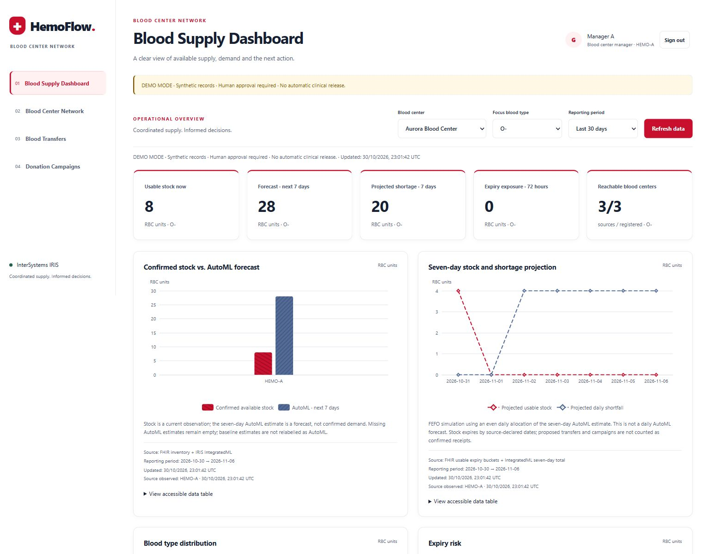

A demonstração utiliza **dados sintéticos**, três simuladores independentes de hemocentros e conexão real com um LLM. A coordenação preserva o grupo sanguíneo exato solicitado. Compatibilidade transfusional e liberação clínica permanecem sob responsabilidade assistencial; os resultados apresentados medem operações da demonstração.

[Instalação](#instalação-local) · [Telas](#guia-das-telas) · [Agente IA](#o-agente-ia-dentro-da-interoperabilidade-iris) · [Workflows](#dois-workflows-da-evidência-à-ação) · [Tecnologias](#mapa-de-tecnologias) · [Verificação](#verificação-e-observabilidade)

## Propósito e impacto social

Uma doação se transforma em benefício quando o componente chega à instituição que precisa dele dentro de sua validade. Uma rede pode apresentar excedente em um local e falta projetada em outro. Campanhas também precisam de antecedência para mobilização, coleta e processamento. O HemoFlow reúne essas informações para apoiar decisões coordenadas.

| Desafio | Resposta do HemoFlow | Indicadores acompanhados |
| --- | --- | --- |
| Falta prevista em um centro e excedente em outro | Consultar instituições, verificar prazos e propor transferência do mesmo grupo | Unidades solicitadas, expedidas e recebidas |
| Demanda futura exige nova coleta | Planejar campanha com previsão, capacidade de parceiros e experiências semelhantes | Convites, comparecimento, coleta e unidades liberadas, separadamente |
| Unidades próximas do vencimento | Considerar validade, transporte e consumo no destino | Exposição atual ao vencimento |
| Várias instituições precisam coordenar a execução | Definir responsáveis, aprovações e prazos | Autor, transições de estado, correlação e resultado |

Cada instituição mantém o controle do próprio estoque. O HemoFlow consulta a disponibilidade diretamente nas fontes; o IRIS conserva os registros dos workflows e as evidências das mensagens.

| Participante | Como utiliza | Valor prático |
| --- | --- | --- |
| Gestor do hemocentro | Investiga necessidades, aprova propostas e confirma resultados | Evidências compartilhadas e próxima ação com responsável definido |
| Organização parceira | Aceita ou recusa convite de coleta autorizado | Participação comunitária vinculada a uma necessidade e janela viável |
| Doador com consentimento | Registra interesse em um convite | Participação com consentimento e acompanhamento da programação |
| Administrador | Mantém instituições, parceiros e validade dos convites | Coordenação consistente da rede |
| Auditor | Analisa decisões, ferramentas, avaliação do modelo e resultados | Rastreabilidade da recomendação à execução |

**O objetivo social é agir antes da falta, aproveitar excedentes viáveis dentro da validade e mobilizar doações com tempo para processamento.** A demonstração acompanha passos operacionais nessa direção, com evidências que permitem avaliar a execução.

## Comece por uma decisão explicada

1. Siga a [instalação local](#instalação-local), configure o provedor e carregue a rede sintética.
2. Entre como `gestor-a` e compare estoque confirmado com a previsão de sete dias.
3. Informe a data necessária e solicite **Request AI Hub analysis**. Para uma apresentação controlada, utilize o [roteiro de demonstração](#roteiro-completo-de-demonstração).
4. Acompanhe a transferência ou campanha selecionada e suas aprovações humanas.
5. Consulte as evidências e os Visual Traces; compare a proposta com o recebimento ou a liberação registrados.

## O agente IA dentro da Interoperabilidade IRIS

O agente integra diretamente a **`HemoFlow.Production`**. Um evento de estoque ou uma solicitação autenticada entra por `InventoryEventService`. O `DecisionBPL` prepara o contexto autorizado, chama a operação AI Hub, valida a resposta e encaminha a decisão aceita para `TransferBPL` ou `CampaignBPL`.

O **AI Hub (AI_HUB)** utiliza o SDK nativo **`%AI.*`**: a implementação estende `%AI.Agent` e `%AI.ToolSet`, cria um `%AI.Provider` e persiste a sessão da conversa. As ferramentas participam da troca de mensagens da Production, com correlação explícita.

**O IRIS coordena o workflow; o AI Hub executa o agente; as instituições autorizam os compromissos.** O modelo é acessado pelo endpoint remoto OpenAI configurado. Instância do agente, integração de ferramentas, persistência, validação de negócio e roteamento BPL são gerenciados no IRIS.

| Recurso nativo | Implementação no projeto |
| --- | --- |
| `%AI.Provider.Create("openai", config)` | Resolve chave, endpoint e modelo na configuração do servidor |
| `HemoFlow.DecisionAgent Extends %AI.Agent` | Aplica instruções de domínio, reúne evidências e seleciona candidatos |
| `HemoFlow.DecisionTools Extends %AI.ToolSet` | Expõe cinco ferramentas com argumento tipado `requestId` |
| `CreateSession()` e `Chat(...)` | Executam investigação e seleção na mesma conversa |
| `session.%Save()`, `%Id()` e `GetStats()` | Persistem a conversa e retornam identidade e estatísticas |
| `HemoFlow.AIHubDecisionOperation` | Executa o agente como Business Operation com fila e devolve o resultado ao BPL |

As instruções e ferramentas são definidas em código. Gestores solicitam análises e aprovam ações pela interface; o provedor é configurado no `.env`.

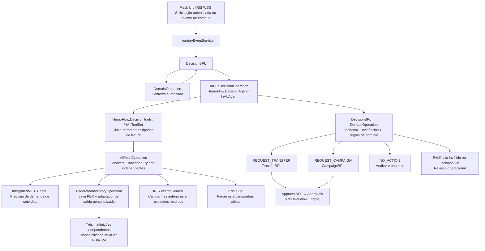

### Das instruções à decisão executável

1. **Preparar a solicitação.** `DomainOperation` resolve usuário, instituição, grupo exato e prazo. `DecisionContext` identifica a solicitação e suas evidências. O bloqueio de domínio é liberado antes da espera pelo LLM.
2. **Investigar pelas ferramentas.** O agente chama as cinco ferramentas com o `requestId` autorizado, escolhe a ordem e atualiza leituras quando necessário. Cada consulta registra identificador, versão, horário e hash da evidência. A primeira resposta é `EVIDENCE_READY`.
3. **Construir opções admissíveis.** A aplicação deriva um catálogo de candidatos dessas observações. Quantidades e datas seguem política determinística. Transferências parciais e campanhas podem ser alternativas; ofertas ainda não executadas permanecem distintas do abastecimento confirmado.
4. **Selecionar e explicar.** Um segundo `Chat`, na mesma sessão, solicita a cópia de um candidato atual e uma justificativa em inglês. O padrão configurado é OpenAI / `gpt-4.1-mini`.
5. **Validar independentemente.** JSON Schema e `policy.guard` verificam identidades, quantidades, datas e atualidade das evidências. Há uma tentativa de correção. O `DecisionBPL` consulta novamente o guard de domínio antes de encaminhar a decisão.
6. **Executar pela Production.** A proposta validada inicia o BPL e suas tarefas humanas. `NO_ACTION` encerra sem proposta. Evidência insuficiente ou resposta rejeitada gera revisão operacional.

### 1. Definir o agente e o provedor nativos

A declaração de [DecisionAgent.cls](iris/HemoFlow/DecisionAgent.cls) vincula o conjunto de ferramentas:

```objectscript
Class HemoFlow.DecisionAgent Extends %AI.Agent
{
Parameter TOOLSETS = "HemoFlow.DecisionTools";
// INSTRUCTIONS exigem coleta de evidências e cópia exata do candidato;
// aprovação, reserva e publicação de convites pertencem ao workflow.
}
```

Em [AIHubDecisionOperation.cls](iris/HemoFlow/AIHubDecisionOperation.cls), o SDK cria o provedor e a conversa persistente:

```objectscript
set provider=##class(%AI.Provider).Create("openai",config)
set agent=##class(HemoFlow.DecisionAgent).%New(provider)
set agent.Model=config.%Get("model"),agent.MaxIterations=8
$$$ThrowOnError(agent.%Init())
set session=agent.CreateSession({"timeout_ms":60000,"max_tokens":900,"temperature":0})
set result=agent.Chat(session,..Prompt(request.JSON))
set selection=..Catalog(input.%Get("request_id"))
set result=agent.Chat(session,"Choose exactly one candidate from this current catalog. Copy every candidate field and add reason only. Return decision JSON only. "_selection)
```

Os trechos destacam os pontos de integração. Os arquivos vinculados contêm também as instruções completas, validações e tratamento de erros.

### 2. Expor ferramentas autorizadas pela Production

O `XData Definition` de `HemoFlow.DecisionTools` registra os métodos no AI Hub:

```xml
<ToolSet Name="HemoFlow">
  <Tool Name="forecast_demand" Method="ForecastDemand"/>
  <Tool Name="query_network_inventory" Method="QueryNetworkInventory"/>
  <Tool Name="search_campaign_experience" Method="SearchCampaignExperience"/>
  <Tool Name="list_campaign_partners" Method="ListCampaignPartners"/>
  <Tool Name="get_active_campaigns" Method="GetActiveCampaigns"/>
</ToolSet>
```

Cada método recebe `requestId As %String` e delega ao dispatcher nativo. Este é o ponto em que uma chamada de ferramenta se transforma em mensagem de interoperabilidade:

```objectscript
ClassMethod Dispatch(name As %String, requestId As %String) As %String
{
    if requestId'=$get(^HemoFlow.ActiveAgent($job)) throw ##class(%Exception.General).%New("Tool request not authorized")
    set input={}
    do input.%Set("request_id",requestId),input.%Set("correlation_id",requestId)
    set input.tool=name
    quit ##class(HemoFlow.Runtime).Submit(input.%ToJSON(),"AIReadOperation")
}
```

A Operation estabelece a solicitação ativa para o processo e limpa esse contexto ao terminar. `AIReadOperation` executa a leitura em um worker independente. Consultas de estoque seguem para a Operation Java PEX e seu adaptador personalizado, tornando o caminho das evidências visível no Visual Trace. [Runtime.Submit](iris/HemoFlow/Runtime.cls) reutiliza o Business Host ativo para preservar a sessão nativa de mensagens.

### 3. Validar e persistir a sessão AI Hub

`AIHubDecisionOperation.Validate`, em Embedded Python, verifica se as cinco famílias de ferramentas foram realmente observadas em `EventAudit` e executa `policy.guard` com o contexto e catálogo atuais. A validação utiliza as evidências registradas. Após a validação, a Operation salva a conversa e as estatísticas:

```objectscript
$$$ThrowOnError(session.%Save())
set output={}
set output.decision=##class(%DynamicObject).%FromJSON(result.Content)
do output.%Set("session_id",session.%Id())
set output.stats=session.GetStats(),output.usage=result.Usage
do output.%Set("model",agent.Model)
do output.%Set("repair_attempts",repairs)
set response.JSON=..Finalize(output.%ToJSON(),input.%Get("request_id"))
```

O tratamento de falhas também preserva a sessão disponível e suas estatísticas, removendo a chave do provedor dos detalhes de erro. A sessão AI Hub identifica a conversa; a sessão de Interoperabilidade identifica mensagens. A correlação de negócio conecta ambas à decisão.

### 4. Retornar ao BPL e selecionar o workflow

| Fronteira | Contrato implementado |
| --- | --- |
| Solicitação | `HemoFlow.Message Extends Ens.Request` |
| Conteúdo e correlação | Propriedades `JSON`, `CorrelationId`, `Phase`, `EntityId` |
| Resposta | `HemoFlow.Response Extends Ens.Response`, com `JSON` |
| Chamada do agente | Call `Agent`, destino `AIHubDecisionOperation`, `async="1"` |
| Sincronização | `<sync calls="Agent" type="all" timeout="110"/>` |
| Validação independente | `DomainOperation`, `Phase="guard"`; leitura da `route` validada |
| Transferência | `REQUEST_TRANSFER`, `Phase="start_transfer"`, `TransferBPL` |
| Campanha | `REQUEST_CAMPAIGN`, `Phase="start_campaign"`, `CampaignBPL` |
| Encerramento | `NO_ACTION` ou revisão operacional sem abertura de proposta |

O roteamento utiliza a resposta validada pelo domínio. Nas sessões capturadas, as mensagens **4451** e **4514** são as chamadas explícitas para `TransferBPL` e `CampaignBPL`. A implementação combina Provider, Agent, Session e ToolSet; a recuperação de campanhas utiliza SQL vetorial e embeddings no IRIS.

### Cinco ferramentas, cinco fontes de evidência

| Ferramenta | Caminho | Evidência |
| --- | --- | --- |
| `forecast_demand` | `AIReadOperation` → Embedded Python → IntegratedML `PREDICT` | Demanda de sete dias, versão do modelo e indicadores de qualidade por centro/grupo |
| `query_network_inventory` | `AIReadOperation` → Java PEX → `FederatedInventoryAdapter` | Disponibilidade atual, limites de transferência, horários, validade e transporte |
| `search_campaign_experience` | `AIReadOperation` → `VECTOR_COSINE` sobre `CampaignExperience` | Cinco campanhas semelhantes, identificadores, scores e resultados |
| `list_campaign_partners` | `AIReadOperation` → registros autorizados do IRIS | Identidade, escopo e capacidade declarada dos parceiros |
| `get_active_campaigns` | `AIReadOperation` → campanhas do escopo autorizado | Compromissos existentes para avaliar sobreposição e necessidade |

**Três formas complementares de inteligência:** AutoML prevê demanda; Vector Search recupera experiências; AI Hub investiga e escolhe uma estratégia admissível. A autorização institucional ocorre nas tarefas humanas.

### Previsão, recuperação e regras de domínio

O modelo conjunto `Demand7dMulti` usa atributos calculados por centro/grupo: médias de consumo de sete e 28 dias, dia da semana e mês. [intelligence.py](python/hemoflow/intelligence.py) implementa `CREATE MODEL`, `TRAIN MODEL`, `VALIDATE MODEL` e `PREDICT`. A avaliação usa separação cronológica, embargo de sete dias, MAE e baseline, excluindo rótulos censurados. A trajetória FEFO distribui o total previsto de sete dias uniformemente entre os dias para simular o consumo por ordem de vencimento.

A busca de campanhas usa `BAAI/bge-small-en-v1.5`, `VECTOR(DOUBLE,384)` e ranking exato por cosseno. A consulta filtra região, modelo de embedding e, opcionalmente, tipo de parceiro; ordena por score e identificador. Campanhas concluídas acrescentam resultados e embeddings à base de experiências.

O [schema da decisão](schemas/decision.schema.json) permite `REQUEST_TRANSFER`, `REQUEST_CAMPAIGN` e `NO_ACTION`. [policy.py](python/hemoflow/policy.py) verifica evidências atuais, grupo exato, disponibilidade e prazos. `Command` deduplica avaliações; `Outbox` recupera despachos sem repetir a escolha pelo LLM. Reservas e convites dependem de aprovação humana.

## Dois workflows: da evidência à ação

Os dois workflows executam na mesma [HemoFlow.Production](iris/HemoFlow/Production.cls). As sessões iniciais incluem agente, ferramentas, consulta Java PEX, guard e BPL selecionado. Comandos humanos posteriores têm sessões próprias, conectadas pela correlação de negócio.

### WF-01 — Redistribuir unidades disponíveis

**Exemplo:** Aurora precisa de concentrados de hemácias; Bandeirantes dispõe de unidades do mesmo grupo dentro das janelas de transporte e validade. O agente propõe uma quantidade admissível, e a instituição de origem decide sobre o compromisso.

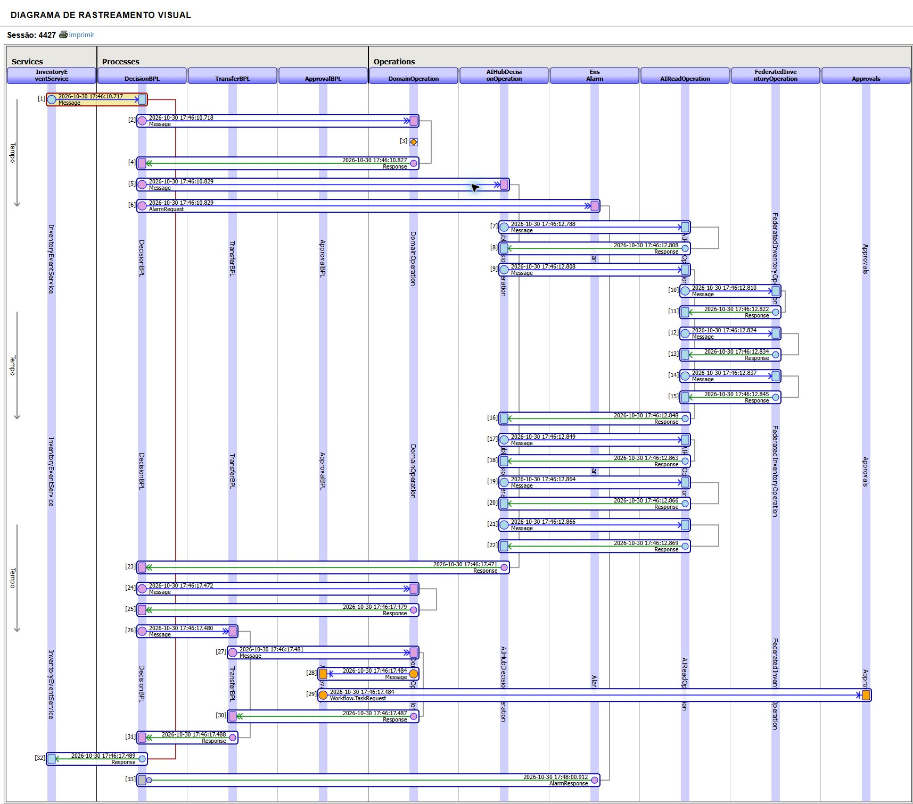

*Captura real de 30 de outubro de 2026, namespace `USER`, **sessão 4427**. Correlação: `67b6a658-02d5-4591-923d-2eb806e9265d`. Os 32 cabeçalhos estão nos [traces completos](#traces-nativos-completos).*

**Como ler:** `4430` chama o agente; `4432` inicia as trocas com os workers; `4435` consulta a Operation Java PEX. Após a resposta, `4449` chama o guard, `4451` entra no `TransferBPL` e `4454` cria a tarefa de aprovação.

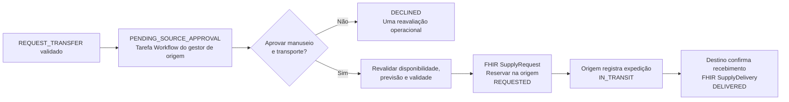

`TransferBPL` coordena comandos de domínio. `ApprovalBPL` e `Approvals` criam tarefas reais do Workflow Engine. `FHIRTransferOperation` troca contratos FHIR R4 com as instituições. A aprovação provoca revalidação antes da reserva; a confirmação no destino registra recebimento. Unidades recebidas e utilizadas são contabilizadas separadamente. Uma recusa gera uma reavaliação operacional.

### WF-02 — Planejar uma campanha de doação

**Exemplo:** uma falta futura permanece, com tempo viável para coleta e processamento. O agente combina experiências e capacidade dos parceiros para propor um plano. O hemocentro autoriza a execução e a instituição convidada confirma sua participação.

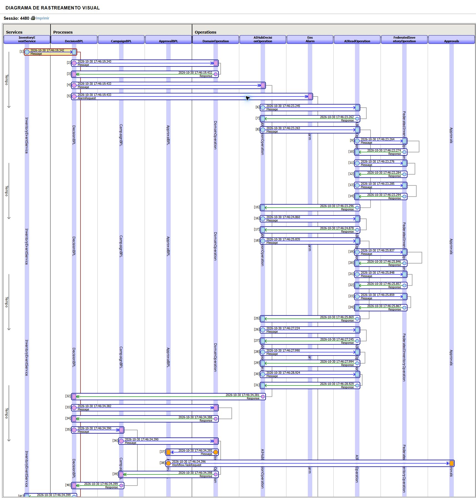

*Captura real de 30 de outubro de 2026, namespace `USER`, **sessão 4480**. Correlação: `386df328-e3f8-47e0-aff9-d75eaead0304`. Os 42 cabeçalhos estão nos [traces completos](#traces-nativos-completos).*

**Como ler:** `4483` chama o agente; `4485` inicia as leituras; `4488` consulta a federação. Esta execução inclui atualização de evidências. O agente retorna em `4511`; `4512` chama o guard; `4514` seleciona `CampaignBPL`; `4517` cria a aprovação do centro. A publicação dos convites ocorre posteriormente, após autorização.

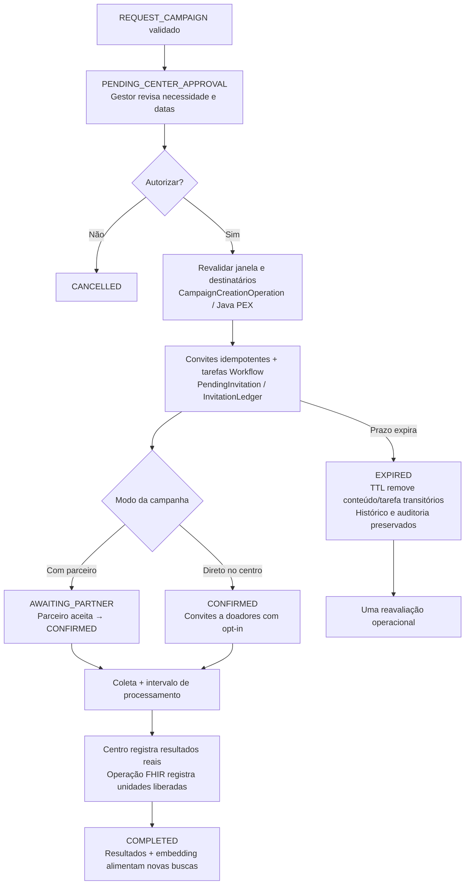

`CampaignCreationOperation`, implementada em Java PEX, materializa convites aprovados de maneira idempotente. Convites pendentes têm TTL configurável: consultas ocultam os vencidos imediatamente e um timer de 15 segundos conclui a limpeza. O histórico durável permanece. Convites diretos exigem opt-in; interesse, coleta e unidades liberadas são registros distintos.

## Instalação local

### 1. Carregar a imagem AI Hub

Pré-requisitos: Docker com Compose e contêineres Linux, Python 3 para configuração local e acesso à imagem AI Hub e aos downloads de dependências/modelos. O ambiente validado é **InterSystems IRIS Community AI Hub `2026.3.0AI.154.0`, Linux amd64**, namespace `USER`. Reserve recursos para IRIS, AutoML e embeddings.

Obtenha a imagem no [portal InterSystems AI Hub Early Access](https://evaluation.intersystems.com/Eval/early-access/AIHub) e carregue-a:

```powershell
docker image load -i iris-community-2026.3.0AI.154.0-docker.tar.gz
docker image ls
# Substitua LOADED_IMAGE_NAME pelo nome da imagem informado pelo Docker.
docker tag LOADED_IMAGE_NAME iris-community:2026.3.0AI.154.0
```

[Dockerfile](Dockerfile) e [compose.yaml](compose.yaml) utilizam essa tag. Observe os termos de distribuição da imagem EAP ao preparar seu ambiente.

### 2. Configurar e iniciar

```powershell
python tools/configure.py
# Edite o .env localmente e preencha OPENAI_API_KEY.
docker compose up -d --build
docker compose ps
```

`configure.py` cria os segredos ausentes e preserva a configuração existente. Preencha sua chave no `.env`. O [modelo de configuração](.env.sample) documenta as variáveis:

| Variável | Finalidade |
| --- | --- |
| `OPENAI_API_KEY` | Chave própria para decisões com o provedor real |
| `OPENAI_MODEL` | Padrão `gpt-4.1-mini` |
| `OPENAI_BASE_URL` | Padrão `https://api.openai.com/v1` |
| `IRIS_IMAGE` | Padrão `iris-community:2026.3.0AI.154.0` |
| `HEMOFLOW_ADMIN_PASSWORD` | Senha gerada para o administrador |
| `HEMOFLOW_CENTER_TOKEN`, `HEMOFLOW_SESSION_SECRET` | Segredos institucionais e de sessão web |
| `HEMOFLOW_DEMO` | `1` habilita cenários e contas sintéticas |
| `HEMOFLOW_EMBEDDING_MODEL` | Padrão `BAAI/bge-small-en-v1.5` |
| `HEMOFLOW_INPUT_USD_PER_MILLION`, `HEMOFLOW_OUTPUT_USD_PER_MILLION` | Preços opcionais para estimar custos; sem configuração, custo desconhecido |

Mantenha `.env` fora do controle de versão. O bootstrap compila classes, configura IRIS WSGI, inicia a Production e habilita o TTL. Cada simulador possui volume SQLite independente; IRIS e embeddings têm volumes persistentes próprios.

### 3. Carregar a demonstração sintética

Aguarde os contêineres ficarem saudáveis e execute:

```powershell
Get-Content tools/seed.script | docker compose exec -T iris iris session IRIS -U USER
Invoke-RestMethod http://localhost:52774/csp/hemoflow/health
```

Equivalente em Linux/macOS:

```bash
docker compose exec -T iris iris session IRIS -U USER < tools/seed.script
curl http://localhost:52774/csp/hemoflow/health
```

A primeira carga baixa embeddings e treina o modelo. Ao concluir, abra o **[HemoFlow](http://localhost:52774/csp/hemoflow/)**. O health retorna `status: ok` e `Embedded Python / IRIS WSGI`; a aceitação dos workflows verifica separadamente a integração com o agente.

O seed v2 inclui três centros, seis parceiros, três contatos fictícios de doadores, 13 contas, **4.320 observações de consumo** (3 centros × 8 grupos × 180 dias) e 72 experiências iniciais de campanhas. Uma nova execução retorna `ALREADY_LOADED`, preservando a atividade posterior. A migração de bases v1 é aditiva e cria backups.

### 4. Escolher um perfil

As contas sintéticas usam a senha **`DemoHemoFlow2026!`**. `admin` utiliza `HEMOFLOW_ADMIN_PASSWORD`. As credenciais do Portal IRIS são independentes das contas da aplicação.

| Login | Uso |
| --- | --- |
| `admin` | Cadastro, TTL, carga/restauração e cenários controlados |
| `gestor-a`, `gestor-b`, `gestor-c` | Operações e aprovações do centro correspondente |
| `parceiro-1` … `parceiro-6` | Consulta e resposta aos convites do próprio parceiro |
| `doador-1`, `doador-2` | Registro de interesse em convites autorizados |
| `doador-3` | Exemplo sem opt-in |
| `auditor` | Consulta de auditoria e análises |

## Guia das telas

A interface utiliza páginas em inglês renderizadas por Flask/Jinja e hospedadas via IRIS WSGI. Os rótulos abaixo reproduzem os controles reais para facilitar o uso. As rotas têm o prefixo `/csp/hemoflow`; ações e dados respeitam perfil e instituição. As capturas mostram dados sintéticos que evoluem com as operações.

### Acesso — `/login`

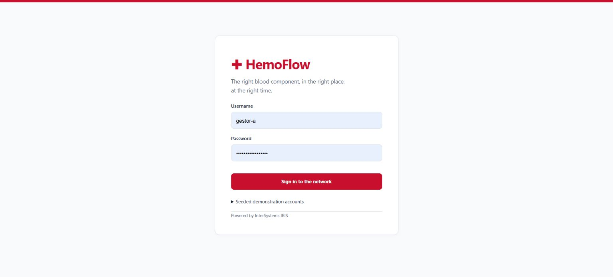

Informe uma conta e a senha correspondente e selecione **Sign in to the network**. Expanda **Seeded demonstration accounts** para consultar exemplos. Comece como `gestor-a`; utilize **Sign out** para trocar de perfil. Autenticação, CSRF e escopo institucional são verificados no servidor.

### Painel de abastecimento — `/dashboard`


**Objetivo:** compreender o abastecimento e solicitar investigação. Escolha **Blood center**, **Focus blood type** e **Reporting period**; clique em **Refresh data**. Compare estoque, previsão AutoML de sete dias, trajetória FEFO, distribuição por grupo, vencimentos e mapa da rede. Consulte tabelas acessíveis e horários das fontes.

**Exemplo:** como `gestor-a`, selecione Aurora e O−. Uma leitura da demonstração registrou 8 unidades utilizáveis e previsão de 28 para sete dias. Em **Assess supply needs**, informe grupo, centro e **Required by (UTC)** no futuro; selecione **Request AI Hub analysis** e examine decisão e evidências. O período filtra o histórico; o estoque representa a observação atual.

O administrador também encontra carga, restauração, avanço do relógio e cenários controlados. Esses cenários restauram o estoque sintético pertencente à demonstração e encerram planos sintéticos abertos; utilize uma sessão isolada de apresentação.

### Rede de hemocentros — `/blood-center-network`

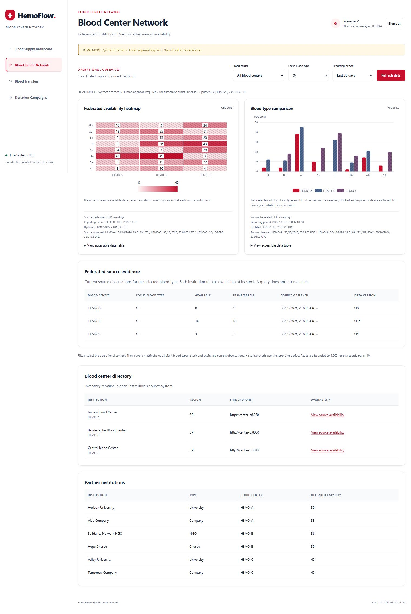

**Objetivo:** comparar disponibilidade atual entre instituições. Selecione um centro ou a rede, examine os mapas de disponibilidade e transferência e utilize **View live availability** no cadastro.

**Exemplo:** compare Aurora, Bandeirantes e Central para A+. O saldo transferível considera reservas locais, bloqueios e validade. Fontes inacessíveis aparecem como evidência indisponível. A consulta preserva o estoque sem reservá-lo. Administradores cadastram centros com endpoints e parceiros com escopo, tipo e capacidade no formulário inferior.

### Transferências — `/blood-transfers`

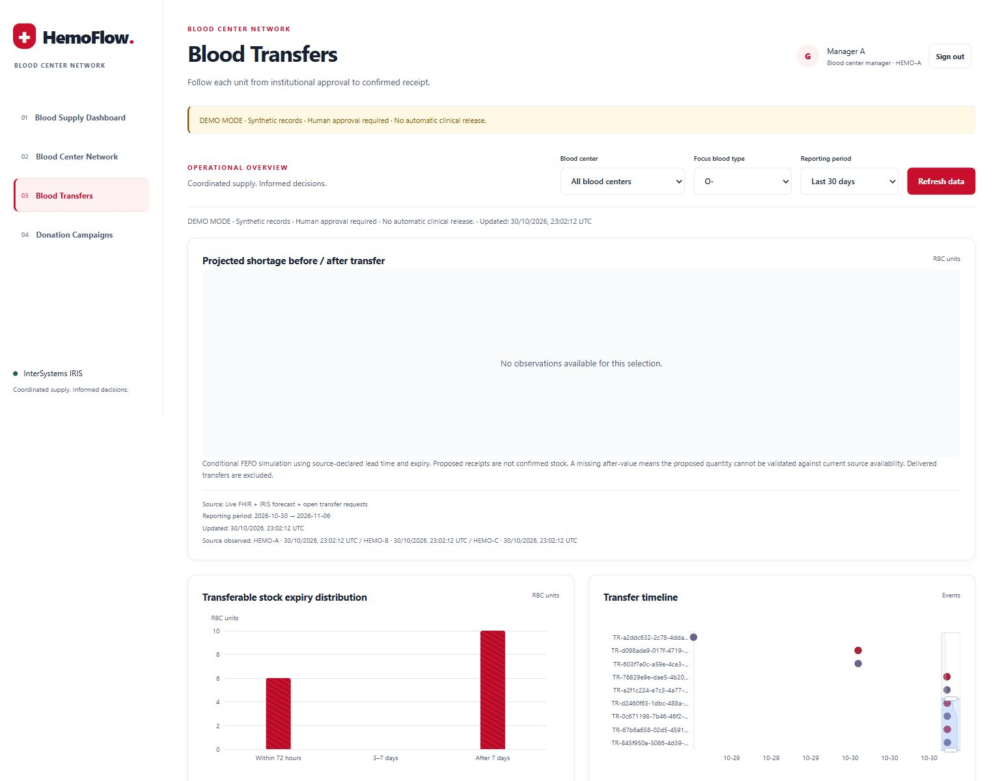

**Objetivo:** acompanhar proposta, aprovação, expedição e recebimento. Filtre grupo/centro e confira origem, destino, quantidade, prazo, estado e eventos. A projeção após transferência representa um cenário condicionado ao recebimento e às evidências atuais.

**Exemplo:** como admin, gere **Redistribute surplus**. Como `gestor-b`, revise o pedido, confirme manuseio/transporte, aprove e registre a expedição. Como `gestor-a`, confirme o recebimento. O estado passa a `DELIVERED`; utilização é registrada separadamente. Uma recusa na origem gera reavaliação correlacionada.

### Campanhas de doação — `/donation-campaigns`

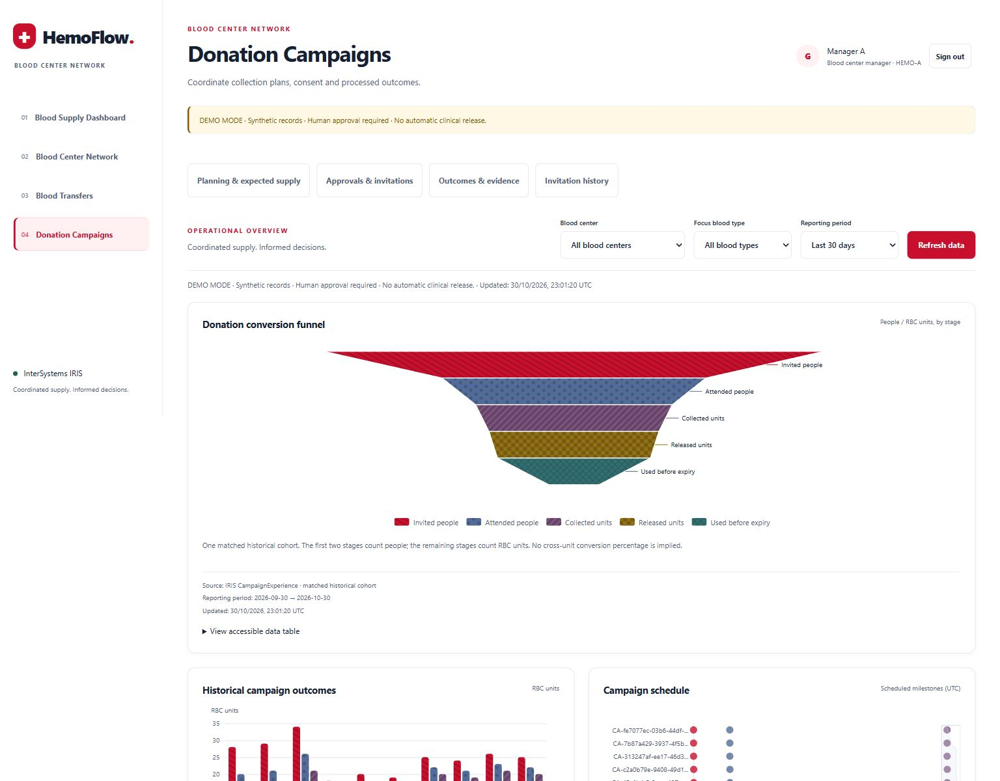

**Objetivo:** vincular necessidade futura, janela de coleta, participantes e resultados. Os filtros permitem comparar todos os grupos. A página separa **Planning & expected supply**, convites, resultados e histórico.

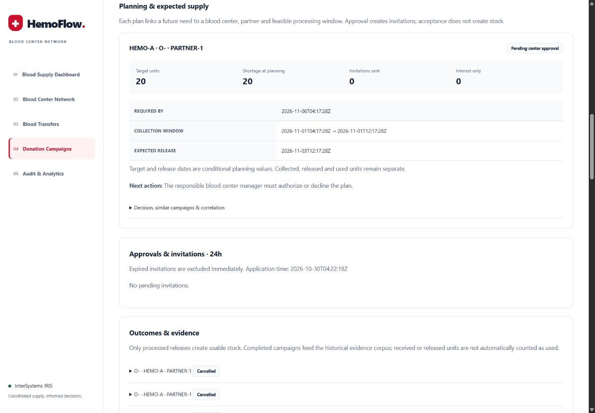

**Exemplo:** como admin, gere **Future donation campaign**. Como `gestor-a`, confira data necessária, coleta, liberação prevista e próximo responsável; autorize o plano. No modo com parceiro, entre com a conta da instituição indicada e aceite o convite. No modo direto, doadores com opt-in registram interesse.

Abra as evidências do plano para consultar campanhas semelhantes e a correlação. Após confirmação e processamento, o gestor informa comparecimento, unidades coletadas, liberadas e utilizadas, além da validade declarada. Em demonstração, **Simulate collection and processing · advance demo clock** exercita o caminho de liberação. Os resultados concluídos alimentam a recuperação de experiências. O funil distingue pessoas de unidades de hemácias.

O admin configura o TTL nesta página. Convites vencidos deixam de aceitar respostas imediatamente; seu estado permanece no histórico durável.

### Auditoria e análises — `/audit-analytics`

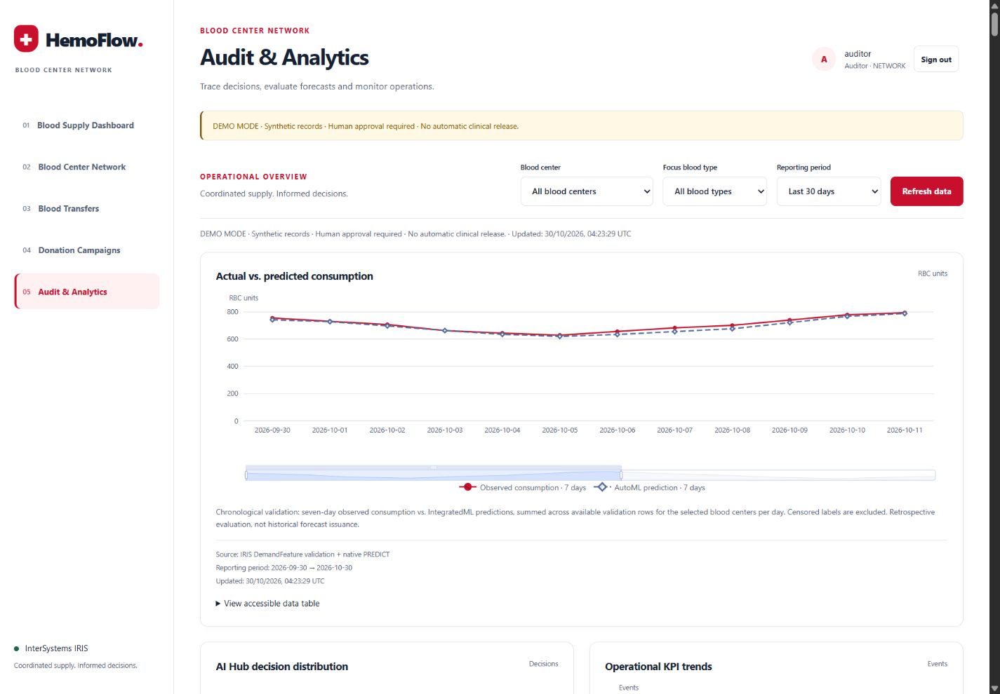

**Objetivo:** explicar a recomendação e o que foi executado. Como `auditor` ou `admin`, selecione filtros, compare consumo observado e previsto, examine decisões e tendências operacionais.

**Exemplo:** localize uma decisão e siga correlação, observações das ferramentas e referências de sessão até o Visual Trace IRIS. Confira modelo, evidências, tokens, latência e justificativa. O gráfico observado/previsto representa avaliação retrospectiva com separação cronológica; as métricas usam dados sintéticos.

### Uso em dispositivos móveis

| Painel no celular | Campanhas no celular |
| --- | --- |
| 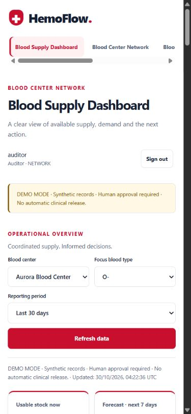 | 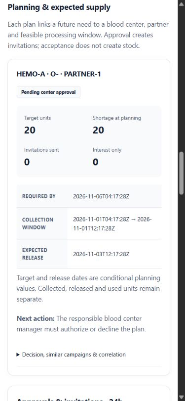 |

As mesmas rotas adaptam o layout e preservam as permissões. Os 16 gráficos Apache ECharts locais incluem unidades, origem, horários, interpretação e tabelas acessíveis. Estados de carregamento, ausência de dados e erro são explícitos. Consultar gráficos é uma operação de leitura, sem chamada ao LLM.

## Mapa de tecnologias

| Tecnologia | Papel no HemoFlow | Implementação |
| --- | --- | --- |
| **Interoperabilidade IRIS** | Mensagens persistentes, orquestração e rastreamento dos dois workflows | [Production](iris/HemoFlow/Production.cls), [DecisionBPL](iris/HemoFlow/DecisionBPL.cls), [TransferBPL](iris/HemoFlow/TransferBPL.cls), [CampaignBPL](iris/HemoFlow/CampaignBPL.cls) |
| **AI Hub / AI_HUB (`%AI.*`)** | Agente nativo, provedor, sessões e ferramentas tipadas | [DecisionAgent](iris/HemoFlow/DecisionAgent.cls), [DecisionTools](iris/HemoFlow/DecisionTools.cls), [AIHubDecisionOperation](iris/HemoFlow/AIHubDecisionOperation.cls) |
| **IntegratedML + AutoML** | Treinamento, validação e previsão de sete dias por SQL | [intelligence.py](python/hemoflow/intelligence.py), [DemandFeature](iris/HemoFlow/DemandFeature.cls), [ConsumptionDaily](iris/HemoFlow/ConsumptionDaily.cls) |
| **IRIS Vector Search** | Recuperação por cosseno com embeddings de 384 dimensões | [CampaignExperience](iris/HemoFlow/CampaignExperience.cls), [embeddings e recuperação](python/hemoflow/intelligence.py) |
| **Embedded Python** | Regras, SQL, preparação de ML, análises e TTL dentro do IRIS | [Pacote Python](python/hemoflow/), [AIReadOperation](iris/HemoFlow/AIReadOperation.cls), [DomainOperation](iris/HemoFlow/DomainOperation.cls) |
| **ObjectScript / BPL** | Integração com SDK, coordenação e pontes de execução | [Classes IRIS](iris/HemoFlow/), [Runtime](iris/HemoFlow/Runtime.cls) |
| **Java PEX** | Consulta federada e criação de convites aprovados | [Operations Java](java/pex/src/main/java/com/hemoflow/pex/) |
| **Outbound Adapter personalizado** | Protocolo institucional e tratamento de respostas remotas | [FederatedInventoryAdapter.java](java/pex/src/main/java/com/hemoflow/pex/FederatedInventoryAdapter.java) |
| **FHIR R4** | Disponibilidade, reservas e recebimentos confirmados | [FHIRTransferOperation](iris/HemoFlow/FHIRTransferOperation.cls), [fhir.py](python/hemoflow/fhir.py), [simulador](simulators/center.py) |
| **IRIS Workflow Engine** | Tarefas humanas de aprovação, recusa e expiração | [ApprovalBPL](iris/HemoFlow/ApprovalBPL.cls), `EnsLib.Workflow.Operation`, [WorkflowLink](iris/HemoFlow/WorkflowLink.cls) |
| **IRIS SQL / `%Persistent`** | Decisões, históricos, estados e auditoria durável | [DecisionAudit](iris/HemoFlow/DecisionAudit.cls), [EventAudit](iris/HemoFlow/EventAudit.cls), [InvitationLedger](iris/HemoFlow/InvitationLedger.cls) |
| **`%Dictionary` + TTL** | Descoberta de subclasses expiráveis e limpeza do estado transitório | [Expirable](iris/HemoFlow/Expirable.cls), [ExpirationService](iris/HemoFlow/ExpirationService.cls), [ttl.py](python/hemoflow/ttl.py) |
| **Flask / Jinja / WSGI** | Interface autenticada renderizada no servidor e hospedada pelo IRIS | [web.py](python/hemoflow/web.py), [templates](web/templates/); WSGI é a interface de gateway web |
| **Apache ECharts 5.6.0** | Dezesseis gráficos operacionais locais e acessíveis | [app.js](web/static/app.js), [analytics.py](python/hemoflow/analytics.py), [projections.py](python/hemoflow/projections.py) |
| **Docker Compose / SQLite** | Ambiente reproduzível e três bancos institucionais independentes | [compose.yaml](compose.yaml), [Dockerfile](Dockerfile), [simuladores](simulators/) |
| **IPM / ZPM** | Instalação das classes no ambiente preparado | [module.xml](module.xml), [instalação IPM](#instalação-via-ipm) |

## Verificação e observabilidade

A validação de orquestração registrada em **30 de outubro de 2026** reúne **56 testes nativos aprovados e 12 cenários de demonstração aprovados**. A aceitação registra 12 unidades recebidas por transferência e 20 liberadas pela campanha. São resultados operacionais sintéticos.

Execute os testes em um ambiente de demonstração isolado:

```powershell
Get-Content tools/run.script | docker compose exec -T iris iris session IRIS -U USER
Get-Content tools/test.script | docker compose exec -T iris iris session IRIS -U USER
docker compose exec -T iris python3 /opt/hemoflow/tools/test_ui_http.py
Get-Content tools/demo_e2e.script | docker compose exec -T iris iris session IRIS -U USER
```

`demo_e2e.script` utiliza o modelo OpenAI real, cria backups, executa cenários e restaura estoque sintético próprio. Há consumo do provedor e encerramento de planos sintéticos abertos. `e2e_fixture.script` prepara uma rede vazia antes do seed.

Após a aceitação, abra uma sessão `USER` e execute a verificação causal do trace:

```powershell
docker compose exec iris iris session IRIS -U USER
```

```objectscript
do ##class(HemoFlow.Probe).File("/opt/hemoflow/tools/test_orchestration.py")
halt
```

A verificação lê evidências existentes e confirma as cinco ferramentas, a consulta Java PEX e o ramo BPL correto. Também verifica a ausência de propostas associadas a `NO_ACTION` ou escalonamento. Os relatórios ficam em `/durable/hemoflow-evidence/`.

No [Portal IRIS local](http://localhost:52774/csp/sys/UtilHome.csp), selecione **USER**, `HemoFlow.Production` e Message Viewer / Visual Trace. As capturas usam **4427** e **4480**; novas execuções recebem novos IDs. Sessão de Interoperabilidade, conversa AI Hub e comandos humanos posteriores são ligados pela correlação de negócio.

As evidências incluem modelo, ferramentas, versões, latência, tokens/cache e tentativas corretivas. Estimativas monetárias utilizam os preços configurados. Custos desconhecidos e fontes indisponíveis são identificados explicitamente.

## Operação e ciclo de vida dos dados

### Conferência da instalação

| Situação | Conferir | Procedimento |
| --- | --- | --- |
| Imagem base ausente | `docker image ls`, `IRIS_IMAGE` | Carregar o arquivo e aplicar a tag indicada na instalação |
| Contêineres iniciando | `docker compose ps`, logs | Acompanhar downloads, bootstrap e disponibilidade dos simuladores antes do seed |
| Análise exige revisão | Configuração do provedor e erro correlacionado | Conferir chave/modelo, disponibilidade das fontes, prazo e evidências |
| Acesso recusado | Perfil e conclusão do seed | Usar senha gerada para admin ou senha da demonstração para contas sintéticas |
| Gráficos carregando ou sem dados | Horários, perfil, grupo e período | Atualizar os dados e consultar a mensagem da visualização |
| Proposta encerrada | Estado, escopo e validade | Consultar o histórico e o responsável atual |

Verificações de leitura a partir da raiz do projeto:

```powershell
docker compose ps
docker compose logs --tail 100 iris
Invoke-RestMethod http://localhost:52774/csp/hemoflow/health
```

A conferência completa passa por contêineres saudáveis, sessão web autenticada, decisão real do agente e evidências correlacionadas do workflow.

### Persistência e restauração

- **Restauração segura:** exige modo demo, admin, marcador de propriedade do seed e ausência de dados externos. Cria backup, encerra planos sintéticos abertos e restaura estoque próprio, preservando auditoria e `InvitationLedger`.
- **Relógio da demonstração:** compartilhado com os simuladores, limitado ao modo demo e independente do relógio do host. Avançar 25 horas demonstra expiração; a restauração zera o deslocamento.
- **Volumes:** preservam os dados entre reinicializações. Utilize a restauração da aplicação para reiniciar a demonstração.
- **IPM:** instala as classes no ambiente preparado com Python, JARs e assets em `/opt/hemoflow`; Compose entrega o conjunto completo.

### Dados transitórios: implementação inspirada na DPI-I-393

A [DPI-I-393 — Transient data](https://ideas.intersystems.com/ideas/DPI-I-393), proposta por Yuri Marx, inspira a definição de um prazo de existência para dados persistidos. No HemoFlow, esse conceito é implementado por uma classe-base reutilizável e um serviço periódico dentro da Production IRIS.

**A limpeza automática atua nos dados temporários das campanhas:** exclui fisicamente convites vencidos de `PendingInvitation` e contextos expirados de `DecisionContext`. Os registros de `Campaign`, resultados, `InvitationLedger` e auditoria permanecem disponíveis para rastreabilidade e recuperação de experiências pelo agente. Assim, a pendência deixa de ocupar a fila operacional e o histórico institucional é preservado.

#### Modelo persistente e prazo de expiração

[HemoFlow.Expirable](iris/HemoFlow/Expirable.cls) herda de `HemoFlow.Record`, cuja base é `%Persistent`, e define o contrato comum:

```objectscript
Class HemoFlow.Expirable Extends HemoFlow.Record [ Abstract, NoExtent ]
{
Parameter TTLSECONDS = 86400;
Property ExpiresAt As %String(MAXLEN = 32) [ Required ];
Index ExpiryIndex On ExpiresAt;
}
```

[PendingInvitation](iris/HemoFlow/PendingInvitation.cls) e [DecisionContext](iris/HemoFlow/DecisionContext.cls) estendem essa classe. `TTLSECONDS` declara a referência de 24 horas; a exclusão utiliza o valor efetivamente gravado em `ExpiresAt`. O código de negócio calcula esse prazo por tipo de registro: convites usam `invite_ttl_hours`, configurável pelo admin entre 1 e 168 horas, com padrão de 24; contextos de análise recebem cinco minutos e contextos de expedição recebem dois dias. [repository.py](python/hemoflow/repository.py) projeta `expires_at` do payload na propriedade persistente `ExpiresAt`.

#### Descoberta pelo dicionário e execução periódica

[ttl.py](python/hemoflow/ttl.py) descobre as subclasses diretas da base pelo dicionário de classes, restritas ao pacote da aplicação:

```sql
SELECT Name FROM %Dictionary.ClassDefinition
WHERE Super='HemoFlow.Expirable' AND Name %STARTSWITH 'HemoFlow.'
```

[ExpirationService](iris/HemoFlow/ExpirationService.cls) é um `Ens.BusinessService` com `Ens.InboundAdapter`. A [Production](iris/HemoFlow/Production.cls) configura `CallInterval=15`. A cada ciclo, o serviço invoca `ExpirationTask.OnTask()`: essa classe estende `%SYS.Task.Definition` e executa Embedded Python para chamar `expire()` e, em seguida, `dispatch_outbox()`. A execução periódica está integrada à Production.

O processamento adquire o lock `mutations`, abre uma transação e seleciona registros com `ExpiresAt <= horário atual`, ordenados por vencimento. Cada ciclo processa, por classe, um lote padrão de 100 registros, com teto de 500. A exclusão usa a API persistente `_DeleteId`, equivalente Python de `%DeleteId`; sucesso confirma a transação, exceção provoca rollback e o lock é liberado ao final.

#### Expiração conectada ao Workflow Engine

Para cada convite vencido ainda `PENDING`, a mesma rotina:

1. Atualiza `InvitationLedger` para `EXPIRED`.
2. Registra `INVITATION_EXPIRED` em `EventAudit`, com a correlação de negócio.
3. Grava um evento Outbox com ID estável `expired:<invitation_id>`.
4. Chama [workflow.timeout](python/hemoflow/workflow.py), que conclui a tarefa nativa com `CompleteTask('EXPIRED')` e atualiza `WorkflowLink`.
5. Exclui o registro transitório de `PendingInvitation`.

Depois do commit, [dispatch_outbox](python/hemoflow/service.py) encaminha uma reavaliação ao `DecisionBPL` com `review_only=True` e o ID do evento como chave de idempotência. Esse caminho registra a revisão operacional sem republicar automaticamente convites.

As leituras pendentes filtram `expires_at > horário atual`, e a resposta a um convite verifica o prazo antes da alteração, retornando HTTP 409 se vencido. A validade é aplicada imediatamente, inclusive entre dois ciclos do timer. A aceitação registrada cobre `AUTOMATIC_TTL_24H_TWO_CLASSES_AND_LATE_409` e `SINGLE_EXPIRATION_REASSESSMENT`: limpeza das duas classes, resposta tardia bloqueada e reavaliação única, com histórico preservado.

## Roteiro completo de demonstração

Utilize `HEMOFLOW_DEMO=1` e as contas da seção de instalação. Os cenários controlados usam O−; os oito grupos continuam disponíveis para análises e workflows do grupo exato.

| Etapa | Perfil e ação | Resultado esperado |
| --- | --- | --- |
| 1. Examinar a necessidade | `gestor-a`: Aurora, O− e A+, previsão e validade | Estoque observado, previsão e falta simulada identificados separadamente |
| 2. Consultar a rede | Comparar as três instituições | Observações atuais sem reserva de estoque |
| 3. Iniciar transferência | `admin`: **Redistribute surplus** | Investigação AI Hub e proposta em `PENDING_SOURCE_APPROVAL` |
| 4. Aprovar e entregar | `gestor-b`: condições, aprovação e expedição; `gestor-a`: recebimento | Revalidação, reserva e estado final `DELIVERED` |
| 5. Iniciar campanha | `admin`: **Future donation campaign**; `gestor-a`: revisão e autorização | Plano com janela viável e convites após aprovação |
| 6. Confirmar participação | Parceiro indicado aceita; no modo direto, doadores com opt-in registram interesse | Confirmação institucional ou interesse individual |
| 7. Registrar processamento | Gestor registra resultados ou usa a ação de simulação | Coleta, liberação e utilização separadas; experiência indexada |
| 8. Explicar o resultado | `auditor`: decisões, observações e correlações | Evidências conectadas aos Visual Traces |

### Cenários adicionais

| Cenário | Como demonstrar | Comportamento esperado |
| --- | --- | --- |
| Cobertura suficiente | **Sufficient coverage** | `NO_ACTION` com evidências |
| Validade insuficiente | Cenário controlado de vencimento | Transferência inviável bloqueada |
| Fonte indisponível | Cenário offline | `UNAVAILABLE` e revisão quando a evidência é insuficiente |
| Falta urgente | Cenário de falta | Revisão quando a campanha não atende ao prazo |
| Recusa na origem | Gestor recusa | Registro durável e uma reavaliação |
| Expiração | Convite pendente e avanço de 25 horas | Exclusão imediata das leituras pendentes e limpeza pelo timer |
| Resposta tardia | Aceitar convite vencido | HTTP 409 e preservação do histórico |
| Ausência de consentimento | Caso `doador-3` | Nenhum convite emitido |

Prepare os cenários antes da apresentação, pois restauram estoque próprio e encerram planos sintéticos abertos, preservando auditoria. Para gerar os exemplos de apresentação após a aceitação:

```powershell
Get-Content tools/prepare_demo_presentation.script | docker compose exec -T iris iris session IRIS -U USER
```

O script usa AI Hub real, verifica uma transferência A+ sem alterar O− e prepara campanha e transferência A+ pendentes. Registra resultados em `/durable/hemoflow-evidence/presentation-acceptance.json`. Execute em demonstração isolada.

Durante a apresentação, mostre o aviso de dados sintéticos, horários, unidades e períodos. Identifique o aprovador e acompanhe a correlação. Diferencie observação, previsão, compromisso e resultado registrado.

## Arquitetura da interface e interpretação dos dados

### Renderização, idioma e acessibilidade

Flask/Jinja renderiza páginas via IRIS WSGI. Os textos da aplicação estão em `web/static/locales/en.json`, carregados por `python/hemoflow/ui.py` e `web/static/app.js`. Templates utilizam `t()`, `label` e `display_name`. Identificadores, contratos FHIR e evidências históricas são preservados. As justificativas novas do agente são solicitadas em inglês. Rotas antigas em português redirecionam às correspondentes em inglês, mantendo parâmetros.

`web/static/app.css` define vermelho `#C8102E`, fundo `#FFFFFF`, superfície `#F8FAFC` e texto `#172033`. Texto branco sobre vermelho tem contraste aproximado de 5,9:1. Avisos críticos combinam texto, papel de alerta e borda; os de demonstração usam âmbar. O layout adapta-se em 1200, 950 e 650 pixels. Há atalho para o conteúdo, foco visível e indicação da página atual.

Apache ECharts 5.6.0 renderiza SVG com descrições ARIA, padrões para previsões e tabelas acessíveis por teclado. Preferências de movimento reduzido desabilitam animações. Assets, LICENSE e NOTICE são locais. Para regenerá-los:

```powershell
npm ci --ignore-scripts
npm run vendor
```

Node/npm são usados na manutenção dos assets. A aplicação mantém Content Security Policy restrita à própria origem.

### Endpoint analítico e autorização

```http
GET /csp/hemoflow/api/analytics/panel?center=ALL&days=30&blood_type=O%2B
```

| Parâmetro | Valores |
| --- | --- |
| Segmento da página | `panel`, `network`, `transfers`, `campaigns`, `audit` |
| `center` | Identificador autorizado ou `ALL`, conforme escopo |
| `days` | `7`, `30`, `90`, `180` |
| `blood_type` | `O-`, `O+`, `A-`, `A+`, `B-`, `B+`, `AB-`, `AB+`; campanhas/auditoria também aceitam `ALL` |

Codifique `+` como `%2B`. A camada HTTP autentica a sessão; `AnalyticsOperation` resolve o usuário e verifica o escopo independentemente. O perfil web utiliza as permissões existentes. As consultas analíticas são somente leitura.

Admin e auditor têm análises da rede. Gestores consultam estoque da rede para redistribuição, com registros de workflow/histórico limitados à instituição. Parceiros veem sua coorte; doadores, a programação vinculada. Estoque e auditoria são reservados aos perfis autorizados. Dados e previsões marcados como demonstração ficam restritos ao modo demo.

### Inventário dos gráficos

| Tela | Visualizações | Fontes |
| --- | --- | --- |
| Painel | Estoque × previsão; trajetória FEFO; oito grupos; vencimento; mapa da rede | FHIR federado, consumo e IntegratedML |
| Rede | Mapa de disponibilidade; comparação por grupo | FHIR federado |
| Transferências | Falta antes/depois do recebimento hipotético; validade; linha do tempo | FHIR, IntegratedML, `Transfer`, `EventAudit` |
| Campanhas | Funil da coorte; resultados históricos; programação | `CampaignExperience` e registros autorizados |
| Auditoria | Consumo observado/previsto; distribuição de decisões; tendências | `DemandFeature`/`PREDICT`, `DecisionAudit`, eventos |

São 16 gráficos, além de cinco indicadores no painel e tabelas de fontes/pendências. Cada visualização informa unidade, origem, período, atualização e interpretação, com estados de carregamento e nova tentativa.

### Como interpretar os números

- **Identidade do produto:** consultas, reservas, envios, recebimentos, campanhas e atributos históricos preservam o grupo solicitado. Registros legados sem grupo recebem O−.
- **Disponibilidade:** totais da rede abrangem fontes acessíveis; zero representa uma observação de zero. Fontes indisponíveis são identificadas.
- **Observação e previsão:** estoque é atual; a previsão cobre sete dias futuros. Baseline e AutoML são identificados separadamente.
- **FEFO:** o total previsto é distribuído por etapas diárias de consumo dos lotes que vencem primeiro. Chegada e validade condicionam o cenário de transferência; recebimentos no mesmo dia entram no primeiro intervalo aplicável. Transferências entregues são excluídas da simulação para evitar dupla contagem.
- **Projeção após transferência:** depende da disponibilidade atual. Unidades já reservadas ou expedidas podem alterar a projeção, sem alterar por si só o estado do envio.
- **Exposição ao vencimento:** representa faixas atuais de validade do estoque transferível.
- **Funil de campanha:** utiliza coortes com cinco etapas informadas. Convites e comparecimentos contam pessoas; coleta, liberação e utilização contam unidades de hemácias.
- **Planejado e liberado:** a programação abrange o período selecionado antes e depois do horário da aplicação. Metas e datas previstas são condicionais; estoque requer liberação registrada.
- **Validação do modelo:** usa avaliação retrospectiva cronológica com exclusão de rótulos censurados.
- **Resultados:** linhas do tempo usam eventos registrados. Falhas na indexação de experiências são auditadas separadamente da conclusão operacional.

### Mapa da implementação da interface

| Responsabilidade | Código |
| --- | --- |
| Rotas, autenticação, formulários e SSR | `python/hemoflow/web.py`, `web/templates/` |
| Textos e design | `python/hemoflow/ui.py`, `web/static/locales/en.json`, `web/static/app.css` |
| Gráficos | `web/templates/charts.html`, `web/static/app.js`, `web/static/vendor/echarts/` |
| Análises e projeções | `python/hemoflow/analytics.py`, `python/hemoflow/projections.py`, `iris/HemoFlow/AnalyticsOperation.cls` |
| Produtos e integração institucional | `python/hemoflow/products.py`, `fhir.py`, `federation.py`, `service.py`, `simulators/center.py` |
| Atributos e migração | `python/hemoflow/intelligence.py`, `demo.py`, `ConsumptionDaily.cls`, `DemandFeature.cls`, `tools/migrate_multitype.script` |

## Migração, backup e recuperação

O seed v2 amplia a base aditivamente para 4.320 observações e 72 experiências iniciais. Identificadores e conteúdo são determinísticos por versão/época do seed; novas execuções geram seus próprios horários e IDs. A migração cria snapshots e preserva workflows posteriores. O modelo conjunto calcula atributos por centro/grupo, mantendo o modelo legado disponível.

`ConsumptionDaily` e `DemandFeature` possuem mapas explícitos de armazenamento. A migração reconhece o layout v1 por identificador/data, cria backup, remapeia valores e treina os atributos derivados. A validação exige um layout reconhecido. Após reconstruir uma instalação antiga:

```powershell
Get-Content tools/migrate_multitype.script | docker compose exec -T iris iris session IRIS -U USER
Get-Content tools/verify_products.script | docker compose exec -T iris iris session IRIS -U USER
```

O seed normal também aplica a migração. A verificação executa inferência AutoML para os 24 pares centro/grupo e confere idempotência. A restauração é uma ação explícita que encerra planos próprios abertos e recompõe estoque sintético, preservando auditoria e histórico de convites.

Snapshots institucionais ficam em `/data/snapshots` de cada simulador; backups da aplicação, em `/durable/hemoflow-demo-backups`. A restauração exige `HEMOFLOW_DEMO=1`, admin, marcador de propriedade e ausência de dados externos; também zera o relógio da demonstração. Volumes persistentes sobrevivem às reinicializações comuns.

## Configuração do ambiente de execução

O HemoFlow executa no InterSystems IRIS Community AI Hub `2026.3.0AI.154.0`. Build e bootstrap preparam namespace, AutoML, dependências Embedded Python, classes Java PEX e assets WSGI. Dispatchers ObjectScript conectam as ferramentas do agente aos workers Python por mensagens da Production.

Recursos FHIR R4 e operações personalizadas conectam os simuladores. A inferência analítica utiliza consultas parametrizadas de atributos compartilhadas pelo painel e pela auditoria.

## Instalação via IPM

Compose prepara dependências Python, JARs e assets em `/opt/hemoflow`; `module.xml` instala as classes no namespace `USER`. Em uma instância build 154 preparada, com IPM disponível:

```powershell
docker compose exec iris iris session IRIS -U USER
```

```objectscript
zpm "load /opt/hemoflow -v"
write ##class(Ens.Director).StartProduction("HemoFlow.Production")
halt
```

A validação registrada utilizou IPM 0.10.9 em instância limpa: `CLEAN_APPLICATION_CLASSES 0`, etapas Initialize/Validate/Compile/Activate concluídas e `IPM_APPLICATION_CLASSES 1`. Production e PEX foram verificados após a carga. A distribuição utiliza Compose/Dockerfile do projeto.

## Matriz de aceitação e resultados registrados

Os resultados abaixo documentam execuções registradas. Testes de contrato utilizam fixtures isoladas; testes de runtime executam dentro do IRIS com Production ou simuladores. As métricas descrevem dados sintéticos e operações da demonstração.

| Etapa | Resultado registrado |
| --- | --- |
| MVP inicial, 29/10/2026 | 35 testes nativos; 12 casos; transferência de 12 unidades recebida e campanha com 15 unidades liberadas |
| Persistência/modelo inicial | Reinicialização preservou seed, decisões, histórico e auditoria; base anterior de 540 observações e 40 experiências; MAE 1,85 × baseline 4,93 em 84 linhas |
| Interface multigrupo, 30/10/2026 | 44 testes nativos; 12 casos completos; 16 gráficos, assets, rotas, formulários, permissões, 24 previsões e idempotência verificados |
| Apresentação | Transferência A+ de sete unidades sem alterar O−; campanha concluída indexada |
| Orquestração atual, 30/10/2026 | 56 testes, `PYTEST_EXIT 0`; 12 cenários reais; correlação agente/ferramentas/PEX/guard/ramo verificada |
| Revisão dos traces, 30/10/2026 | Verificação causal por leitura das sessões 4427 e 4480; capturas atualizadas |

A base atual contém 4.320 observações e 72 experiências iniciais. O painel capturado informa MAE 0,57 × baseline 4,43. Contagens e métricas anteriores correspondem às respectivas bases e execuções.

| ID | Comportamento e evidência executada |
| --- | --- |
| T01 | Contrato altera o SQLite institucional e relê; cenários consultam fontes atualizadas via PEX |
| T02 | Resposta real atrasada do adaptador e cenário offline retornam UNAVAILABLE sem quantidade inventada |
| T03 | CREATE/TRAIN/VALIDATE/PREDICT reais, versão, MAE e baseline |
| T04 | Histórico censurado produz stockout_affected; guard verifica qualidade |
| T05 | VECTOR_COSINE real e recuperação repetida dos mesmos cinco IDs |
| T06 | Serviço → BPL → AI Hub real, conversa nativa, ferramentas e ramo selecionado |
| T07 | Contrato rejeita quantidade alterada, evidência desconhecida e campos ausentes |
| T08 | Transferência completa: aprovação, reserva revalidada, SupplyRequest e entrega |
| T09 | Estoque removido/bloqueado antes da reserva resulta em rejeição da reserva insuficiente |
| T10 | Contrato FEFO e transferência bloqueada por validade |
| T11 | DELIVERED com received_units=12 e used_units=0 |
| T12 | Janela curta de campanha rejeitada; falta urgente encaminhada à revisão |
| T13 | Campanha confirmada impede candidatos e convites sobrepostos |
| T14 | Java PEX cria convites aprovados com IDs estáveis de campanha/destinatário |
| T15 | Federação real utiliza adaptador Java personalizado e tratamento de timeout |
| T16 | Tarefas Workflow reais com aprovação, recusa e histórico; contratos verificam perfil/escopo |
| T17 | Aceitação válida → CONFIRMED → processamento simulado → COMPLETED |
| T18 | Timer automático, expiração em 24 horas, exclusão de pendentes e HTTP 409 tardio |
| T19 | Timer limpa DecisionContext/PendingInvitation e preserva DecisionAudit e histórico |
| T20 | Outbox de expiração concluída uma vez, sem repetição automática de convites |
| T21 | Doador sem opt-in rejeitado antes da criação Java |
| T22 | Contratos FHIR R4 OperationDefinition, Parameters, SupplyRequest e SupplyDelivery validados e trocados |
| T23 | NO_ACTION real sem proposta externa |
| T24 | Contrato de provedor indisponível retorna HTTP 503 e ESCALATED; respostas inválidas reais bloqueadas |
| T25 | Reinicialização/atualização preserva decisões identificadas e volumes |
| T26 | Instalação IPM limpa, ativação, início da Production e consulta PEX no mesmo build |
| T27 | Convite de outra instituição retorna HTTP 403 antes de alteração |
| T28 | Painel distingue observações anteriores/atuais, previsão, simulação, recebimento e uso |

As verificações adicionais cobrem abastecimento parcial, reconciliação FEFO entre ofertas, necessidade de campanhas, evidências atuais, revisões obsoletas e deduplicação de avaliações concluídas/em andamento. Comparações antes/depois e exposição ao vencimento são indicadores operacionais.

### Aceitação dos workflows

Os doze casos da aceitação de orquestração foram aprovados:

| Caso | Resultado |
| --- | --- |
| `SEED_COUNTS_AND_IDEMPOTENCY` | APROVADO |
| `REQUEST_TRANSFER_FULL_WORKFLOW` | APROVADO; 12 unidades recebidas; correlação `67b6a658-02d5-4591-923d-2eb806e9265d` |
| `REQUEST_CAMPAIGN_FULL_WORKFLOW` | APROVADO; 20 unidades liberadas; correlação `386df328-e3f8-47e0-aff9-d75eaead0304` |
| `NO_ACTION` | APROVADO |
| `OFFLINE` | APROVADO |
| `STOCKOUT` | APROVADO |
| `EXPIRY_BLOCKS_TRANSFER` | APROVADO |
| `DECLINED` | APROVADO |
| `EXPIRED_INVITE` | APROVADO |
| `AUTOMATIC_TTL_24H_TWO_CLASSES_AND_LATE_409` | APROVADO |
| `SINGLE_EXPIRATION_REASSESSMENT` | APROVADO |
| `SAFE_RESTORE_PRESERVES_AUDIT_AND_LEDGER` | APROVADO |

As verificações de interface cobrem autenticação, cinco páginas operacionais SSR, 16 gráficos, assets, enums de formulários, filtros inválidos e fronteiras de perfil. Contratos analíticos e dos simuladores verificam observações ausentes, baseline, isolamento da demonstração, recebimentos no mesmo dia e preservação do grupo na reserva, expedição e recebimento. As mutações dos workflows precederam a reconstrução final da interface; verificações posteriores conferiram testes nativos, HTTP, previsões e seed.

## Origem das capturas

Todas as imagens são capturas reais da aplicação local em **30 de outubro de 2026**, com dados sintéticos. Valores, relógio da aplicação e estados evoluem entre execuções. As imagens estão incorporadas neste documento.

| Captura | Origem e interpretação |
| --- | --- |
| Acesso | Captura durante a revisão da documentação, com exemplo de conta sintética |
| Painel, rede, transferências e campanhas | Atualizadas após o carregamento dos gráficos, largura de 1536 pixels; painel/transferências/campanhas mostram os primeiros 1200 pixels; rede em página completa |
| Planejamento e auditoria | Capturas do mesmo dia em 1440 × 1000; planejamento mostra um exemplo pendente naquele momento |
| Painel e campanhas móveis | Capturas do mesmo dia em 390 × 844 |
| Visual Trace de transferência | `USER`, sessão 4427, 32 cabeçalhos; o portal mostra 33 itens ao incluir um marcador de evento |
| Visual Trace de campanha | `USER`, sessão 4480, 42 cabeçalhos, incluindo releituras das ferramentas |

Os traces mostram serviço → preparação → AI Hub → ferramentas → Java PEX → guard → BPL selecionado → aprovação inicial. São sessões de decisão/proposta; as ações posteriores de aprovação, entrega e coleta se conectam pela correlação de negócio. A sequência integral abaixo inclui respostas finais e trocas de alarme. A verificação de leitura foi aprovada durante a captura.

## Navegação da documentação

Toda a documentação em português está reunida neste arquivo, com links para implementações e imagens incorporadas.

| Assunto | Seção |
| --- | --- |
| Propósito e impacto | [Impacto social](#propósito-e-impacto-social) |
| Engenharia do agente | [AI Hub dentro do IRIS](#o-agente-ia-dentro-da-interoperabilidade-iris) |
| Operação por perfil | [Telas](#guia-das-telas), [demonstração](#roteiro-completo-de-demonstração) |
| Interface e acessibilidade | [Arquitetura da interface](#arquitetura-da-interface-e-interpretação-dos-dados) |
| Tecnologias | [Mapa](#mapa-de-tecnologias) |
| Instalação e manutenção | [Instalação local](#instalação-local), [IPM](#instalação-via-ipm), [recuperação](#migração-backup-e-recuperação) |
| Ambiente | [Configuração](#configuração-do-ambiente-de-execução) |
| Testes e evidências | [Matriz de aceitação](#matriz-de-aceitação-e-resultados-registrados), [aceitação dos workflows](#aceitação-dos-workflows) |
| Capturas e mensagens | [Origem das capturas](#origem-das-capturas), [traces completos](#traces-nativos-completos) |

## Traces nativos completos

As tabelas reproduzem todos os cabeçalhos exportados das duas sessões capturadas. IDs identificam mensagens nativas; origem e destino identificam hosts da Production. Comandos posteriores de aprovação, expedição e resultados pertencem a sessões correlacionadas. Respostas de alarme podem chegar após a resposta principal.

### REQUEST_TRANSFER — sessão 4427

Correlação de negócio: `67b6a658-02d5-4591-923d-2eb806e9265d`. Cabeçalhos exportados: **32**.

| ID da mensagem | Sessão | Origem | Destino |
| --- | --- | --- | --- |
| 4427 | 4427 | InventoryEventService | DecisionBPL |
| 4428 | 4427 | DecisionBPL | DomainOperation |
| 4429 | 4427 | DomainOperation | DecisionBPL |
| 4430 | 4427 | DecisionBPL | AIHubDecisionOperation |
| 4431 | 4427 | DecisionBPL | Ens.Alarm |
| 4432 | 4427 | AIHubDecisionOperation | AIReadOperation |
| 4433 | 4427 | AIReadOperation | AIHubDecisionOperation |
| 4434 | 4427 | AIHubDecisionOperation | AIReadOperation |
| 4435 | 4427 | AIReadOperation | FederatedInventoryOperation |
| 4436 | 4427 | FederatedInventoryOperation | AIReadOperation |
| 4437 | 4427 | AIReadOperation | FederatedInventoryOperation |
| 4438 | 4427 | FederatedInventoryOperation | AIReadOperation |
| 4439 | 4427 | AIReadOperation | FederatedInventoryOperation |
| 4440 | 4427 | FederatedInventoryOperation | AIReadOperation |
| 4441 | 4427 | AIReadOperation | AIHubDecisionOperation |
| 4442 | 4427 | AIHubDecisionOperation | AIReadOperation |
| 4443 | 4427 | AIReadOperation | AIHubDecisionOperation |
| 4444 | 4427 | AIHubDecisionOperation | AIReadOperation |
| 4445 | 4427 | AIReadOperation | AIHubDecisionOperation |
| 4446 | 4427 | AIHubDecisionOperation | AIReadOperation |
| 4447 | 4427 | AIReadOperation | AIHubDecisionOperation |
| 4448 | 4427 | AIHubDecisionOperation | DecisionBPL |
| 4449 | 4427 | DecisionBPL | DomainOperation |
| 4450 | 4427 | DomainOperation | DecisionBPL |
| 4451 | 4427 | DecisionBPL | TransferBPL |
| 4452 | 4427 | TransferBPL | DomainOperation |
| 4453 | 4427 | DomainOperation | ApprovalBPL |
| 4454 | 4427 | ApprovalBPL | Approvals |
| 4455 | 4427 | DomainOperation | TransferBPL |
| 4456 | 4427 | TransferBPL | DecisionBPL |
| 4457 | 4427 | DecisionBPL | InventoryEventService |
| 4949 | 4427 | Ens.Alarm | DecisionBPL |

### REQUEST_CAMPAIGN — sessão 4480

Correlação de negócio: `386df328-e3f8-47e0-aff9-d75eaead0304`. Cabeçalhos exportados: **42**.

| ID da mensagem | Sessão | Origem | Destino |
| --- | --- | --- | --- |
| 4480 | 4480 | InventoryEventService | DecisionBPL |
| 4481 | 4480 | DecisionBPL | DomainOperation |
| 4482 | 4480 | DomainOperation | DecisionBPL |
| 4483 | 4480 | DecisionBPL | AIHubDecisionOperation |
| 4484 | 4480 | DecisionBPL | Ens.Alarm |
| 4485 | 4480 | AIHubDecisionOperation | AIReadOperation |
| 4486 | 4480 | AIReadOperation | AIHubDecisionOperation |
| 4487 | 4480 | AIHubDecisionOperation | AIReadOperation |
| 4488 | 4480 | AIReadOperation | FederatedInventoryOperation |
| 4489 | 4480 | FederatedInventoryOperation | AIReadOperation |
| 4490 | 4480 | AIReadOperation | FederatedInventoryOperation |
| 4491 | 4480 | FederatedInventoryOperation | AIReadOperation |
| 4492 | 4480 | AIReadOperation | FederatedInventoryOperation |
| 4493 | 4480 | FederatedInventoryOperation | AIReadOperation |
| 4494 | 4480 | AIReadOperation | AIHubDecisionOperation |
| 4495 | 4480 | AIHubDecisionOperation | AIReadOperation |
| 4496 | 4480 | AIReadOperation | AIHubDecisionOperation |
| 4497 | 4480 | AIHubDecisionOperation | AIReadOperation |
| 4498 | 4480 | AIReadOperation | FederatedInventoryOperation |
| 4499 | 4480 | FederatedInventoryOperation | AIReadOperation |
| 4500 | 4480 | AIReadOperation | FederatedInventoryOperation |
| 4501 | 4480 | FederatedInventoryOperation | AIReadOperation |
| 4502 | 4480 | AIReadOperation | FederatedInventoryOperation |
| 4503 | 4480 | FederatedInventoryOperation | AIReadOperation |
| 4504 | 4480 | AIReadOperation | AIHubDecisionOperation |
| 4505 | 4480 | AIHubDecisionOperation | AIReadOperation |
| 4506 | 4480 | AIReadOperation | AIHubDecisionOperation |
| 4507 | 4480 | AIHubDecisionOperation | AIReadOperation |
| 4508 | 4480 | AIReadOperation | AIHubDecisionOperation |
| 4509 | 4480 | AIHubDecisionOperation | AIReadOperation |
| 4510 | 4480 | AIReadOperation | AIHubDecisionOperation |
| 4511 | 4480 | AIHubDecisionOperation | DecisionBPL |
| 4512 | 4480 | DecisionBPL | DomainOperation |
| 4513 | 4480 | DomainOperation | DecisionBPL |
| 4514 | 4480 | DecisionBPL | CampaignBPL |
| 4515 | 4480 | CampaignBPL | DomainOperation |
| 4516 | 4480 | DomainOperation | ApprovalBPL |
| 4517 | 4480 | ApprovalBPL | Approvals |
| 4518 | 4480 | DomainOperation | CampaignBPL |
| 4519 | 4480 | CampaignBPL | DecisionBPL |
| 4520 | 4480 | DecisionBPL | InventoryEventService |
| 4950 | 4480 | Ens.Alarm | DecisionBPL |


