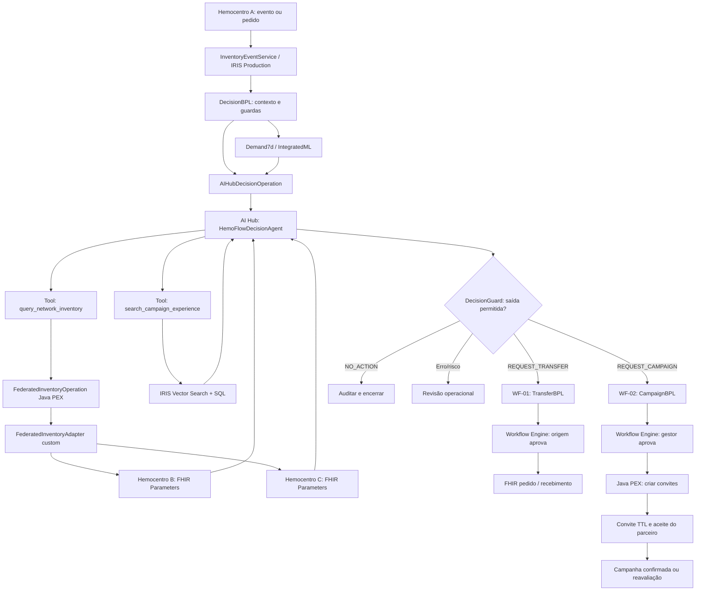

# HemoFlow — SPEC do MVP de orquestração inteligente de hemocomponentes

> **Atualização implementada em 29/10/2026 — UI e seed v2.** Esta atualização prevalece sobre as referências abaixo a interface PT-BR, protótipo local e escopo inicial O−. A aplicação real usa inglês, branco/vermelho (#C8102E), cinco rotas em inglês e 16 gráficos Apache ECharts locais. O estoque federado e os workflows suportam oito grupos ABO/Rh de hemácias, sempre mantendo o grupo solicitado; não há substituição ou compatibilidade transfusional. O seed v2 adiciona dados preservando auditoria e estoques existentes. As features AutoML são derivadas por centro/grupo. Campanhas expõem necessidade, planejamento, aprovações, evidências de similaridade e resultados. Previsões e simulações são separadas de estoque confirmado; fonte indisponível não equivale a zero. Ver [documentação atual da UI](docs/UI.md), [roteiro executável](docs/DEMONSTRATION.md) e [capturas](docs/screenshots/README.md). O restante registra a especificação original e seus invariantes de interoperabilidade.

**Versão:** 5.0 · **Data:** 28/10/2026 · **Status:** especificação proposta, ainda não compilada/testada no IRIS  
**Plataforma-alvo:** InterSystems IRIS for Health AI Hub Community EAP, build `2026.3.0AI.154.0`  
**Padrão de interoperabilidade:** HL7 FHIR R4 (4.0.1) + operação de disponibilidade definida pelo HemoFlow  
**Composição:** uma Production IRIS; dois workflows de negócio; um agente AI Hub; um modelo AutoML; uma coleção Vector Search; PEX Java; Embedded Python; TTL configurável  
**Demonstração inicial:** **concentrado de hemácias O negativo**, em três hemocentros sintéticos independentes.

> **Pergunta norteadora:** Como garantir que a rede tenha o hemocomponente certo, no local certo e no momento certo, sem incentivar coletas desnecessárias nem comprometer a segurança transfusional?

**Interpretação de produto:** o HemoFlow procura **reduzir rupturas de abastecimento e descartes evitáveis por vencimento**, orientando propostas operacionais. Não garante disponibilidade absoluta, não prescreve transfusões e não libera hemocomponentes para uso clínico. Cada instituição aprova e executa os próprios atos.

## 0. Objetivo, evidências e indicadores de sucesso

**Princípio de decisão:** responder a uma necessidade concreta com a menor intervenção segura e necessária, considerando a rede e a validade real do produto. Uma proposta deve demonstrar simultaneamente **necessidade, possibilidade temporal, oportunidade de aproveitamento e responsabilidade institucional**.

| Dimensão da pergunta | Evidência obrigatória | Medida de avaliação na demo |
|---|---|---|
| Hemocomponente **certo** | Mesmo componente e grupo demonstrado; unidades liberadas e transferíveis segundo origem | Quantidade apta ofertada versus quantidade solicitada |
| **Local certo** | Centro de destino com déficit e centro de origem com excedente seguro | Déficit residual estimado por centro após proposta |
| **Momento certo** | Data da necessidade, prazo para transporte/uso e vencimento das unidades | Propostas viáveis dentro da janela temporal |
| **Sem coleta desnecessária** | Antes da campanha: verificar estoque, transferências possíveis e campanhas já confirmadas | Campanhas não abertas quando a rede já cobre a necessidade |
| **Sem desperdício por vencimento** | Faixas de vencimento, demanda de uso no destino e reserva mínima da origem | Unidades com vencimento próximo aproveitáveis, não apenas transferidas |
| **Sem comprometer segurança** | Aprovação humana, confirmação da origem, integridade dos dados, condições logísticas declaradas | Ações indevidas bloqueadas; nenhuma liberação clínica automática |

**KPIs do MVP:** (K1) déficit projetado por grupo/componente/centro nos próximos 7 dias; (K2) unidades com risco de vencimento evitável; (K3) unidades transferidas e efetivamente recebidas/utilizadas na simulação; (K4) campanhas propostas, aprovadas e unidades liberadas após coleta simulada; (K5) erro de previsão MAE versus baseline; (K6) decisões bloqueadas por dados/segurança. Valores só poderão ser apresentados como resultados **sintéticos**, nunca como evidência clínica real.

## 1. Invariantes da aplicação

1. **Estoque federado:** nenhum inventário operacional central de outros hemocentros; cada um responde ao vivo pela quantidade, reservas e validade de seu próprio estoque.
2. **Uma consulta não reserva sangue:** a origem revalida disponibilidade, validade e condições de transporte antes de aprovar fornecimento. Pedido, expedição, recebimento e utilização são eventos distintos.
3. **Três ações de negócio da IA:** `REQUEST_TRANSFER`, `REQUEST_CAMPAIGN`, `NO_ACTION`. Dados faltantes, resposta inválida, prazo inviável ou indisponibilidade crítica produzem **revisão operacional**, não `NO_ACTION`.
4. **Um agente AI Hub nativo dentro da Production:** usa ferramentas de consulta autorizadas; saída tipada é revalidada por código independente antes de qualquer tarefa externa.
5. **Dois workflows principais:** WF-01 redistribuição entre hemocentros; WF-02 campanhas com organizações e doadores opt-in. Eventos, análise, aprovação e auditoria são mecanismos compartilhados.
6. **Somente concentrado de hemácias O negativo na demo inicial:** extensão futura por componente deve usar validade e políticas fornecidas pelo hemocentro, nunca prazos fixos genéricos.
7. **Prazos reais, não apenas quantidade:** candidato a transferência só é válido se a unidade chegar e puder ser utilizada antes do vencimento, sem comprometer a reserva de segurança da origem.
8. **Campanha não resolve urgência imediata:** só recomendar se houver tempo suficiente para organizar, coletar, processar e liberar unidades; interesse de doador não conta como sangue disponível.
9. **Convites pendentes expiram em 24h por padrão, configurável:** somem imediatamente da caixa Pendentes após `expires_at`; decisões e histórico permanecem.
10. **Segurança e privacidade:** nenhum dado pessoal clínico em prompts/embeddings. Nenhuma compatibilidade transfusional, triagem de doador ou liberação de produto é realizada pela IA.
11. **Simplicidade:** uma Production, um agente, um modelo, uma coleção vetorial e cinco telas. Nenhuma tecnologia entra sem participar de pelo menos um teste verificável.

## 2. Requisitos funcionais e critérios mensuráveis

| ID | Requisito do MVP | Evidência objetiva de aceite |
|---|---|---|
| RF-01 | Cadastrar 3 hemocentros e endpoints FHIR de consulta | Identidades, URLs e permissões registradas; B/C independentes |
| RF-02 | Cadastrar parceiros (ONG, empresa, igreja, universidade) e doadores fictícios com opt-in | Parceiros podem responder; contato não consentido é bloqueado |
| RF-03 | Receber evento de estoque/consumo do hemocentro A | Evento identificado gera correlação na Production |
| RF-04 | Consultar estoque de B/C sob demanda | Mudança local em B se reflete sem sincronização central |
| RF-05 | Obter da origem `transferable_units` e faixas de vencimento | Nenhuma unidade bloqueada/reservada contada como transferível |
| RF-06 | Prever consumo em 7 dias com IntegratedML/AutoML | Execução de treino/validação e inferência identificadas |
| RF-07 | Identificar períodos de consumo censurado por falta de estoque | Qualidade do forecast indica `stockout_affected` |
| RF-08 | Avaliar viabilidade temporal de transferência e campanha | Ação atrasada é bloqueada antes de proposta externa |
| RF-09 | AI Hub decidir uma de 3 ações usando dados reais de Tools | `DecisionAudit` registra Tool IDs, evidências e decisão validada |
| RF-10 | Exigir aprovação do fornecedor e revalidação antes de transferir | Estoque mudado durante espera impede execução com quantidade antiga |
| RF-11 | Trocar `SupplyRequest` e `SupplyDelivery` FHIR R4 quando cabível | Recursos validados em R4 e correlacionados com a simulação |
| RF-12 | Recuperar campanhas anteriores com Vector Search nativo | Top-K com IDs, metadados e resultados históricos verificáveis |
| RF-13 | Criar convite de campanha com Java PEX | BO PEX recebe plano aprovado e devolve registro de criação |
| RF-14 | Aprovar/recusar convites institucionais e registrar interesse de doadores autorizados | Estados e responsáveis rastreáveis |
| RF-15 | Expirar convites em 24h configuráveis | `now >= expires_at` remove de Pendentes; aceite devolve 409 |
| RF-16 | Reavaliar uma proposta expirante quando o risco persistir | Evento único de expiração, sem loop de convites |
| RF-17 | Medir riscos antes e depois da ação simulada | KPIs K1–K6 e justificativa exibidos |
| RF-18 | Manter cinco telas operacionais completas | Cadastro, risco, transferências, campanhas e auditoria |
| RF-19 | Instalar via Docker e apresentar Visual Trace completo | Build 154, Production e integração executados na demo |
| RF-20 | Registrar falhas com segurança | `UNAVAILABLE` não vira saldo zero; erro da IA não vira `NO_ACTION` |

## 3. Mapa de todas as tecnologias InterSystems e componentes necessários

**Este mapa é normativo e também existe em `SPEC/MAPA_TECNOLOGIAS.md`.** Os bônus abaixo são apenas potenciais; exigem implementação e prova na Production ou publicação conforme o regulamento.

| Tecnologia | Problema que resolve | WF-01 transferência | WF-02 campanhas | Prova técnica / bônus potencial |
|---|---|---|---|---|
| **IRIS for Health / SQL / `%Persistent`** | Dados de histórico, solicitações, configurações e auditoria | `Transfer` e trilha | `Campaign`, `InvitationLedger` | SQL e persistência verificáveis |
| **IRIS Interoperability (BS/BP/BPL/BO)** | Entrada, roteamento, mensagens, tratamento de erro e observabilidade | Consultar B/C e executar fluxo de fornecimento | Solicitar, aprovar, enviar e receber respostas | Visual Trace dos dois workflows; requisito do concurso |
| **AI Hub / `%AI.Agent` + ToolSet** | Escolher uma das três estratégias com justificativa e evidências | Seleciona origem/quantidade permitida ou não agir | Decide necessidade, parceiro e janela viáveis | Sessão/Tool calls/decisão correlacionadas no workflow; requisito central |
| **IntegratedML + AutoML** | Prever consumo de 7 dias, com qualidade identificada | Detecta déficit futuro de A | Evita campanhas sem necessidade e dimensiona meta | Treino, backtest, modelo e chamada SQL real |
| **IRIS Vector Search** | Recuperar campanhas encerradas semelhantes para orientar parceiros | Não usado para buscar números de estoque | Busca semântica com filtros e resultado medido | SQL `VECTOR_COSINE`, top-K e referências; **+2** |
| **FHIR R4 / IRIS for Health** | Contratos entre organizações sem compartilhar banco | Operação customizada `Parameters` e `SupplyRequest`/`SupplyDelivery` | `Organization` / `Location` para cadastro quando aplicável | Exemplos validados em R4 e duas fontes independentes |
| **Java PEX** | Materializar planos de convites como BO da Production | BO Java para operação de consulta federada | `CampaignCreationOperation` Java PEX | Classes Java registradas e chamadas pela Production; **+3** |
| **Custom Outbound Adapter** | Encapsular protocolo de disponibilidade FHIR dos centros | `FederatedInventoryAdapter` usado pela BO | — | Adapter próprio ativo na Production; **+2** |
| **IRIS Workflow Engine** | Encaminhar aprovações humanas e registrar resposta | Aprovação da origem | Aprovação do hemocentro e aceite institucional | Tarefas reais, recusa, aceite e timeout; **+2** |
| **Embedded Python / PyProd** | Preparação de dados, validações, API e expiração | Orquestra entradas/cálculos determinísticos | Regras, registro de convites, TTL | Código executado dentro IRIS; **+3** |
| **`%Dictionary` + classe-base TTL** | Metadados de classes e política reutilizável de expiração | Contextos técnicos transitórios | Convites de 24h | Duas classes expirando sem apagar auditoria; candidato **DPI-I-393 +4**, sujeito à avaliação |
| **WSGI / Flask** | Painel e APIs enxutas hospedadas no IRIS | Gatilhos e aprovações | Caixa de convites | Interface funcional autenticada |
| **Docker / Compose** | Subir IRIS + dois hemocentros simulados independentes | Demonstra consulta federada real | Executa aplicação | Build e restart com volumes; **+2** |
| **IPM/ZPM** | Instalar o produto reproduzivelmente | Classes/Production | Classes/PEX/arquivos | Pacote instalado e publicado; **+2 se atendidas exigências** |

**Limite:** Java PEX tem duas responsabilidades técnicas pequenas e justificadas. PyProd/Embedded Python não é tratado como bônus Java PEX. AI Hub/AutoML/Vector Search são recursos diferentes; similaridade não significa previsão nem autorização.

## 4. Arquitetura de execução: dado → evidência → decisão → aprovação



O diagrama é **lógico**: ferramentas podem ser chamadas sob demanda na mesma execução do agente, antes da decisão final. A implementação do Tool → Operation deve evitar reentrada bloqueante na mesma fila/pool; reservar caminho de execução independente e tempo-limite. Cada resposta da rede contém timestamp, centro, validade e estado `AVAILABLE`/`UNAVAILABLE`; nenhuma resposta `UNAVAILABLE` pode virar zero.

### 4.1 Responsabilidade pelos dados

| Informação | Fonte da verdade | Persistência no HemoFlow |
|---|---|---|
| Quantidade, reservas, validade e disponibilidade de B/C | Sistema do respectivo hemocentro | **Sem réplica operacional**; apenas resposta técnica transitória e auditoria resumida |
| Consumo histórico agregado e flag de período sem estoque | Centro que fornece dados para treino | Histórico sintético autorizado/agrupado para modelo |
| Centros, endpoints, identidade e parceiros | Administração da rede | Cadastro durável |
| Decisões e provas de aprovação | HemoFlow / participantes | Registros duráveis com referências, versões, timestamps e hash |
| Campanhas, tarefas e convites | HemoFlow | Campanha e ledger duráveis; convite temporário com TTL |
| Movimentações e recebimento | Instituições responsáveis | Pedido, estado, evidência de confirmação e recursos FHIR quando recebidos |

**Observação técnica:** o motor de interoperabilidade pode persistir payloads no Message Trace. "Sem inventário central" significa não manter saldos sincronizados como fonte operacional; usar mensagens compactas e política de retenção proporcional.

## 5. Política operacional de decisão e segurança

### 5.1 Gatilhos de análise

- `INVENTORY_CHANGED`: o centro A comunica evento agregado com `event_id`, centro, componente, grupo, data e mudança operacional.
- `REASSESS_REQUESTED`: gestor pede nova avaliação.
- `INVITATION_EXPIRED`: uma proposta institucional expira e o risco ainda existe.
- `TRANSFER_DECLINED`: a origem recusa ou revalida saldo insuficiente.

A Production deduplica `(source_center_id, event_id)`. Nem toda entrada chama LLM: mudanças que não alteram risco só atualizam o evento e encerram.

### 5.2 Métricas de cálculo, responsabilidade de código determinístico

- `usable_now`: unidades do solicitante **liberadas**, não bloqueadas, não vencidas e não reservadas.
- `forecast_7d`: consumo futuro esperado; manter versão, qualidade, data e origem do cálculo.
- `expected_confirmed_receipts`: entradas comprovadamente previstas para a janela, sem contar convites ou comparecimento hipotético.
- `projected_gap`: `max(0, forecast_7d - usable_now - expected_confirmed_receipts)`, com janelas e vencimentos conciliados; **fórmula simplificada para demo**, não substitui simulação diária por datas de expiração.
- `at_risk_expiration`: unidades que, dadas validade, consumo e reservas, podem não ser usadas a tempo na origem.
- `safe_transferable`: limite informado pela origem depois de sua reserva mínima e unidades indisponíveis.
- `destination_usable_before_expiry`: limite estimado que o destino pode consumir antes do vencimento, após transporte e recebimento.

Para definir a quantidade proposta: `min(projected_gap, safe_transferable, destination_usable_before_expiry)`, sujeita à aprovação e revalidação da origem. Não é permitido pedir unidades com vencimento anterior ao recebimento ou que não possam ser utilizadas na janela. Usar *first-expiring-first-out* como preferência logística **somente entre opções válidas**.

### 5.3 Janela temporal é obrigatória

Uma proposta de transferência deve incluir `need_by`, previsão de disponibilidade na origem, tempo estimado de preparação/transporte, vencimento relevante, e confirmação da capacidade do destino. Uma proposta de campanha deve incluir `expected_collection_date`, `processing_release_lead_time` e `expected_available_at`. Se a campanha ficaria disponível após `need_by`, não pode ser apresentada como solução daquela urgência.

As durações são **declaradas/configuradas nos simuladores e aprovadas pelos centros**, não inferidas pelo LLM. O MVP demonstra **um único hemocomponente/grupo (hemácias O−)** para não reproduzir algoritmos clínicos de compatibilidade.

### 5.4 Estados decisórios

| Resposta do AI Hub | Requisitos mínimos | Destino |
|---|---|---|
| `REQUEST_TRANSFER` | Déficit + saldo remoto transferível + prazo/uso viáveis | WF-01, aprovação da origem |
| `REQUEST_CAMPAIGN` | Demanda futura remanescente, janela de processamento viável, sem ação melhor já confirmada | WF-02, aprovação do centro e convite |
| `NO_ACTION` | Cobertura demonstrável, dados atuais/confiáveis e nenhuma perda evitável relevante na rede consultada | Auditoria e revisão agendada |
| *Falha operacional* | Dados ou confiabilidade insuficientes, nenhum cenário seguro, LLM inválido ou timeout | Revisão humana, sem ação externa |

**Regra:** a IA seleciona somente candidatos produzidos por ferramentas confiáveis e validados após sua saída; não gera uma quantidade ou prazo arbitrário, não consulta centros fora da lista autorizada e não publica convites diretamente.

### 5.5 Segurança assistencial do MVP

O HemoFlow recomenda **coordenação de abastecimento**, não conduta clínica. Qualidade, liberação, transporte, elegibilidade de doadores, compatibilidade transfusional e execução efetiva continuam sob responsabilidade das instituições. A decisão deve ser anulada se a origem não confirmar condição do produto ou disponibilidade no momento do aceite.

## 6. WF-01 — Transferência federada entre hemocentros

**Objetivo:** evitar ruptura em A usando excedente real da rede, sobretudo quando também reduz risco de descarte por vencimento na origem, sem criar falta em B/C.

1. `InventoryEventService` recebe evento de A, autentica, valida e deduplica; `DecisionBPL` registra `correlation_id`.
2. `forecast_demand` devolve previsão `Demand7d` e indicador de confiabilidade; código calcula lacuna com estoque próprio e entradas confirmadas.
3. `HemoFlowDecisionAgent` invoca `query_network_inventory` via Business Operation/Custom Adapter. B/C respondem com quantidade transferível, faixa de validade, data da resposta e capacidade declarada; cada resposta é independente.
4. O sistema calcula candidatos válidos por prazo de transporte, quantidade utilizável no destino antes de expirar e reserva mínima da origem. Candidate IDs são fornecidos ao agente.
5. O agente escolhe `REQUEST_TRANSFER`, `REQUEST_CAMPAIGN` ou `NO_ACTION`; `DecisionGuard` revalida todos os limites e evidências.
6. Quando transferência é escolhida, `TransferBPL` abre aprovação para gestor do centro **fornecedor**. Nenhuma reserva ocorre só pela consulta.
7. Na aprovação, B reavalia seu próprio saldo e validade; confirma/reduz/recusa. Uma mudança invalida a proposta antiga; não reutilizar autorização vencida.
8. Após aceite, gerar `SupplyRequest` FHIR R4 com `itemCodeableConcept`; registrar envio/expedição. Somente após confirmação do recebimento gerar `SupplyDelivery` de entrega comprovada.
9. Atualizar estados de solicitação, provas e KPI projetado. A utilização efetiva é evento posterior informado pelo centro; não equiparar `DELIVERED` a `USED`.

**Estados:** `PROPOSED → PENDING_APPROVAL → APPROVED → REQUESTED → IN_TRANSIT → DELIVERED`; desvios `DECLINED`, `FAILED`, `CANCELLED`. Registrar evidência da origem e timestamp em cada transição.

**Testes de domínio indispensáveis:** (a) B com excedente válido; (b) B altera estoque sem atualizar HemoFlow; (c) unidades de B próximas do vencimento mas destino não consegue usá-las: **bloquear transferência**; (d) B ficaria abaixo de sua reserva: **bloquear**; (e) C indisponível: status `UNAVAILABLE`, nunca estoque zero.

## 7. WF-02 — Campanhas direcionadas, Java PEX e TTL

**Objetivo:** solicitar apenas a captação que pode atender uma falta **futura**, quando a rede não oferece transferência suficiente/viável, e evitar campanhas excessivas.

### 7.1 Destinatários e modalidades

| Modalidade | Destinatários | Aprovação/retorno |
|---|---|---|
| `PARTNER_HOSTED` | ONG, empresa, igreja ou universidade cadastrada | Gestor do hemocentro aprova; parceiro aceita/recusa convite |
| `CENTER_DIRECT` | Contatos de doadores anteriores com opt-in, vinculados ao centro | Gestor aprova; doador marca interesse, sem inferência de aptidão |

### 7.2 Sequência operacional

1. `CampaignBPL` recebe solicitação manual ou decisão de necessidade residual. Calcular déficit com o `Demand7d`; deduzir estoques utilizáveis, recebimentos confirmados e campanhas **já confirmadas**, sem contabilizar intenções como unidades prontas.
2. `search_campaign_experience` recupera até 5 campanhas encerradas semelhantes por IRIS Vector Search, com filtros de região, tipo de parceiro e período. Expor resultados objetivos (`attended`, `collected`, `released_usable`, `used_before_expiry`) ao AI Hub.
3. Avaliar tempo de organização + coleta + processamento/liberação. A campanha precisa produzir unidades utilizáveis **antes de `need_by`**. O cálculo da meta é uma **estimativa**, nunca promessa de bolsas aptas.
4. O agente recomenda `REQUEST_CAMPAIGN`, candidato a parceiro e janela, ou decide não agir/transferir; validar no `DecisionGuard` antes de iniciar convite.
5. Workflow Engine registra autorização humana do gestor. `CampaignCreationOperation` em **Java PEX** recebe o plano aprovado e cria envelopes tipados de convites, sem tomar decisão clínica ou acessar base de doadores livremente.
6. `InvitationService` publica convites na caixa de entrada e grava `expires_at = published_at + ttl_hours` com padrão **24h**, configurável **1–168h**.
7. O parceiro responde `ACCEPT` ou `DECLINE`. Aceite em prazo confirma a colaboração e agenda a campanha. No fluxo direto, contatos autorizados respondem `INTERESTED` ou `DECLINED`; interesse **não** significa triagem aprovada nem estoque disponível.
8. `now >= expires_at` remove convite de **Pendentes imediatamente**, mesmo sem job de limpeza. Aceite tardio retorna HTTP `409 INVITATION_EXPIRED`.
9. `ExpirationTask` registra `EXPIRED`, cancela a tarefa correspondente e remove payload transitório; `InvitationLedger` e `DecisionAudit` permanecem. Expiração institucional pode gerar **uma** reavaliação por evento; nunca acionar LLM para cada doador.
10. Ao finalizar campanha simulada, gravar convidados, presentes, doações coletadas, unidades liberadas e unidades realmente utilizadas. Só campanhas encerradas alimentam `CampaignExperience`.

### 7.3 Framework TTL reutilizável (DPI-I-393)

Contrato conceitual da classe-base, sujeito a compilação no build:

```objectscript
Class HemoFlow.TTL.Expirable Extends %Persistent [ Abstract ]
{
    Parameter TTLSECONDS = 86400;
    Property CreatedAt As %TimeStamp;
    Property ExpiresAt As %TimeStamp;
    Index ExpiryIndex On ExpiresAt;
}
```

`PendingInvitation` e `DecisionContext` derivam de `Expirable`. O parâmetro não elimina dados automaticamente: serviço de domínio calcula a data; task periódica marca expiração, emite evento e expurga payload sem tocar em auditoria. Configuração aplicada **na publicação** do convite; mudanças futuras de TTL não modificam prazos de convites já criados. Datas em UTC; aceite e expiração usam validação concorrente/atômica.

### 7.4 Regras de segurança de campanhas

- Nenhuma campanha é tratada como sangue disponível até processamento e liberação simulados.
- Nenhum contato sem opt-in recebe convite. O LLM recebe apenas IDs autorizados e dados agregados.
- Não programar campanha que resulta tarde demais para a necessidade-alvo; a interface deve informar "revisão operacional" em vez de solução fictícia.
- Campanha aprovada não expira por TTL de convite. Histórico é durável.

## 8. FHIR R4 — perfis e operação federada

### 8.1 Recursos usados

| Recurso R4 | Utilização | Cuidados |
|---|---|---|
| `Organization` | Identificação do hemocentro/organização parceira | Registrar identificador estável, sem presumir interoperabilidade de contas |
| `Location` | Localização do centro e endereço de coleta | Usar códigos/endereços verificáveis na demo |
| `Parameters` | Input/output da operação customizada `$inventory-availability` | **Contrato HemoFlow**, não endpoint standard de estoque da HL7 |
| `OperationDefinition` | Define formalmente a operação própria `$inventory-availability` | Publicar e versionar contrato; testar com simuladores |
| `SupplyRequest` | Registra pedido de fornecimento de um hemocomponente | Em R4 usar `itemCodeableConcept`; não referenciar diretamente `BiologicallyDerivedProduct` em `itemReference` |
| `SupplyDelivery` | Registra entrega confirmada do pedido | Não usar como prova de entrega antes de confirmação externa |
| `BiologicallyDerivedProduct` | Representar produto sanguíneo individual quando a origem o fornecer | Fica preferencialmente no sistema da origem; não é base central de inventário |

### 8.2 Operação de disponibilidade da rede

- URI lógica: `POST [center.fhirBase]/$inventory-availability`, com FHIR `Parameters` de entrada; código/OperationDefinition do HemoFlow, e não uma operação padrão HL7.
- Parâmetros de entrada: `requestingCenterId`, `componentCode`, `bloodType`, `horizonDays`, `needBy`.
- Resposta: `centerId`, `componentCode`, `bloodType`, `availableUnits`, `transferableUnits`, `observedAt`, `expiryBucket` (0..N, `daysUntilExpiry`/`units`), `dataVersion`, `responseStatus` e `handlingLeadTimeHours` declarado pela origem.
- Quantidades são inteiras não negativas; `transferableUnits <= availableUnits`. A origem calcula margem mínima e descarta bloqueadas/expiradas; ausência de dado = erro, não zero.
- O adapter rejeita tipos incorretos, dados vencidos, IDs desconhecidos, comunicação sem TLS fora da demo e `Parameters` com valores inconsistentes. Limitar centros, tempo total e tamanho das respostas.
- Simuladores B e C mantêm **dados separados** (JSON local, sem tabela central). A operação deve devolver dados recém-lidos em cada requisição.

### 8.3 FHIR: responsabilidades clínicas

O HemoFlow registra **pedido e confirmação de logística**, não liberação clínica de bolsas. Os centros participantes respondem pela compatibilidade transfusional, qualidade, preparo, armazenamento e transporte de seus estoques. Recursos FHIR e perfis de demonstração precisam ser validados com validador R4 antes da publicação.

## 9. Contratos de aprendizado de máquina e busca vetorial

### 9.1 IntegratedML + AutoML — `Demand7d`

**Problema:** estimar a quantidade de unidades de hemácias O− demandadas nos sete dias seguintes no hemocentro A.

- **Dataset de treino:** `ConsumptionDaily(center_id, date, component_code, blood_type, used_units, demand_unmet_flag, data_quality)` com consumo agregado sintético; **não** sincroniza estoque atual B/C.
- **Features disponíveis no instante T:** consumos anteriores 7 e 28 dias, dia/semana/mês, centro, grupo e componente; sem atributos futuros.
- **Label:** soma de consumo/necessidade observada T+1 a T+7, distinguindo dias com falta de estoque. Quando consumo foi limitado por indisponibilidade, marcar `stockout_affected` e não apresentar essa observação como demanda total conhecida.
- **Experimento:** split cronológico treino/validação, baseline de média móvel, avaliação MAE e cortes por grupo; registrar versão do dataset/modelo. Com dados sintéticos, não declarar predição clinicamente validada.
- **Implementação:** `CREATE MODEL`, `TRAIN MODEL`, `VALIDATE MODEL` e inferência SQL pelo provider suportado no build. Treino fora do caminho síncrono BPL; nenhum número de acurácia sem execução.
- **Tool:** `forecast_demand(...) → {expected_units, forecast_as_of, horizon_days, model_version, method, quality_flags}`. Se ML indisponível, baseline **identificada como tal**; qualidade insuficiente bloqueia `NO_ACTION` automático e remete à revisão.

### 9.2 Vector Search — `CampaignExperience`

- **Corpus:** campanhas sintéticas encerradas com `campaign_id`, `partner_id`, `partner_type`, `region`, `period`, `summary_text`, `invited`, `attended`, `collected`, `released_usable`, `used_before_expiry` e metadados de origem.
- **Embeddings:** um modelo e dimensão fixa, versão/hash armazenados em `VECTOR(DOUBLE, n)` conforme suporte validado. Geração pelo Embedded Python sem dados pessoais.
- **Pesquisa:** filtros SQL por local/período/tipo + `TOP K` e `VECTOR_COSINE` em ordem decrescente. Dataset pequeno: busca exata suficiente; não presumir índices HNSW necessários.
- **Tool:** `search_campaign_experience(context, region, partner_type, top_k=5)` devolve IDs, contexto e medidas reais da simulação.
- **Limite interpretativo:** similaridade semântica **não é** chance de sucesso. A IA usa o conjunto recuperado para **justificar a escolha de parceiro**, enquanto o código verifica capacidade, tempo e objetivos.

### 9.3 Catálogo mínimo de ferramentas de leitura do AI Hub

| Tool | Entrada | Retorno | Origem |
|---|---|---|---|
| `forecast_demand` | centro/componente/grupo/horizonte | valor + qualidade + versão | IntegratedML |
| `query_network_inventory` | centro solicitante/componente/grupo/centros permitidos | disponibilidade, validade, origem e timestamps | Java PEX Adapter + Interoperability |
| `search_campaign_experience` | contexto/filtros/top-K | exemplos com IDs e resultados | Vector Search |
| `list_campaign_partners` | região/tipo/centro | IDs válidos, capacidade e janela | SQL |
| `get_active_campaigns` | centro/componente/grupo | campanhas já confirmadas, datas e metas estimadas | SQL |

Todas as Tools são read-only, tipadas, autorizadas no servidor e com timeouts. Não há Tool que transfira estoque ou envie convite diretamente. A camada de aplicação converte as respostas em candidatos fechados e o `DecisionGuard` verifica a saída final.

## 10. Contratos de decisão e estados

O agente sempre retorna:

```json
{
  "schema_version": "1.0",
  "request_id": "REQ-007",
  "decision": "REQUEST_TRANSFER",
  "reason": "Shortage predicted; viable near-expiry surplus at HEMO-B",
  "evidence_ids": ["FCST-007", "AVAIL-B-007"],
  "source_center_id": "HEMO-B",
  "target_center_id": "HEMO-A",
  "component": "RED_BLOOD_CELLS",
  "blood_type": "O-",
  "requested_units": 10,
  "need_by": "2026-10-31T12:00:00Z",
  "inventory_observed_at": "2026-10-28T18:00:00Z",
  "requires_approval": true
}
```

`REQUEST_CAMPAIGN` utiliza `requesting_center_id`, `partner_id`, `target_units`, `campaign_window_start/end`. `NO_ACTION` não possui campos de transferência/campanha e exige motivo, referências de evidência e cobertura válida. `REQUEST_TRANSFER` deve referenciar candidato autorizado e janela viável; `REQUEST_CAMPAIGN` deve referenciar janela de disponibilidade posterior ao processamento e anterior à necessidade. Falhas técnicas são estados do workflow, não valores do enum de decisão. O JSON Schema completo discrimina campos obrigatórios por ação em `schemas/decision.schema.json`.

**Estados relevantes:**

- `Transfer`: `PROPOSED`, `PENDING_SOURCE_APPROVAL`, `APPROVED`, `REQUESTED`, `IN_TRANSIT`, `DELIVERED`, `DECLINED`, `FAILED`.
- `Campaign`: `PROPOSED`, `PENDING_CENTER_APPROVAL`, `AWAITING_PARTNER`, `CONFIRMED`, `CANCELLED`, `COMPLETED`.
- `InvitationLedger`: `PENDING`, `ACCEPTED`, `DECLINED`, `INTERESTED`, `EXPIRED`.
- `DecisionAudit`: `DECIDED`, `INVALID_OUTPUT`, `ESCALATED`, `EXECUTED`.

Os eventos têm `correlation_id`, `event_id`, `created_at_utc`, `actor_id`/`source_id`, `schema_version`, estado anterior/novo e chave idempotente.

## 11. Modelo de dados mínimo — sem inventário central

| Entidade | Atributos necessários | Por que existe |
|---|---|---|
| `NetworkCenter` | ID, nome, endereço/region, endpoint FHIR, credencial por referência, transporte viável declarado | Descoberta e autorização de centros |
| `Partner` | ID, tipo, região, responsável e capacidade declarada | Seleção de parceiros |
| `DonorContact` | ID fictício, centro de referência, opt-in, canal | Convites autorizados; acesso restrito |
| `ConsumptionDaily` | centro, data, hemocomponente, grupo, utilizado, `demand_unmet_flag`, qualidade | Treino e avaliação de demanda |
| `CampaignExperience` | histórico agregado, resultados, `VECTOR`, versão de embedding | Busca semântica contextual |
| `Transfer` | centro origem/destino, unidades solicitadas/confirmadas, status, `need_by`, FHIR refs | Workflow 1 |
| `Campaign` | centro, parceiro, janela, objetivo, datas de disponibilidade e resultados | Workflow 2 e medida de utilidade |
| `InvitationLedger` | ID, destino, publish/expiry, estado e tarefa | Auditoria durável, não expira |
| `PendingInvitation` | payload curto do convite, `CreatedAt`, `ExpiresAt` | Convite com TTL |
| `DecisionContext` | contexto temporário mínimo e referências | TTL genérico |
| `DecisionAudit` / `EventAudit` | correlação, decisão, evidence IDs, status, revisores e tempos | Rastreabilidade |
| `SystemConfig` | TTL 24h, políticas temporais e configurações de integração | Configuração transparente |

**Nenhuma tabela `BloodUnit` global.** Eventos e respostas da rede não atualizam inventário central. Aplicar índices de expiração aos transitórios; chaves de idempotência e correlação aos comandos; `CampaignExperience` usa índice/consulta vetorial conforme versão.

## 12. Mapa de telas — aplicação mínima completa

| Tela | Quem opera | Ações | Critério de completude |
|---|---|---|---|
| **01 Rede** | Admin | Cadastrar hemocentros, endpoints, parceiros, estado de integração | A consulta de B/C usa endpoints realmente cadastrados |
| **02 Painel de abastecimento** | Gestor A | Enviar evento, ver cobertura projetada e riscos, acionar AI Hub e ver justificativa | Mostra prazo, déficit previsto, risco de vencimento e decisão |
| **03 Transferências** | Gestor A/B | Ver candidato, aprovar/recusar, revalidar origem, acompanhar expedição/recebimento | Pedido nunca aparece como recebido sem confirmação |
| **04 Campanhas e convites** | Gestor, parceiro e doador de demonstração | Criar proposta, autorizar, aceitar/recusar, acompanhar TTL, registrar resultado agregado | Convite some de Pendentes em 24h; histórico preservado |
| **05 Auditoria e configuração** | Admin/auditor | Inspecionar correlation IDs, ações, erros, KPIs e TTL | Mostra decisões e dados/validações que as sustentam |

Web simples servida por Flask/WSGI no IRIS, sem frontend SPA. A UI deve distinguir **previsão**, **convite aceito**, **sangue coletado**, **unidade liberada**, **transferência entregue** e **unidade utilizada**.

## 13. Produção, Java e boundaries

### 13.1 Hosts da Production propostos

| Host lógico | Tipo | Responsabilidade |
|---|---|---|
| `InventoryEventService` | PyProd Business Service | Receber evento validado/autenticado e iniciar análise |
| `DecisionBPL` | Business Process BPL | Orquestrar previsão/AI Hub, validar decisão e rotear |
| `AIHubDecisionOperation` | Business Operation com bridge mínima ao SDK AI Hub | Executar Agent/ToolSet e retornar JSON tipado |
| `FederatedInventoryOperation` | Java PEX Business Operation | Agregar consultas por centro e resultado tipado |
| `FederatedInventoryAdapter` | **Java PEX Custom Outbound Adapter** | HTTP FHIR `Parameters`, timeout e normalização |
| `TransferBPL` | Business Process BPL | Aprovação de origem, pedido/entrega FHIR e auditoria |
| `CampaignBPL` | Business Process BPL | Contexto vetorial, autorização, Java PEX e resposta de convites |
| `CampaignCreationOperation` | **Java PEX Business Operation** | Criar plano de convites já autorizados, sem selecionar estratégia nem contar campanhas como estoque |
| `FHIRTransferOperation` | PyProd/host interoperável | Emissão e confirmação de `SupplyRequest`/`SupplyDelivery` |
| `WorkflowApprovalOperation` | Host de integração Workflow | Tarefas humanas para centro/parceiro |
| `AuditOperation` | PyProd Business Operation | Persistir trilha durável e IDs de correlação |

Hosts são **nomes propostos do produto**, não classes nativas prontas. Confirmar assinaturas de `Ens.*`, `%AI.*`, PyProd e Java PEX no build 154. A Tool de consulta não deve reentrar no mesmo BP com pool de jobs saturado: projetar host de inventário com capacidade isolada e timeout total, testar ausência de deadlock.

### 13.2 Java PEX e adaptador

- `com.hemoflow.pex.CampaignCreationOperation` deriva de `com.intersystems.enslib.pex.BusinessOperation`; recebe plano aprovado e retorna mensagens de convites tipadas.
- `com.hemoflow.pex.FederatedInventoryOperation` deriva de `com.intersystems.enslib.pex.BusinessOperation`; consulta centros selecionados.
- `com.hemoflow.pex.FederatedInventoryAdapter` deriva de `com.intersystems.enslib.pex.OutboundAdapter`; encapsula o contrato HTTP/FHIR e a validação externa, podendo ser reutilizado.
- Registrar os componentes PEX e configurar gateway Java/classpath de acordo com o build. Sem assumir `OnMessage`/registro/classpath verificados em runtime até executar smoke tests.

### 13.3 Workflow Engine

Usar a infraestrutura nativa de tarefas para (a) responsável do hemocentro de origem aceitar/recusar transferência; (b) gestor autorizar campanha; (c) parceiro responsável aceitar/recusar campanha. Configurar prazo do aceite de parceiro de acordo com o convite. Ao expirar, a aplicação torna o aceite inelegível **antes** do agendador e emite cancelamento da task conforme capacidade real do build.

## 14. Segurança, resiliência e observabilidade

1. **Autorização:** contas e escopos por hemocentro/parceiro; gestores só aprovam tarefas de sua instituição. Identidades informadas em payload são verificadas no servidor.
2. **Dados clínicos e pessoais:** prompts e embeddings recebem apenas agregados/IDs pseudônimos; contato e opt-in ficam no serviço autorizado. Segredos ficam fora de Git e logs.
3. **Consulta federada:** somente centros cadastrados, payload compactado, no máximo três centros no demo, TLS quando aplicável, timeout individual e agregado; resposta `UNAVAILABLE` nunca substituída por zero.
4. **Concorrência:** alterar saldo após consulta invalida a quantidade; origem verifica idempotency key e disponibilidade no aceite. Nenhuma transação distribuída é presumida.
5. **Viabilidade temporal:** calcular datas com UTC; nenhuma transferência com vencimento antes de potencial utilização; nenhuma campanha considerada solução anterior à liberação simulada.
6. **LLM e dados externos:** respostas FHIR, descrições vetoriais e mensagens são entradas não confiáveis; whitelist de Tools, timeout e validação JSON/IDs/capacidades.
7. **TTL:** rejeitar aceite se `now >= expires_at`; task só confirma evento/limpa. Corrida entre aceite e expiração é serializada; não publicar convite duplicado.
8. **Auditoria:** `correlation_id` une entrada, mensagens BPL, tools, sessão AI Hub, decisão, aprovação, operação e FHIR. Tool calls não aparecem automaticamente em Visual Trace; registrar explicitamente.
9. **Falhas:** insuficiência de dados, modelo mal treinado, erro da IA, atraso de transporte ou aprovação faltante resultam em **revisão operacional**, não `NO_ACTION` nem campanha fictícia.
10. **Natureza do produto:** coordenação administrativa de abastecimento. Liberar unidade, determinar compatibilidade e avaliar aptidão do doador permanecem exclusivamente nos sistemas responsáveis.

## 15. Dados e roteiro de demonstração sintéticos

**Ambiente:** A é o centro solicitante; B e C são simuladores com dados próprios (por exemplo, arquivos SQLite independentes) acessíveis por endpoints FHIR customizados. Nunca atualizar B/C pelo banco IRIS da aplicação. Demanda e entradas são sintéticas, mas devem respeitar cronologia.

| Caso | Situação de entrada | Decisão e resultado esperados |
|---|---|---|
| **D1 — Transferir e aproveitar** | A tem 8 hemácias O− utilizáveis; demanda estimada de 24/7d; B possui 12 transferíveis com prazo suficiente para A usar | `REQUEST_TRANSFER`, aprovação de B, entrega, possibilidade de reduzir déficit e risco de vencimento |
| **D2 — Campanha futura** | A precisa de unidades em janela futura; B/C sem excedente; parceiro disponível, coleta + processamento cabem no prazo | `REQUEST_CAMPAIGN`, Vector Search, Java PEX, convite com TTL, aceite e resultado registrado |
| **D3 — Não agir** | A possui cobertura suficiente e validade compatível; nenhuma perda evitável relevante verificada no escopo consultado | `NO_ACTION` documentado; nenhuma campanha |
| **D4 — Validade inviável** | B tem excedente, mas a validade restante não permite entrega e utilização em A | Transferência rejeitada; investigar outra alternativa ou revisão |
| **D5 — Campanha tardia** | Faltará sangue amanhã; coleta+liberação levariam vários dias | Não apresentar campanha como solução dessa necessidade; revisão urgente |
| **D6 — Estoque remoto mudou** | B devolve 12 unidades na primeira consulta e zero na segunda | Segunda avaliação respeita B=0, sem estoque central desatualizado |
| **D7 — Evento incompleto** | B timeout e demais dados insuficientes | Revisão humana; não afirmar que B tem zero nem emitir `NO_ACTION` |

**Dados históricos:** série determinística de consumo agregado com marcação de escassez em alguns dias, e 12–40 campanhas encerradas com métricas realistas da simulação. Dados não geram afirmações de eficácia clínica.

**Demonstração temporal:** relógio injetável apenas nos testes de TTL permite verificar `expires_at` e HTTP 409 sem esperar um dia real; no runtime, usar relógio UTC do servidor.

## 16. Critérios de aceite e testes de ponta a ponta

| ID | Prova executável | Aceite |
|---|---|---|
| T01 | Alterar saldo de B diretamente no simulador | A próxima consulta vê o novo saldo sem sincronização central |
| T02 | B responde, C retorna timeout | C `UNAVAILABLE`; sistema não usa estoque zero inventado |
| T03 | Rodar treino/validação IntegratedML | Modelo, run e MAE identificados; baseline comparado |
| T04 | Injetar período sem estoque no histórico | Forecast marca qualidade/viés potencial, não trata consumo censurado como demanda atendida |
| T05 | Buscar campanhas por Vector SQL | Top-K e IDs/resultados reproduzíveis |
| T06 | Executar evento no IRIS | Business Service → processo → AI Hub real → decisão validada visíveis |
| T07 | IA propõe origem/quantidade fora dos candidatos | DecisionGuard bloqueia |
| T08 | Solicitar transferência viável B→A | Workflow de aprovação, `SupplyRequest` e estados rastreáveis |
| T09 | Retirar saldo da origem antes de aprovar | Revalidação rejeita a quantidade anterior |
| T10 | Ofertar unidade que vencerá antes de utilização viável | Guard rejeita transferência |
| T11 | Confirmar entrega, mas não uso | `DELIVERED` não é contabilizado como `USED` |
| T12 | Solicitar campanha com prazo insuficiente | Não tratar campanha como cobertura da demanda imediata |
| T13 | Confirmar campanhas existentes suficientes | Bloquear convite duplicado/desnecessário |
| T14 | Java PEX `CampaignCreationOperation` | BO real chamado pela Production; convites idempotentes |
| T15 | Custom Adapter PEX consultando B | Adaptador real registrado e usado na Production |
| T16 | Workflow humano | Aprovação/recusa vinculada a usuário autorizado |
| T17 | Aceitar convite no prazo | Campanha fica `CONFIRMED`; log durável |
| T18 | Expirar convite em 24h e tentar aceitar | Sai de Pendentes, retorna 409, ledger `EXPIRED` |
| T19 | Testar TTL em `DecisionContext` | Expurgo genérico funciona sem excluir auditoria |
| T20 | Expirar proposta institucional e reavaliar | No máximo uma reanálise por evento |
| T21 | Doador sem opt-in | Nenhum convite/contacto emitido |
| T22 | Validar exemplos FHIR R4 | `Parameters`, `SupplyRequest`, `SupplyDelivery` validáveis |
| T23 | Produzir `NO_ACTION` em cobertura adequada | Nenhuma operação externa iniciada |
| T24 | Simular falha do provider AI Hub | Revisão humana; nenhum falso `NO_ACTION` |
| T25 | Reiniciar Docker/Production | Dados e audit trail persistem, serviços voltam |
| T26 | Instalar IPM em imagem limpa da mesma versão | Classes/scripts instalados, PEX e config documentados |
| T27 | Acessar convite de outra organização | 403, sem dados revelados |
| T28 | Comparar cenários com e sem intervenção | Mostrar K1–K6 e diferenciar hipótese/simulação de ganho real |

**Pronto para demo de produto** quando T01–T08, T10, T12, T14, T16–T18, T22–T25 e T28 estiverem comprovados, com ambos os workflows encerrando um cenário. **Pronto para submissão completa** somente quando todos os testes relevantes e os artefatos de instalação/documentação passarem. Não declarar bônus tecnológico sem prova real.

## 17. Estrutura de arquivos, implementação e definição de pronto

Arquivos abaixo são **artefatos a desenvolver**, não implementação já existente. Comentários `#` indicam função do arquivo.

```text
hemoflow/
├── SPEC.md                                  # Contrato principal de produto, arquitetura e aceite
├── README.md                                # Instalação e demo, em inglês
├── Dockerfile                               # Imagem IRIS for Health EAP 154 com dependências verificadas
├── compose.yaml                             # IRIS + dois centros simulados independentes, com volumes
├── .env.example                             # Nomes de variáveis sem credenciais
├── module.xml                               # Empacotamento IPM/ZPM para o mesmo build-alvo
├── iris/
│   ├── bootstrap.script                     # Namespace, roles, importação e Production idempotentes
│   └── HemoFlow/
│       ├── Production.cls                   # Declaração dos hosts da Production
│       ├── DecisionBPL.cls                  # Orquestra ferramentas/AI Hub e encaminha decisão
│       ├── TransferBPL.cls                  # Aprovação e ciclo de transferência
│       ├── CampaignBPL.cls                  # Aprovação, convites e aceites de campanha
│       ├── DecisionAgent.cls                # `%AI.Agent` nativo e Provider configurado
│       ├── DecisionTools.cls                # `%AI.ToolSet` com ferramentas read-only
│       ├── AIHubDecisionOperation.cls       # Ponte pequena com SDK AI Hub real do build
│       ├── Expirable.cls                    # `%Persistent`, TTLSECONDS, ExpiresAt e índice
│       ├── PendingInvitation.cls            # Convites temporários
│       ├── DecisionContext.cls              # Contextos transitórios
│       └── ExpirationTask.cls               # Agendamento de expiração e eventos
├── python/hemoflow/
│   ├── hosts.py                             # BS/BO PyProd necessários à Production
│   ├── service.py                           # Cálculo de déficit, qualidade e candidatos válidos
│   ├── repository.py                        # SQL IRIS parametrizado
│   ├── intelligence.py                      # IntegratedML/Vector e contexto por Tool
│   ├── fhir.py                              # Contratos de entrada/saída FHIR R4
│   ├── ttl.py                               # Expiração concorrente, ledger e expurgo
│   └── web.py                               # Flask WSGI, endpoints e cinco telas
├── java/pex/src/main/java/com/hemoflow/
│   ├── CampaignCreationOperation.java       # BO PEX cria envelopes de convites aprovados
│   ├── FederatedInventoryOperation.java     # BO PEX consulta parceiros da rede
│   └── FederatedInventoryAdapter.java       # Custom Outbound Adapter FHIR para centros
├── simulators/
│   ├── center_b.py                          # Endpoint FHIR B + estoque próprio isolado
│   └── center_c.py                          # Endpoint FHIR C + estoque próprio isolado
├── web/templates/                           # Cinco telas SSR e caixas de entrada
├── schemas/decision.schema.json             # Validação de decisão por ação
├── fixtures/                                # Eventos e respostas sintéticas testáveis
├── agents/                                  # Sete especialistas de desenvolvimento fornecidos
└── tests/                                   # Testes unitários, FHIR, BPL, PEX e ponta a ponta
```

### 17.1 Ordem de construção por fatia vertical

1. **Ambiente e contratos:** build 154, namespace, SDK `%AI.*`, PEX Java, Embedded Python/PyProd, FHIR R4, Workflow e segurança. Compilar Production mínima e subir simuladores B/C.
2. **Consulta federada:** enviar evento de A, buscar B/C pelo Custom Adapter Java PEX, comprovar T01/T02 e auditoria sem réplica de saldos.
3. **Predição e agente:** treinar/validar `Demand7d`, conectar Tools, executar AI Hub de verdade, validar as três ações no `DecisionGuard`.
4. **WF-01 completo:** implementar autorização da origem, revalidação, pedido FHIR e recebimento, incluindo cenários de validade inviável.
5. **WF-02 completo:** implementar coleção Vector, Java PEX de convites, aprovação, TTL 24h, aceite e indicadores de campanha.
6. **Entrega:** fechar cinco telas, testes, Docker com persistência, manifesto IPM, README e demonstração.

### 17.2 Critério de conclusão

A aplicação só pode ser descrita como **funcional** quando os dois workflows terminarem em resultados rastreáveis no IRIS, a IA realmente utilizar evidências dos Tools e o sistema impedir uma transferência temporalmente inviável e uma campanha tardia/desnecessária. A demo deve apresentar também um `NO_ACTION` legítimo e um evento de convite expirado.

**Sem over-engineering:** não criar mais modelos, agentes de runtime, frontends, serviços independentes, protocolos ou classes apenas para sofisticar a apresentação. A complexidade técnica deve comprovar a pergunta norteadora.

## 18. Mapa de uso dos sete agentes de engenharia anexados

Os especialistas em `agents/` são **referências de implementação/revisão**, não sete instâncias de LLM no runtime. Cada um deve atuar onde sua especialidade altera a qualidade ou a segurança do produto.

| Agente especialista | Parte sob responsabilidade técnica | Entrega/validação |
|---|---|---|
| `IA_HUB.agent.md` | Agente nativo, ToolSets, Provider, contexto, schema e limites | Tool invocada, decisão tipada, custos e timeout |
| `iInteroperability.agent.md` | BS/BP/BPL/BO, dois workflows, correlação e aprovação | Visual Trace, filas, retries e estados corretos |
| `iEmbeddedPython.agent.md` | PyProd, Embedded Python, WSGI, regras operacionais e TTL | Código executado dentro do IRIS e APIs funcionais |
| `iris.IntegratedML-AutoML.agent.md` | Dataset, vazamento temporal, stockout flag, modelo e backtest | `Demand7d`, MAE e metadados do modelo |
| `iris.VectorSearch.agent.md` | Embeddings, coluna VECTOR, filtros SQL e top-K | Casos de campanhas encontrados e medidos |
| `iris.Dictionary.agent.md` | Inspeção real de classes, TTL, índices, herança e APIs da versão | Metadados e classes compiladas no build |
| `docker.iris.agent.md` | Docker/Compose, Java Gateway/PEX, bootstrap, IPM e segurança | Build repetível e pacote instalável |

**Regra de trabalho:** revisar APIs e métodos no SDK/Class Reference da imagem instalada antes de gerar código; nenhum exemplo ilustrativo é considerado compilado ou executado sem prova.

## 19. Referências técnicas do projeto

- [InterSystems — Concurso AI Agents in Interoperability Workflows](https://community.intersystems.com/post/intersystems-programming-contest-ai-agents-interoperability-workflows)
- [InterSystems — Technology Bonuses 2026](https://community.intersystems.com/post/technology-bonuses-intersystems-programming-contest-ai-agents-interoperability-workflows)
- [AI Hub EAP e SDK](https://github.com/intersystems-community/ai-hub-eap)
- [InterSystems IRIS — Java PEX](https://docs.intersystems.com/irislatest/csp/docbook/DocBook.UI.Page.cls?KEY=EPEX)
- [InterSystems — Embedded Python](https://docs.intersystems.com/irislatest/csp/docbook/DocBook.UI.Page.cls?KEY=GEPYTHON)
- [InterSystems — Python Productions / PyProd](https://docs.intersystems.com/irislatest/csp/docbook/DocBook.UI.Page.cls?KEY=APYPROD)
- [FHIR R4 — OperationDefinition](https://hl7.org/fhir/R4/operationdefinition.html)
- [FHIR R4 — Parameters](https://hl7.org/fhir/R4/parameters.html)
- [FHIR R4 — SupplyRequest](https://hl7.org/fhir/R4/supplyrequest.html)
- [FHIR R4 — SupplyDelivery](https://hl7.org/fhir/R4/supplydelivery.html)
- [FHIR R4 — BiologicallyDerivedProduct](https://hl7.org/fhir/R4/biologicallyderivedproduct.html)
- [InterSystems Ideas — DPI-I-393](https://ideas.intersystems.com/ideas/DPI-I-393)

**Compatibilidade:** APIs, métodos, settings, modelo de PEX Gateway, engine de Workflow e recursos de AI Hub EAP dependem do build instalado e devem ser comprovados. Os nomes `HemoFlow.*` e contratos de Tools descritos são **propostas da aplicação**, não APIs nativas da InterSystems. O pacote contém especificação e exemplos, não uma aplicação já implementada.

