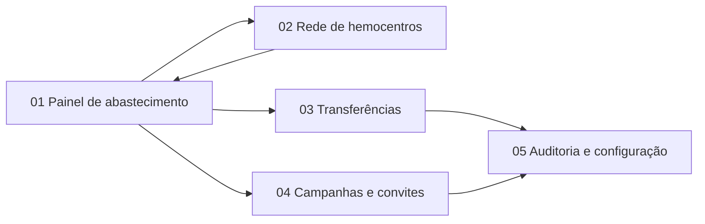

# HemoFlow — telas, jornadas UX e roteiro de apresentação

> **Referência histórica do protótipo.** A implementação de 29/10/2026 substitui a identidade, idioma, URLs e escopo inicial descritos abaixo. O roteiro atual está em [DEMONSTRATION.md](../docs/DEMONSTRATION.md), a organização das cinco telas em [UI.md](../docs/UI.md) e as evidências visuais em [screenshots](../docs/screenshots/README.md). `index.html` agora redireciona à aplicação IRIS real. O design atual é branco/vermelho, em inglês, com oito grupos ABO/Rh e 16 gráficos ECharts; não há mais demonstração funcional independente neste HTML.

**Versão:** MVP v5.1 · **Fonte normativa:** `../SPEC.md` · **Guia técnico:** `../GUIA_IMPLEMENTACAO.md`  
**Entrada da aplicação real:** [`index.html`](./index.html). Exige os containers locais ativos e autenticação.

## 1. Princípio de experiência

A interface deve responder sempre à pergunta: **“Há disponibilidade do hemocomponente correto, onde e quando será necessário, sem coleta desnecessária ou perda evitável por vencimento?”**

A navegação precisa mostrar claramente **o que é previsto**, **o que foi consultado**, **o que foi proposto**, **o que foi aprovado**, **o que foi entregue** e **o que foi utilizado**. Nunca transformar `INTERESTED` em doador apto, `CONFIRMED` em bolsas liberadas ou `DELIVERED` em `USED`.

**Estilo visual:** clínica-operacional, profissional, alto contraste, branco + azul petróleo + verde-água, alertas âmbar/vermelho apenas em situações reais de atenção. UI SSR responsiva e sem SPA. Idioma PT-BR; nomes de ações/schemas preservados em inglês.

## 2. Mapa de navegação e responsabilidades



| Tela | Perfil principal | Entrada de dados | Ações efetivas da aplicação futura | Resultado visível |
|---|---|---|---|---|
| **01 Painel de abastecimento** | Gestor solicitante | Consumo agregado A, forecast `Demand7d`, retorno B/C via Tool, decisões | `POST /api/inventory-events`, `POST /api/decisions` | K1/K2, `REQUEST_TRANSFER`/`REQUEST_CAMPAIGN`/`NO_ACTION`, evidências e correlation ID |
| **02 Rede de hemocentros** | Admin e gestor | `NetworkCenter`, endpoints, status das consultas, `Partner` | Cadastrar/editar centro por endpoint permitido; reconsultar por Production | Instituições, disponibilidade ao vivo, tipo de fonte e falha sem saldo fabricado |
| **03 Transferências** | Gestor A/B | `Transfer`, resposta do hemocentro de origem, tarefas Workflow, FHIR | Aprovar/recusar, registrar expedição, confirmar recebimento | Estados distintos e quantidades: solicitada, autorizada, recebida, utilizada |
| **04 Campanhas e convites** | Gestor, parceiro, doador sintético | `Campaign`, `InvitationLedger`, `PendingInvitation`, resultado de Vector Search | Aprovar campanha, aceitar/recusar convite; administrar TTL (admin) | Pendentes filtrados por prazo; histórico preservado; campanha confirmada ≠ coleta |
| **05 Auditoria e configuração** | Admin/auditor | `DecisionAudit/EventAudit`, KPIs e `SystemConfig` | Ver eventos/correlações, ajustar TTL, exportar logs autorizados | Cadeia de decisão e validação, K1–K6 e status de integração |

**Cinco telas principais** são suficientes. Não construir uma página exclusiva por tecnologia (AI Hub, AutoML, PEX etc.). Cada tecnologia aparece como **evidência contextual** nas telas pertinentes.

## 3. Tela 01 — Painel de abastecimento

**Hierarquia visual:** título “O hemocomponente certo. Na hora certa.”, contexto hemocentro A/O−, quatro KPIs, gráfico de previsão/estoque, painel de decisão do AI Hub, resumo das consultas federadas.

**Componentes obrigatórios:**

- `KPI local_usable_units` — saldo local utilizável informado pelo centro A, nunca total bruto sem validação.
- `KPI predicted_units_7d` — previsão com método (`AutoML` ou baseline identificado) e qualidade.
- `KPI projected_deficit` — déficit relativo à janela de 7 dias, antes da intervenção.
- `KPI network_sources` — centros consultáveis, com tempo/status de consulta.
- Cartão de decisão com enum, motivo e `evidence_ids`, data da necessidade, validação e ação direcionada.
- Tabela remota B/C: fonte/`observed_at`/`transferable_units`/validade; status `UNAVAILABLE` sem quantidade fabricada.

**Contrato:** decisão somente após `DecisionGuard`. Sem dados críticos, exibir “Revisão operacional necessária”, não `NO_ACTION`.

**Cenários de apresentação:** D1 `REQUEST_TRANSFER` (A=8, consumo previsto=24, déficit=16); D2 `REQUEST_CAMPAIGN` (falta sem transferência suficiente e prazo de captação viável); D3 `NO_ACTION` (A=36, demanda=18, cobertura validada). Todos os valores são **exemplos sintéticos**.

## 4. Tela 02 — Rede de hemocentros

**Hierarquia visual:** centros A, B e C, tipo de fonte, status, endpoint configurado; teste de alteração da fonte B; lista de parceiros.

**Fluxo UI→backend esperado:** usuário solicita consulta → WSGI autoriza `center_ids` → Production processa consulta → `FederatedInventoryOperation` Java PEX → `FederatedInventoryAdapter` → `Parameters` FHIR R4 B/C → resposta com `observedAt`, `dataVersion`, `expiryBucket` → mostra status. *Não* armazenar inventário atual de B/C na tabela central.

**Demonstração de federação:** alterar B no simulador B (não no IRIS) e consultar novamente. A UI real apresenta valor atualizado e o Visual Trace correspondente. O controle deslizante no HTML entregue é apenas ilustração local dessa mudança.

**Campos de centro:** ID, nome, endereço/região, `fhir_base_url`, referência a credencial, status de integração e capacidade logística declarada. Identidades do cliente são determinadas na sessão autenticada, não pelo nome enviado no body.

## 5. Tela 03 — Transferências (WF-01)

**Estados de UI:** `PROPOSED`, `PENDING_APPROVAL`, `APPROVED`, `REQUESTED`, `IN_TRANSIT`, `DELIVERED`, `DECLINED`, `FAILED`, `CANCELLED`. O backend mantém os nomes exatos da SPEC (por exemplo `PENDING_SOURCE_APPROVAL` na versão v4), e a UI pode apresentar rótulos em PT-BR sem mudar o enum persistido.

**Ações:** aceitar/recusar origem, registrar expedição (quando autorizada), confirmar recebimento no destino. Cada botão só aparece habilitado ao papel e estado autorizados. Alteração do estoque na origem antes do aceite deve impedir aprovação obsoleta; não oferecer botão de “forçar” transferência.

**Campos visíveis:** hemocentro origem/destino, componente/grupo, unidades solicitadas/autorizadas/recebidas/utilizadas, `need_by`, validade e lead time, tarefa Workflow, referências `SupplyRequest`/`SupplyDelivery` e correlação.

**Critério de UX:** mesmo em estado `DELIVERED`, `used_units` deve permanecer zero ou valor realmente registrado; nunca autocompletar utilização clínica.

## 6. Tela 04 — Campanhas e convites (WF-02)

**Subáreas na mesma tela:** aba `Pendentes`, aba `Histórico`, recomendação Vector Search, configuração de TTL (somente admin), resultados agregados quando campanha encerrada.

**Aprovação do gestor precede Java PEX.** O backend passa ao `CampaignCreationOperation` o plano já validado. Depois, o convite recebe `published_at_utc` e `expires_at_utc` calculado a partir do TTL configurado no momento da criação.

**Regras de visibilidade e aceite:**

```text
Pendentes = status == PENDING && now_utc < expires_at_utc
Resposta = transação atômica validando escopo, status == PENDING e now_utc < expires_at_utc
Se vencido = HTTP 409 INVITATION_EXPIRED; registrar em ledger; não confirmar a campanha
Task de limpeza = marca EXPIRED, registra evento e exclui payload transitório
Histórico = InvitationLedger, Campaign e DecisionAudit (não expiram com convite)
```

O prazo padrão é **24 horas**, configurável entre **1 e 168 horas**. Uma mudança administrativa afeta **apenas novos convites**. `PARTNER_HOSTED` exige aceite da organização; `CENTER_DIRECT` usa doadores fictícios com opt-in e a resposta `INTERESTED`, que não representa aptidão para doação.

**O que Vector Search mostra:** IDs das campanhas encerradas mais semelhantes, tipo de parceiro, contexto, presença, coleta, unidades liberadas e efetivamente utilizadas; score cosseno rotulado **similaridade**, não probabilidade de êxito.

## 7. Tela 05 — Auditoria, indicadores e configuração

**Visão principal:** K1 déficit, K2 risco de vencimento evitável, K3 recebidas e utilizadas, K4 resultados de campanhas, K5 erro MAE do AutoML contra baseline, K6 decisões bloqueadas. Sem treino/testes reais, apresentar K5/K6 como **“sem medição”**, nunca números inventados.

**Linha de auditoria:** `source_event_id → correlation_id → message IDs → AI session/tool IDs → decisão/schema → validação → tarefa Workflow → Java PEX/FHIR → resultado`. As Tool calls não surgem automaticamente no Visual Trace; persistir correlação explícita em `DecisionAudit`.

**Filtros no produto real:** período, hemocentro, tipo da ação, status, correlation ID. Exportação só com autorização; não exportar credenciais, contatos ou payload sensível.

## 8. Estados e UX de falha

| Situação | Texto/estado na tela | Comportamento técnico |
|---|---|---|
| Inventário remoto indisponível | “Centro indisponível; estoque desconhecido” | `UNAVAILABLE`; não exibir `0` |
| Dados vencidos | “Consulta desatualizada; reconsultar” | não usar para decisão |
| AI Hub falhou | “Revisão operacional necessária” | nenhum convite/transferência |
| Transferência não viável no prazo | “Transferência bloqueada por prazo/validade” | tarefa de análise, não movimentar |
| Campanha tardia | “Campanha não atende à data necessária” | impedir criação |
| Convite expirado | Removido de Pendentes; aparece em Histórico | HTTP `409` para aceite tardio |
| Parceiro recusou | “Recusado” | evento e até uma reavaliação por solicitação |
| Resultado de coleta ainda pendente | “Aguardando processamento/liberação” | não somar no estoque disponível |

## 9. Papéis e autorização na interface real

| Ação | Admin | Gestor de A | Gestor de B (origem) | Parceiro | Doador opt-in |
|---|:---:|:---:|:---:|:---:|:---:|
| Configurar endpoint e TTL | ✓ | — | — | — | — |
| Enviar evento/reanalisar A | — | ✓ | — | — | — |
| Aprovar fornecimento B→A | — | — | ✓ | — | — |
| Aprovar campanha de A | — | ✓ | — | — | — |
| Responder convite organizacional | — | — | — | ✓ | — |
| Marcar interesse individual | — | — | — | — | ✓ |
| Ver auditoria de toda a rede | ✓ | — | — | — | — |

A tela respeita o papel, mas **todo endpoint verifica autorização novamente no servidor**. O HTML isolado não implementa controles de acesso.

## 10. Roteiro de apresentação (7–9 minutos, demonstração sintética)

1. **Pergunta norteadora (30s):** apresentar falta e desperdício como problemas simultâneos; explicar que não há inventário central de B/C.
2. **Painel (50s):** abrir D1, saldo A=8, previsão 24; mostrar que `Demand7d` é previsão e a IA decide entre três ações.
3. **Rede (90s):** alterar B no sistema próprio, consultar via PEX/Custom Adapter e mostrar a resposta FHIR no Visual Trace. Demonstrar ausência de sincronização.
4. **Transferência (90s):** exibir `REQUEST_TRANSFER`, confirmação da origem, revalidação e entrega; diferenciar `DELIVERED` de `USED`.
5. **Campanha (90s):** abrir D2, Vector Search encontra histórico, AI Hub seleciona parceiro e Java PEX cria convite aprovado. Mostrar aceite institucional.
6. **TTL (60s):** abrir convite não respondido; avançar tempo de demonstração e verificar que some de Pendentes, aparece no Ledger e retorna 409 no endpoint de aceite tardio.
7. **Sem ação (45s):** abrir D3 e comprovar `NO_ACTION`: nenhuma operação externa realizada.
8. **Auditoria (45s):** mostrar Tool IDs, ML run, Vector SQL, PEX, Workflow, FHIR e KPI sintético; encerrar com a pergunta central.

**Evidências reais de cada tecnologia devem vir da aplicação implementada no IRIS.** O `index.html` é um design interativo de apresentação; botões não produzem mensagens IRIS, FHIR, sessões AI Hub nem tarefas Workflow.

## 11. Critérios de aceite para UI implementada

- [ ] Cinco telas servidas por WSGI/Flask e autenticação funcional.
- [ ] A visão federada consulta a Production, sem `NetworkInventory` persistente.
- [ ] A decisão apresentada corresponde exatamente ao schema e à auditoria persistida.
- [ ] Botões dependem de perfil/estado, e backend repete as mesmas verificações.
- [ ] Transferência distingue pedido, expedição, recebimento e uso.
- [ ] Campanhas distinguem aceite, coleta, liberação e utilização.
- [ ] Convite pendente expira pela consulta, independente do scheduler.
- [ ] Histórico de convites/decisões permanece após expurgo.
- [ ] B/C indisponíveis não surgem como estoque zero; erros do LLM não surgem como `NO_ACTION`.
- [ ] KPIs não exibem métricas clínicas inventadas como resultado medido.
- [ ] Layout responsivo e navegação por teclado, com status legível sem depender somente de cor.

## 12. Nota de implementação do protótipo

O arquivo `index.html` contém HTML, CSS e JavaScript locais, sem imports externos. O protótipo permite navegar, alternar cenários, simular mudança em B, executar etapas de uma transferência, criar/aceitar/expirar convites com relógio sintético, configurar TTL para convites novos e exportar eventos sintéticos. Esses comportamentos são **modelo de interação**, não integração implementada. Use-o como referência para os templates em `web/templates/`, mantendo as regras no backend.
