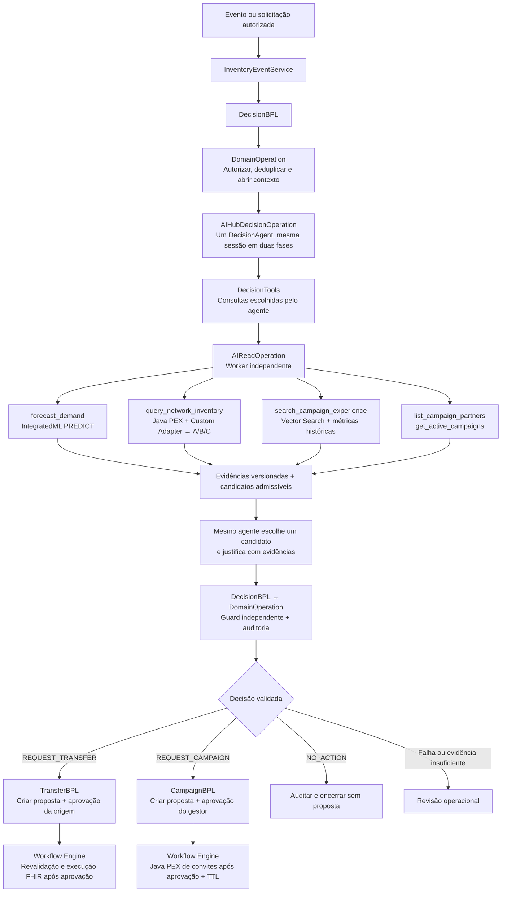

# Proposta: decisão do AI Hub governando a interoperabilidade

**Data:** 30/10/2026. **Status:** desenho de referência implementado em 30/10/2026. O SPEC continua sendo o contrato normativo. Diagnóstico e seções de proposta abaixo preservam a base da mudança; evidências atuais estão no README e nos relatórios de execução. A ponte de despacho nativo compilou no build 154U e o teste `tools/test_orchestration.py` verifica o vínculo causal entre agente, Tools e ramo BPL.

## 1. Recomendação e escopo

Transformar `DecisionBPL` no orquestrador explícito da análise: preparar contexto autorizado → invocar o agente → validar a decisão → encaminhar a `TransferBPL`, `CampaignBPL` ou encerramento auditado. O agente deve conduzir as consultas reais e escolher entre candidatos admissíveis construídos a partir dessas consultas, antes da criação de propostas.

Preservar uma Production, um `%AI.Agent`, cinco Tools de leitura, dois workflows de negócio, um modelo AutoML, uma coleção vetorial, os oito grupos ABO/Rh e as cinco telas existentes. Reutilizar PEX, adapter, FHIR, Workflow Engine, TTL, entidades e regras de autorização. Não criar um segundo agente de runtime, um novo frontend ou um serviço externo.

Autonomia proposta: o agente escolhe a sequência de consultas, pode atualizar evidências dentro do orçamento e seleciona estratégia, origem ou parceiro entre alternativas seguras. Quantidades, datas e autorização continuam calculadas e verificadas pelo código. A decisão validada determina o próximo destino da mensagem; aprovação institucional continua necessária para executar os atos externos.

## 2. Base da análise e grau de evidência

- [SPEC](../SPEC.md): §§1, 4, 5.4, 6, 7, 9.3, 10, 13, 14, 16 e 18; a atualização inicial para oito grupos e UI em inglês prevalece sobre o escopo original O−.
- [IA_HUB.agent.md](../agents/IA_HUB.agent.md): agente nativo, contratos, Tools autorizadas, distinção entre sessão AI Hub e sessão de interoperabilidade, validação externa ao LLM.
- [iInteroperability.agent.md](../agents/iInteroperability.agent.md): responsabilidade do BPL, roteamento explícito, correlação, filas, idempotência e recuperação.
- [IntegratedML/AutoML](../agents/iris.IntegratedML-AutoML.agent.md) e [Vector Search](../agents/iris.VectorSearch.agent.md): inferência e recuperação reais, qualidade, origem dos dados e separação entre similaridade e previsão.
- [Embedded Python](../agents/iEmbeddedPython.agent.md): fronteira de execução, locks, transações e isolamento dos callbacks; [Dictionary](../agents/iris.Dictionary.agent.md): confirmar APIs no build; [Docker](../agents/docker.iris.agent.md): preservar imagem, volumes, bootstrap e compatibilidade.

A revisão de dados foi realizada com um subagente. Duas outras delegações ficaram indisponíveis por limite de uso; suas referências foram analisadas diretamente. Os arquivos em `agents/` são orientações de engenharia, não novos agentes da aplicação.

**Ambiente observado:** consulta somente leitura em 30/10/2026 confirmou IRIS UNIX x86-64 `2026.3.0AI`, build `154U`, namespace `USER`, com `%AI.Agent` e `HemoFlow.DecisionBPL` presentes. A imagem configurada é IRIS Community AI Hub. O código local e os exports em `docs/runtime-probe.json` foram inspecionados; não houve comparação integral de todos os fontes locais com todas as classes carregadas.

**Concurso:** o [anúncio oficial](https://community.intersystems.com/post/intersystems-programming-contest-ai-agents-interoperability-workflows) pede um workflow de interoperabilidade que use agente AI Hub para uma tarefa decisória; exige aplicação funcional, código aberto e README em inglês, e indica build 154. O anúncio não exige liberar ações irrestritas ao LLM nem proíbe guardas determinísticas. Tornar a decisão causal no roteamento é a recomendação arquitetural desta análise, não uma promessa de aprovação pelos avaliadores. O README atual em português também precisa de uma revisão de idioma antes da submissão, separadamente desta mudança.

Os [bônus oficiais](https://community.intersystems.com/post/technology-bonuses-intersystems-programming-contest-ai-agents-interoperability-workflows) devem continuar apoiados em execução verificável das tecnologias existentes; não justificam adicionar componentes neste ajuste.

## 3. Como está hoje

| Achado observado no código | Efeito | Referência |
|---|---|---|
| `DecisionBPL` tem uma chamada fixa a `DomainOperation` e retorna | Não há ramo BPL governado pelo resultado da IA | `iris/HemoFlow/DecisionBPL.cls:6` |
| `service.decide()` chama `intelligence.prepare()` e `policy.candidates()` antes do AI Hub | O agente recebe opções calculadas antes de suas próprias consultas | `python/hemoflow/service.py:37` |
| `prepare()` executa as cinco leituras; as Tools do agente as executam novamente | Leituras reais, mas duplicadas; candidatos iniciais podem ficar obsoletos | `python/hemoflow/intelligence.py:115`, `:141` |
| `if offers: return offers` encerra a geração ao encontrar qualquer transferência | Campanha excluída mesmo quando a rede só oferece cobertura parcial | `python/hemoflow/policy.py:61` |
| Prompt exige copiar um candidato; `service.decide()` cria Transfer/Campaign por `if` | A decisão produz efeito no domínio Python, sem chamar o BPL do ramo na análise | `iris/HemoFlow/DecisionAgent.cls:9`; `python/hemoflow/service.py:59` |
| UI escolhe TransferBPL/CampaignBPL pela operação solicitada | Prints desses comandos não demonstram que o AI Hub escolheu o ramo | `python/hemoflow/web.py:132` |
| `Runtime.Submit()` e `Workflow.Start()` criam Business Service; Tools usam `Submit()` | Chamadas internas aparecem como novas entradas/sessões, fragmentando o trace | `iris/HemoFlow/Runtime.cls:24`; `Workflow.cls:3`; `DecisionTools.cls:40` |
| Evidence ID é `TOOL:<request>:<name>` em todas as leituras | Não distingue prefetch, primeira leitura e atualização da mesma Tool | `python/hemoflow/intelligence.py:138` |
| `execute()` mantém lock global de mutações durante o handler inteiro | A espera por LLM/rede retém o lock; dividir etapas exige redesenhar deduplicação | `python/hemoflow/service.py:277` |
| `search()` retorna IDs/resumo/liberadas/score, mas omite métricas estruturadas já persistidas | O agente recebe menos contexto para comparar parceiros que o previsto no SPEC | `python/hemoflow/intelligence.py:25`, `:109` |

As Tools **já acessam fontes reais**: `forecast_demand` executa `PREDICT`; `query_network_inventory` consulta os simuladores pelo PEX/adapter; `search_campaign_experience` executa `VECTOR_COSINE`. O problema não é ausência dessas tecnologias, mas sua posição no ciclo de decisão, as alternativas antecipadamente reduzidas e a fragmentação da mensageria.

O guard já existe, assim como controles de escopo, grupo, prazo e quantidade. Devem ser preservados. A validação dentro do AI Hub hoje usa os candidatos iniciais, enquanto `service.decide()` recalcula os candidatos após as Tools; o desenho deve eliminar essa divergência de versões.

Os prints atuais das sessões `2568` e `2284` documentam comandos isolados válidos. Permanecem evidências da versão atual, não do fluxo proposto.

## 4. Desenho proposto

Diagrama lógico de responsabilidades; não representa BPL já implementado. Os blocos de preparação e guard reutilizam `DomainOperation`, sem exigir novos hosts.



### 4.1 Duas fases no mesmo agente

1. **Preparação:** validar identidade, centro/grupo, necessidade, evento e planos em aberto. Criar contexto com escopo, fontes autorizadas, deadline e correlação. Não pré-consultar as cinco fontes nem decidir a categoria de ação.
2. **Investigação:** o agente recebe objetivo e catálogo das cinco Tools. Escolhe ordem e, se necessário, repete leituras dentro de limites. As cinco famílias de evidência continuam obrigatórias para uma decisão bem-sucedida no MVP; chamadas faltantes não são supridas silenciosamente por prefetch. Falha crítica pode encerrar antes, com revisão.
3. **Candidatos:** ao encerrar a aquisição, código determinístico reúne as observações de uma revisão consistente e calcula candidatos fechados com quantidades/datas permitidas. A sinalização técnica de aquisição concluída não é uma quarta decisão de negócio.
4. **Escolha:** uma segunda interação na mesma sessão AI Hub fornece catálogo versionado, comparação de impactos e evidências. O agente escolhe uma alternativa e retorna o JSON de negócio existente. Se fizer nova consulta que altere as evidências, o catálogo anterior perde validade e precisa ser reconstruído antes da escolha final.
5. **Validação e rota:** o BO devolve a escolha; `DecisionBPL` chama a validação independente. Apenas o resultado validado alimenta o ramo BPL. Uma saída apenas sintaticamente válida não abre tarefas.

Essa organização reutiliza a capacidade de múltiplas interações na mesma sessão já empregada para correção de resposta. Acrescenta uma etapa normal de escolha; custo e latência das duas fases devem ser somados. Limitar a uma rodada corretiva/atualização de catálogo por avaliação, dentro de um deadline total; esgotamento resulta em revisão.

A montagem de candidatos é código de aplicação, executado fora do callback Rust, com as funções de política existentes refatoradas. Não requer sexta Tool nem outro LLM. A sessão deve registrar quais evidências e catálogo foram efetivamente apresentados antes da escolha.

### 4.2 Autonomia e contratos das Tools

| Tool existente | Autonomia proposta | Restrições e resultado |
|---|---|---|
| `forecast_demand` | Solicitar a projeção e atualização durante a investigação | Centro/grupo do contexto; horizonte 7 dias; método, versão, timestamp, qualidade, MAE/baseline; não treinar no workflow |
| `query_network_inventory` | Consultar a rede e repetir consulta de centros autorizados | IDs permitidos pelo servidor, nunca URL livre; estoque próprio + B/C no MVP; disponibilidade, transferível, validade, transporte e timestamp; cobertura do escopo obrigatória para concluir |
| `search_campaign_experience` | Consultar históricos e refinar tipo/período/top-K com parâmetros tipados | Região/escopo impostos no servidor; K até 5; IDs, período, grupo, parceiro e métricas existentes; score não é probabilidade |
| `list_campaign_partners` | Obter opções autorizadas de parceiro | Capacidade e durações declaradas; nenhum dado pessoal de doador |
| `get_active_campaigns` | Verificar planos confirmados antes de propor nova campanha | Janelas e metas de planejamento; nunca aumentar estoque utilizável por campanha ainda não liberada |

Inputs opcionais devem ser retrocompatíveis com `requestId`. Na primeira fatia, a Tool de rede pode continuar consultando todos os três centros por chamada, mantendo a superfície mínima. A capacidade de selecionar subconjuntos é refinamento, não pré-requisito para a decisão causar roteamento. O contexto do servidor determina o escopo efetivo, mesmo se o modelo pedir algo diferente.

Envelope proposto de observação: `request_id`, `tool_call_id`, `evidence_id`, `tool_name`, `scope`, `observed_at`, `status`, `result`, `result_hash`, `context_revision`. Cada chamada recebe identidade própria, inclusive refresh. São campos de contrato da aplicação, não APIs nativas do IRIS.

Manter resultados compactos e limitados. Acrescentar à busca as métricas já persistidas em `CampaignExperience.Metrics`; não alterar embeddings, dimensão ou modelo. Resultado vazio legítimo e indisponibilidade são distintos; falha técnica de evidência obrigatória exige revisão. Não inventar experiência histórica para justificar parceiro sem histórico.

### 4.3 Admissibilidade versus preferência

O SPEC exige candidatos fechados e menor intervenção segura. Autonomia não exige disponibilizar as três decisões em todas as entradas.

| Situação comprovada | Alternativas e limites |
|---|---|
| Cobertura própria suficiente, dados íntegros e nenhuma perda evitável relevante | `NO_ACTION`; sem campanha desnecessária |
| Rede cobre a necessidade com transferência viável | Candidatos de transferência; agente escolhe origem e fundamenta aproveitamento/tempo; campanha desnecessária bloqueada |
| Rede só oferece transferência parcial e existe necessidade futura não coberta | Transferência parcial e campanha podem ser alternativas, se ambas forem admissíveis para a necessidade-alvo; comparar déficit residual, prazos e risco de vencimento |
| Sem transferência viável, campanha cabe na janela | Candidatos de campanha; agente compara parceiros com evidências vetoriais e capacidade declarada |
| Dados insuficientes, modelo sem qualidade, necessidade urgente sem solução ou nenhuma alternativa segura | Revisão operacional; nunca `NO_ACTION` como fallback |

Substituir o retorno antecipado de qualquer oferta por avaliação explícita de suficiência da rede. Não somar capacidades que atendem a mesma parcela de consumo sem conciliar datas e vencimentos. A análise considera ofertas conjuntas para verificar se a rede cobre a necessidade, mas não cria um novo workflow de múltiplas origens simultâneas. Caso a cobertura dependa de uma coordenação ainda não suportada pelo MVP, registrar essa limitação e encaminhar o planejamento residual para avaliação explícita.

Exemplo sintético: demanda 24, estoque útil 8, transferência viável 12 → déficit inicial 16; **o cenário hipotético da transferência deixa 4**. Uma campanha escolhida como alternativa à transferência não pode usar meta 4 por subtrair 12 unidades ainda não solicitadas/aprovadas. Sua meta parte do déficit real elegível, limitada pela capacidade e janela. Uma decisão abre um plano; não criar `TRANSFER_AND_CAMPAIGN` nem disparar ambos os BPLs.

Expor `deficit_before`, contribuição hipotética, déficit residual, disponibilidade e risco até a liberação, usando a simulação temporal existente. Uma data de liberação anterior a `need_by` não autoriza afirmar que a campanha resolve uma ruptura anterior à coleta. Metas de campanha permanecem estimativas, não cobertura garantida.

Planos abertos continuam protegidos contra duplicação. Preservar inicialmente o bloqueio conservador de nova campanha quando houver campanha confirmada do mesmo centro/grupo; casos residuais vão para revisão. Após encerramento do plano, nova avaliação explícita pode tratar o residual, sem loop automático de propostas.

O caminho atual deixa `confirmed_receipts=[]`: não corrigir isso inventando entradas. Descontar somente recebimentos futuros sustentados por fonte, quantidade, data e validade verificáveis; quando o contrato não fornecer essas garantias, manter a estimativa conservadora e registrar a limitação. Campanhas confirmadas não entram nessa conta como bolsas prontas.

### 4.4 Guard e início do workflow

- Reutilizar o JSON Schema de decisão 1.0 e os três enums. IDs de catálogo, revisão, sessão e rota ficam no envelope/auditoria; não precisam alterar imediatamente o JSON de negócio.
- Validar schema, identidade, escopo, grupo exato, evidências obrigatórias por ação, idade das observações, catálogo atual e correspondência integral com candidato autorizado. IDs conhecidos mas pertencentes a leituras superadas não bastam.
- O guard recalcula admissibilidade a partir da revisão usada na escolha. Não mistura resultados de prefetch e Tool. Se a revisão mudou, rejeita a decisão antiga e usa a única rodada de atualização disponível ou escala.
- Checks dentro do BO AI Hub ajudam a corrigir respostas, mas a autoridade final está fora do LLM, na chamada de validação feita pelo BPL.
- `TransferBPL`/`CampaignBPL` recebem uma operação interna de **iniciar proposta**. Carregam a decisão validada persistida, verificam que ela pertence ao ramo e criam a entidade idempotentemente. A UI não pode fornecer um JSON alegando aprovação interna.
- A criação hoje dentro de `service.decide()` é extraída e reutilizada nessas entradas dos dois BPLs; as operações de aprovar, expedir, receber, responder convite e registrar resultados permanecem.
- Origem revalida estoque/validade no aceite; gestor autoriza campanha antes de Java PEX materializar convites. O agente não reserva, expede, publica nem libera produto.

## 5. Mensageria e Visual Trace

Fluxo esperado da **fase de decisão e abertura da proposta**, preservando a relação nativa entre chamadas:

```text
InventoryEventService
  └─ DecisionBPL
       ├─ DomainOperation: iniciar contexto autorizado
       ├─ AIHubDecisionOperation: agente e seleção
       │    └─ AIReadOperation: chamadas reais de Tools
       │         └─ FederatedInventoryOperation: rede via PEX/adapter
       ├─ DomainOperation: guard + DecisionAudit
       └─ TransferBPL OU CampaignBPL OU encerramento sem proposta
            ├─ DomainOperation: criar proposta idempotente
            └─ ApprovalBPL → Approvals: tarefa humana
```

`Runtime.Submit()` continua apropriado como entrada externa. Dentro de uma Production, o envio deve partir do **host que está processando a mensagem**, sem recriar `InventoryEventService`. O trampoline ObjectScript das Tools precisa de um contexto de despacho local à execução, autorizado e vinculado ao host AI Hub; o worker Python recebe um caminho de envio do próprio `AIReadOperation` para consultar PEX. Não transportar referências de objetos entre jobs nem guardar referências reutilizáveis em globals duráveis. Limpar o vínculo ao finalizar ou falhar.

A implementação exata dessa ponte é uma **hipótese técnica a validar no build 154**, não uma API nova presumida. Os exports locais registram `Ens.BusinessOperation.SendRequestSync`/`SendRequestAsync`; isso confirma a superfície existente, mas não prova que o callback atual mantém automaticamente o contexto de sessão. O primeiro teste de integração deverá provar cabeçalhos, sessões e ausência de deadlock. Falha em manter o contexto não deve ser ocultada abrindo silenciosamente outro Business Service.

Preservar o contorno documentado para callbacks Python que provocaram `signal 11`: Tool nativa em ObjectScript → worker independente `AIReadOperation`. Não colocar novamente Embedded Python diretamente dentro do callback Rust.

Distinções obrigatórias: `correlation_id` de negócio, `SessionId` de interoperabilidade, ID da sessão AI Hub e `tool_call_id` são identificadores diferentes. SQL `PREDICT` e `VECTOR_COSINE` executados dentro do worker não viram setas automaticamente: a mensagem da Tool deve conter nome e referências de evidência, e a resposta deve registrar origem/resultado resumido.

Cliques humanos posteriores, reavaliações e recuperação após restart podem constituir novas sessões técnicas; devem apontar à decisão e entidade originais. O aceite é uma fase decisória contínua e causal no trace, mais sessões posteriores navegáveis por correlação — não uma conexão HTTP ou job bloqueado durante dias.

## 6. Concorrência, recuperação e limites

1. Usar chamada BPL assíncrona com espera persistida para o BO do agente, conforme capacidade confirmada no build. Não manter o worker `DomainOperation` ocupado esperando o LLM.
2. Tirar a espera de LLM/rede do lock global de mutações. Fazer etapas curtas de autorização/deduplicação e persistência; revalidar plano concorrente no commit. Proteger atualização do contexto por requisição/revisão para que Tools não sobrescrevam resultados umas das outras.
3. Reservar processamento por chave idempotente e centro/grupo antes de soltar o lock. Retry do mesmo evento deve retornar estado/resultado existente; não criar outra sessão LLM ou proposta em paralelo. Usar `Command`/`DecisionContext` existentes para estado técnico de andamento com timeout e recuperação.
4. Manter IDs determinísticos de proposta vinculados à decisão e deduplicação de `WorkflowLink`. Persistir decisão validada e intenção de despacho antes de executar o ramo. Reutilizar `Outbox` para entrega pendente, distinguindo explicitamente esse tipo de evento dos eventos de reavaliação atuais. O dispatcher atual não pode tratar tudo como `review_only`.
5. Recuperação reenvia a **mesma decisão validada**, enquanto ainda aplicável, para criação idempotente da proposta; não pede outra decisão ao LLM automaticamente. Contexto expirado ou plano conflitante leva à revisão. Considerar a falha entre publicar tarefa e gravar o vínculo para não duplicar a tarefa nativa.
6. Tratar entrega como sujeita a retries; não prometer exatamente-uma-vez global ou transação distribuída. Transação local não desfaz reserva remota nem chamada ao provider.
7. Preservar pools independentes de AI Hub, leitura e PEX. Nenhuma Tool deve retornar sincronicamente ao mesmo BO/BP que está esperando por ela. Não aumentar pools como substituto de corrigir dependência circular.
8. Manter timeout de rede existente e definir um deadline global para aquisição, escolha e eventual correção, inferior ao timeout externo. Verificar se o orçamento atual de 60 s comporta duas fases; não multiplicar silenciosamente esse prazo por chamada. Limitar também quantidade de chamadas e tamanho das respostas no servidor.

O limite de oito iterações, 900 tokens e uma correção hoje configurados são ponto de partida, não garantia suficiente para o novo ciclo. Validar a semântica de `Chat`, `CreateSession` e `MaxIterations` no build instalado: o guia EAP atual e o export local não descrevem todas essas opções da mesma forma. Definir orçamento efetivo com teste de timeout/loop antes de declarar o limite atendido.

## 7. Mapa mínimo de alterações futuras

| Arquivo/componente | Alteração planejada |
|---|---|
| `DecisionBPL.cls` | Preparar → AI Hub → guard → ramo explícito; erros e encerramento |
| `AIHubDecisionOperation.cls`, `DecisionAgent.cls` | Duas fases na mesma sessão, objetivo de investigação, catálogo atual e justificativa baseada em evidências |
| `DecisionTools.cls`, `AIReadOperation.cls` | Contexto de despacho do host, observações por chamada e filtros opcionais tipados |
| `Runtime.cls`, `federation.py`, `Workflow.cls` | Separar entrada externa de envio interno, preservando rastreabilidade nativa |
| `intelligence.py` | Contexto inicial sem prefetch decisório; observações versionadas; retorno vetorial com métricas |
| `policy.py` | Separar admissibilidade e preferência; tratar suficiência/residual; guard da revisão atual |
| `service.py` | Extrair preparação/validação/criação, locks curtos, recuperação e idempotência; eliminar criação de plano antes do ramo |
| `TransferBPL.cls`, `CampaignBPL.cls` | Entrada interna para iniciar proposta e aprovação pelo ramo selecionado |
| `Production.cls` | Revisar esperas/pools; manter hosts existentes salvo necessidade comprovada na fatia técnica |
| `web.py`, cenário demo e dispatcher de eventos | Toda análise de negócio passa por DecisionBPL; comandos humanos mantêm seus endpoints; demo não chama `decide()` por atalho |
| Auditoria e testes | IDs de sessão/Tool/catálogo/ramo, provas causais e regressão dos invariantes |
| README e screenshots | Atualizar somente após execução real; diferenciar proposta, implementação e provas; README de submissão em inglês |

Não há migração destrutiva prevista. Os novos metadados podem ser aditivos aos payloads já existentes, com limites de tamanho e retenção definidos. Não alterar Docker/Compose, banco dos centros, treinamento ou coleção vetorial para apresentar a nova decisão. Alterações estritamente necessárias de contrato serão versionadas e testadas.

## 8. Plano de execução futuro e aceite

| Etapa | Entrega verificável antes de avançar |
|---|---|
| 1. Provar a ponte nativa | No build 154, uma Tool read-only sai do host AI Hub, passa por AIRead e PEX, volta sem segfault/deadlock e mantém relação de mensagens. Fixture isolada; sem ações de negócio |
| 2. Contratos e política | Revisões de evidência, candidatos consistentes, comparação de cobertura parcial, guard e deduplicação testados sem provider |
| 3. Orquestração | BPL com três saídas e falha; criação de proposta somente no ramo selecionado; respostas controladas testam roteamento |
| 4. Agente real | Duas fases com Tools reais; comparar decisões e evidências; medir custo/tempo total; sem fallback determinístico fingindo IA |
| 5. Regressão e prova | Dois workflows, NO_ACTION, falhas, restart/retry e capturas do trace que incluem agente e ramo escolhido |

Critérios adicionais aos T01–T28:

- **Causalidade (T06):** registrar resposta AI Hub, aprovação do guard e mensagem ao BPL escolhido. `REQUEST_TRANSFER` nunca inicia CampaignBPL; `REQUEST_CAMPAIGN` nunca inicia TransferBPL; NO_ACTION não cria proposta/tarefa.
- **Autonomia verificável:** evidenciar Tools solicitadas pelo agente antes da construção do catálogo. Demonstrar escolha de origem/parceiro e um caso com duas estratégias admissíveis, sem exigir comportamento aleatório do modelo.
- **Teste de roteamento versus inteligência:** doubles são aceitáveis para testar cada ramo determinístico. A prova de integração usa LLM real, com entradas/evidências controladas; texto gerado ou print isolado não substitui as mensagens.
- **Dados alterados (T01/T09):** atualizar estoque no simulador entre leituras; nova Tool cria outro evidence ID/revisão; catálogo antigo não pode produzir proposta. Na aprovação humana, revalidar novamente a origem.
- **Cobertura parcial:** fixture com déficit 16/oferta 12 demonstra residual hipotético 4; campanha alternativa não subtrai oferta não executada; escolha única não dispara os dois planos.
- **Campanha desnecessária:** rede suficiente bloqueia campanha mesmo com score vetorial alto; campanha confirmada não aumenta estoque nem duplica convites.
- **Vector (T05):** evidências mostram IDs, período e resultados históricos recuperados. A justificativa do parceiro cita apenas registros disponíveis; ausência de histórico é explícita. Score não calcula unidades nem chance de sucesso.
- **Guard (T07):** evidência, candidato, centro, grupo, quantidade ou prazo inventados/obsoletos são rejeitados antes da tarefa humana.
- **Falhas (T02/T12/T24):** fonte indisponível, forecast censurado/baseline, saída inválida, coleta tardia, loop e timeout encerram em revisão, sem falso NO_ACTION.
- **Concorrência/recuperação:** mesmo evento repetido, duas análises no mesmo centro/grupo e restart entre guard/rota/tarefa não duplicam propostas; aceites de outros centros não esperam o LLM sob lock global.
- **Sem contorno pela demo:** controles de demonstração e reavaliação percorrem o mesmo DecisionBPL que será mostrado aos avaliadores. A condição `review_only` preserva revisão sem republicação automática.

## 9. Limites e referências técnicas

Este documento não certifica aderência final ao concurso. A implementação atual usa agente e Tools reais; a proposta fecha a lacuna entre decisão e roteamento e torna essa relação demonstrável. APIs de ligação do callback ao host, propagação de sessão e espera BPL ainda exigem prova no build 154.

- [AI Hub — SDK Guide](https://github.com/intersystems-community/ai-hub-eap/blob/master/ObjectScript_SDK_Guide.md): referência de Agent/Session/Tools, prerelease mutável; conferir com `docs/runtime-probe.json` e a instalação.
- [IRIS — Introduction to BPL Processes](https://docs.intersystems.com/irislatest/csp/docbook/DocBook.UI.Page.cls?KEY=EBPL_intro): referência conceitual de processos, não evidência de compilação do desenho.
- [IRIS — Visual Trace](https://docs.intersystems.com/irislatest/csp/docbook/DocBook.UI.Page.cls?KEY=EMONITOR_message_trace): referência de observabilidade de mensagens relacionadas.
- [Limites locais do EAP154](EAP154_PATCH.md) e [validação existente](VALIDACAO.md): preservar contornos já documentados e separar evidência anterior de novos testes.

**Resultado esperado após futura implementação:** o avaliador acompanha um evento entrando na Production, o agente consultando dados reais, uma decisão fundamentada e validada, e a mensagem entrando no workflow escolhido, com aprovação humana antes dos efeitos externos.
